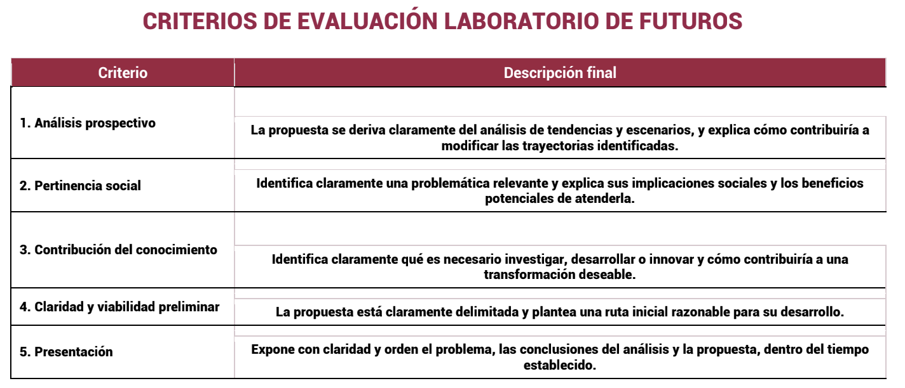

# Criterios de evaluación del Laboratorio de Futuros

*Chilangatón · 25-oct-2026 · Esta es la rúbrica con la que nos califican. Todo lo que hagamos se revisa contra ella.*

## Resultado

🏆 **Primer lugar.** El jurado del Laboratorio de Futuros le dio el primer lugar a **La Chilangonería del futuro** con [Trama](PROPUESTA.md). Ficha completa: [RECONOCIMIENTO.md](RECONOCIMIENTO.md).

## La rúbrica

| # | Criterio | Descripción oficial | En palabras simples |
| --- | --- | --- | --- |
| 1 | **Análisis prospectivo** | La propuesta se deriva claramente del análisis de tendencias y escenarios, y explica cómo contribuiría a modificar las trayectorias identificadas. | La propuesta debe **salir** de nuestras tendencias y escenarios, y decir **cómo nos mueve** del inercial o el colapso hacia la transformación. |
| 2 | **Pertinencia social** | Identifica claramente una problemática relevante y explica sus implicaciones sociales y los beneficios potenciales de atenderla. | Un **problema real**, a **quién le pega** y **qué gana la gente** si lo resolvemos. |
| 3 | **Contribución del conocimiento** | Identifica claramente qué es necesario investigar, desarrollar o innovar y cómo contribuiría a una transformación deseable. | Decir **qué no sabemos todavía** y qué hay que **investigar, construir o inventar**. |
| 4 | **Claridad y viabilidad preliminar** | La propuesta está claramente delimitada y plantea una ruta inicial razonable para su desarrollo. | **Una** propuesta acotada (dónde, para quién, qué) y **primeros pasos realistas**. |
| 5 | **Presentación** | Expone con claridad y orden el problema, las conclusiones del análisis y la propuesta, dentro del tiempo establecido. | Contar en orden **problema → análisis → propuesta**, sin pasarnos del tiempo. |

---

## Cómo vamos (autoevaluación honesta)

| # | Criterio | Lo que ya tenemos | Estado | Qué falta |
| --- | --- | --- | --- | --- |
| 1 | Análisis prospectivo | 34 fuerzas con fuente, matriz, línea del tiempo 2006–2026, tres escenarios con cifras y **11 metas** ([escenarios-2040.md](escenarios-2040.md)). **Trama** sale de las dos incertidumbres críticas y dice qué trayectoria cambia ([PROPUESTA.md §2](PROPUESTA.md#2-de-dónde-sale-criterio-1)) | ✅ | Decirlo en voz alta en el pitch: "Trama ataca justo lo que separa al Inercial de la Transformación" |
| 2 | Pertinencia social | Lente de cuidados y periferias, Rosa, 34.1% llega en 30 min o menos, estrés del traslado. Beneficio en cifra: media hora diaria son unas 10 horas al mes | ✅ | — |
| 3 | Contribución del conocimiento | Qué investigar, desarrollar e innovar, en [PROPUESTA.md §5](PROPUESTA.md#5-qué-hay-que-investigar-desarrollar-e-innovar-criterio-3); datos sintéticos marcados y calibrados mientras llega la encuesta | ✅ | — |
| 4 | Claridad y viabilidad preliminar | Una propuesta delimitada: corredor oriente, cuidadoras y trabajadoras, Trama y una ruta a 3, 12 y 24 meses con costo orientativo; prototipo funcionando | ✅ | — |
| 5 | Presentación | Deck con las láminas de metas y propuesta, y guion de 5 min o menos | 🟡 | Confirmar el tiempo que da el jurado y ensayar una vez con cronómetro |

**Conclusión:** con Trama ya hay **una** propuesta concreta, que sale del análisis y tiene ruta. Lo que falta es ensayar.

---

## Propuesta elegida: Trama · la red que cuida tu tiempo

La candidata "Viaje que cuida" (abajo) creció y se volvió **Trama**: una app, un tablero y un simulador que gestionan el transporte público de la metrópoli como un solo sistema. El índice de pobreza de tiempo es su corazón. **Versión vigente: [PROPUESTA.md](PROPUESTA.md).** Como la encuesta no se pudo levantar en el evento, el prototipo usa datos **SINTÉTICOS** marcados ([datos/sinteticos/](datos/sinteticos/)); la encuesta real queda como el primer paso del piloto.

### Antecedente: la candidata "Viaje que cuida"

**"Viaje que cuida": un índice público de pobreza de tiempo para decidir dónde poner los centros de cuidado y las estaciones.**

- **Problema (criterio 2):** solo 34.1% de las personas ocupadas que viven en la CDMX llega a su trabajo en 30 minutos o menos, y quien cuida encadena viajes a pie. Nadie mide ese costo, así que nadie lo gestiona.
- **De dónde sale (criterio 1):** ataca las dos incertidumbres críticas: da a la metrópoli una **meta común y medible** (P5, P3) y orienta la **inversión de la transición** hacia donde más tiempo se pierde (A7, E5). Mueve la trayectoria del inercial hacia la transformación.
- **Qué hay que investigar, desarrollar e innovar (criterio 3):**
  - *Investigar:* una nueva encuesta origen-destino con viajes de cuidado por sexo y una medición del estrés del traslado.
  - *Desarrollar:* el índice de pobreza de tiempo por colonia y un mapa abierto.
  - *Innovar:* estimar tiempos puerta a puerta con validaciones anónimas de la tarjeta MI y del trolebús, sin datos personales.
- **Delimitación (criterio 4):** piloto en un corredor: **Trolebús Chalco–Santa Martha y Línea A** (oriente, donde se juntan tiempo largo, pasaje caro, hundimiento y lluvia). Población: personas cuidadoras y trabajadoras que viajan a la CDMX.
- **Ruta inicial (criterio 4):**
  - **0–3 meses:** encuesta corta a 300 usuarias del corredor y primer índice.
  - **3–12 meses:** mapa abierto; proponer la ubicación de 3 centros de cuidado de la Ley de Cuidados junto a estaciones.
  - **12–24 meses:** medir si bajan los minutos y el estrés; escalar a otros corredores y proponer el índice como meta del plan a 2045.
- **Beneficio (criterio 2):** cada media hora diaria que se devuelve suma unas 10 horas al mes por persona.

---

## Regla para todos los chats

Antes de subir algo, cada chat responde: **¿a qué criterio le suma esto?** Si no le suma a ninguno, no va.
