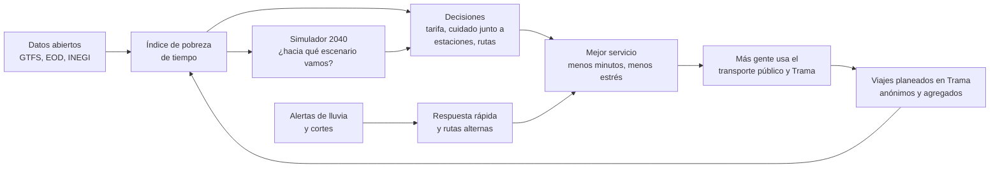

# Propuesta · Trama: la red que cuida tu tiempo

*Chilangatón · Laboratorio de Futuros · 25-oct-2026*

> **En una frase:** Trama es una plataforma pública y abierta (app, tablero y simulador) que maneja todo el transporte público de la metrópoli como **un solo sistema** y le pone una sola meta: **devolver tiempo a quien vive lejos y cuida**.

**Prototipo:** carpeta [`app/`](app/), con la red real y datos sintéticos marcados · **Datos sintéticos:** [`datos/sinteticos/`](datos/sinteticos/) · **Escenarios y metas:** [escenarios-2040.md](escenarios-2040.md)

Las cifras del equipo se marcan con ➕. Los datos sintéticos dicen **SINTÉTICO**: reemplazan, por ahora, la encuesta que no pudimos levantar en el evento.

---

## 0. Cómo responde a la rúbrica

| # | Criterio | Dónde está | En una línea |
| --- | --- | --- | --- |
| 1 | Análisis prospectivo | [§2](#2-de-dónde-sale-criterio-1) | Sale de las dos incertidumbres críticas y mueve la trayectoria del Inercial a la Transformación |
| 2 | Pertinencia social | [§1](#1-el-problema-criterio-2) | La pobreza de tiempo pega primero a quien vive lejos y cuida; devolver media hora al día suma unas 10 horas al mes |
| 3 | Contribución del conocimiento | [§5](#5-qué-hay-que-investigar-desarrollar-e-innovar-criterio-3) | Investigar los viajes de cuidado y el estrés, desarrollar el índice de pobreza de tiempo e innovar con "cadenas de cuidado" |
| 4 | Claridad y viabilidad | [§6](#6-delimitación-criterio-4) y [§7](#7-ruta-inicial-criterio-4) | Un corredor (oriente), una población (cuidadoras y trabajadoras), un entregable (Trama) y una ruta a 3, 12 y 24 meses |
| 5 | Presentación | [pitch.md](pitch.md) | Problema → análisis → escenarios → metas → Trama → piloto |

---

## 1. El problema (criterio 2)

**Moverse en la metrópoli cuesta horas, dinero y salud, y ese costo cae sobre quien vive lejos y sobre quien cuida. Nadie lo mide, así que nadie lo gestiona.**

- Solo **34.1%** de las personas ocupadas que viven en la CDMX llega a su trabajo en 30 minutos o menos; en el país es 51.5% ([INEGI, Intercensal 2025](https://www.inegi.org.mx/contenidos/saladeprensa/boletines/2026/ei/EIC2025-def_CDMX.pdf)).
- Cada persona que se traslada en la Ciudad de México pierde **211 horas al año** en el tráfico ([IMCO, 2026](https://imco.org.mx/costo-del-trafico-2026/)).
- **El cuidado viaja a pie:** 71.4% de las mujeres que viajan en la zona metropolitana camina en algún tramo, contra 60.3% de los hombres ([INEGI, EOD 2017](https://www.inegi.org.mx/contenidos/programas/eod/2017/doc/resultados_eod_2017.pdf)).
- **La periferia paga más:** el pasaje mínimo en el Edomex es de 14 pesos y el Metro cuesta 5 ([La Razón](https://www.razon.com.mx/estados/2025/10/11/aumentan-tarifas-del-transporte-publico-en-edomex-cuanto-costara-y-donde-aplica/)).
- **El sistema real es más grande que el oficial:** 74.1% de los viajes en transporte público usa micro o combi en algún tramo ([UNAM Global con la EOD 2017](https://unamglobal.unam.mx/global_revista/microbus-o-combi-transporte-publico-mas-utilizado-en-el-valle-de-mexico/)). Ninguna app ni ningún tablero lo ve completo.
- **El viaje enferma:** en un estudio exploratorio de la UNAM, se estresa siempre o casi siempre en el trayecto 18% de quienes viven en la CDMX, 24% de quienes vienen de municipios conurbados y 35% de quienes vienen del Edomex ([UNAM Global](https://unamglobal.unam.mx/usuarios-de-transporte-publico-se-estresan-en-sus-recorridos/)).
- **No se mide:** la última encuesta origen-destino es de 2017, y la línea de movilidad del plan a 2045 no menciona el cuidado ni trae metas ([cuadernillo del PGD](https://sedeco.cdmx.gob.mx/storage/app/media/Proyecto%20PGD/PGD_cuadernillo.pdf)).

**Rosa** tiene 54 años, vive en Valle de Chalco y limpia oficinas en Polanco. Cuida a su mamá y a su nieta de 6 años. Hoy pasa unas **3 horas 50 minutos** moviéndose cada día y paga cuatro pasajes por trayecto (SINTÉTICO, calibrado; ver [`datos/sinteticos/`](datos/sinteticos/)).

**Implicaciones sociales**
- **Empleo:** quien vive lejos acepta trabajos peores o deja de trabajar.
- **Cuidado:** el tiempo que se va en el viaje sale del cuidado y del descanso, sobre todo de las mujeres.
- **Salud:** estrés, calor, polvo y riesgo vial. Casi la mitad de quienes murieron en la calle en 2025 iba en moto ([Posta con datos de SEMOVI](https://www.posta.com.mx/cdmx/este-es-el-nivel-mas-bajo-en-muertes-viales-de-cdmx/vl2193107)).
- **Desigualdad territorial:** el oriente y el norte pagan más, tardan más y están más expuestos a la lluvia y al hundimiento.

**Beneficio:** cada media hora diaria que se devuelve suma unas **10 horas al mes** por persona, contando 20 días hábiles ➕.

---

## 2. De dónde sale (criterio 1)

Trama no es "una app más". Sale de nuestro análisis prospectivo: 34 fuerzas, la matriz impacto × incertidumbre, dos incertidumbres críticas y tres escenarios. Ataca justo lo que separa al Inercial de la Transformación.

| Lo que decide el futuro | Qué hace Trama | Trayectoria que cambia |
| --- | --- | --- |
| **Incertidumbre 1: ¿quién gobierna la metrópoli y fija la tarifa?** (P5, P3) | Da a los tres gobiernos **una métrica común**: los minutos que se devuelven y el índice de pobreza de tiempo. También da un tablero compartido y un simulador de tarifa integrada que muestra quién gana con ella | Del "cada gobierno por su lado" a un acuerdo con evidencia: **meta 3**, la tarifa única |
| **Incertidumbre 2: ¿qué tan a fondo va la transición?** (A7, E5) | Ordena las inversiones por **minutos devueltos por peso** y por persona cuidadora. Así empuja el cambio modal donde más tiempo se pierde, no solo la electrificación | De la transición a medias a la de fondo: **metas 1, 2, 6 y 9** |
| **Golpes externos** (A4 lluvias, A5 hundimiento) | Alertas antes de salir, rutas alternas y un mapa de a quién deja sin servicio cada corte | Reduce el riesgo de **Colapso**: **meta 8** |
| **El hueco de datos** (no hay EOD desde 2017) | Cada viaje planeado, anónimo y agregado, alimenta el índice; la encuesta del piloto mide lo que falta | De "no se mide" a "se publica cada año": **meta 10** |
| **El cuidado lejos de las estaciones** (S3 y la Ley de Cuidados) | Dice dónde poner los centros de cuidado: junto a estaciones con más cuidadoras y más minutos perdidos | **Meta 11**: cuidado junto a las estaciones |

### El sistema: dos bucles

- **Bucle que refuerza (R1):** medir → decidir → mejorar → más uso → medir mejor. Es el motor de la Transformación.
- **Bucle que equilibra (B1):** alerta → respuesta → menos daño. Es el freno contra el Colapso.

**Sin Trama**, la ciudad sigue la trayectoria Inercial: obras sueltas, pasajes que suben por separado, el plan a 2045 sin metas y la EOD de 2017. **Con Trama**, la metrópoli tiene un número común que exigir, una evidencia que compartir y una alerta temprana.

---

## 3. Qué es Trama

**Tres principios:** el **día completo**, no un viaje suelto; el **sistema completo**, no una sola línea; y **el futuro**, no solo hoy.

### Las tres vistas

**1. Mi día · para Rosa (usuarias, gratis y sin cuenta)**
- Planea el día como una **cadena de cuidado**: casa → escuela de la nieta → trabajo → clínica de la mamá → casa.
- Junta todos los modos: Metro, Metrobús, Trolebús, Cablebús, Tren Ligero, RTP, corredores concesionados, Mexibús, Mexicable, Suburbano, El Insurgente, Ecobici y caminar.
- Muestra el costo real, con y sin tarifa integrada, y los transbordos.
- Avisa **antes de salir**, por ejemplo: "Lluvia fuerte: Línea A suspendida entre Pantitlán y La Paz", y propone una ruta alterna.
- Tiene modos "viaje tranquilo" (menos transbordos y menos estrés) y "accesible" (sin escaleras, con elevadores).
- Llega a quien no tiene datos: por WhatsApp o SMS, y en los paraderos, en papel.

**2. Red viva · para quien gestiona (SEMOVI, Edomex, Sistema de Cuidados, alcaldías y municipios)**
- El **índice de pobreza de tiempo (IPT)** por alcaldía y municipio.
- Los cortes en tiempo real y a cuántas personas afectan.
- **Dónde poner los centros de cuidado:** estaciones de transbordo cercanas a donde viven más cuidadoras.

**3. Futuros 2040 · para decidir**
- Un simulador con las **dos incertidumbres** (gobernanza y transición) y los **golpes externos**.
- Dice hacia qué escenario va la metrópoli (Colapso, Inercial o Transformación), qué **metas** se cumplen y cómo sería el día de Rosa en 2040: 4 h 30 min en el Inercial, 2 h en la Transformación, o deja su trabajo en el Colapso.

### Por qué es sistémica y holística

Un solo modelo de datos une cinco capas:

| Capa | Qué ve | Ejemplo |
| --- | --- | --- |
| Persona | Quién viaja y a quién cuida | Rosa, su mamá y su nieta |
| Cadena de viajes | El día completo, con caminatas y esperas | Casa → vecina → trolebús → Metro → Polanco |
| Red | Todos los modos, formales e informales | 48 líneas masivas y la combi que las alimenta |
| Territorio | Dónde se pierde el tiempo | El IPT de Valle de Chalco contra el de Benito Juárez |
| Política y futuro | Qué decisión cambia qué meta | La tarifa integrada sube la meta 1 y baja el gasto |

**Privacidad por diseño:** sin cuentas obligatorias, solo datos agregados (nunca menos de 10 personas por celda), código abierto y nada de rastreo individual.

---

## 4. Datos: reales, sintéticos y faltantes

| Tipo | Qué | Para qué |
| --- | --- | --- |
| **Reales** | Red de transporte masivo: 48 líneas y 689 estaciones (OpenStreetMap y GTFS de SEMOVI), EOD 2017, Intercensal 2025, Ecobici (GBFS) y pasajes con fuente | El mapa, las rutas y las anclas de calibración |
| **SINTÉTICOS** | Personas, cadenas de viaje de un día entre semana, estrés e índice por territorio. Generados con semilla fija y calibrados contra las cifras reales | El prototipo, mientras no hay encuesta ([detalle y tabla de calibración](datos/sinteticos/README.md)) |
| **Faltantes** | Viajes de cuidado, estrés del traslado, tiempos puerta a puerta y datos en tiempo real | Se vuelven el plan de investigación (§5) |

---

## 5. Qué hay que investigar, desarrollar e innovar (criterio 3)

**Investigar (lo que no sabemos)**
1. Cuánto tiempo, dinero y estrés cuestan los **viajes de cuidado** en el corredor oriente. Se mide con una encuesta corta a 300 usuarias, que reemplaza a los datos sintéticos.
2. Qué **tarifa integrada** es justa: quién gana, quién pierde y cuánto subsidio hace falta.
3. Qué tan vulnerable es la red del oriente a la **lluvia y al hundimiento**, y qué rutas alternas existen de verdad.

**Desarrollar (lo que hay que construir)**
1. El **índice de pobreza de tiempo**, con método abierto, publicado cada trimestre por alcaldía y municipio.
2. **Trama**, en sus tres vistas, como app web ligera que funciona en celulares de gama baja y sin conexión.
3. El **simulador 2040**: un modelo de dinámica de sistemas calibrado con los tres escenarios.

**Innovar (lo que no existe)**
1. **Planear cadenas de cuidado**, no viajes sueltos. Ninguna app de transporte lo hace.
2. Estimar **tiempos puerta a puerta** con validaciones anónimas de la tarjeta MI, con privacidad diferencial.
3. **Unir la operación diaria con la prospectiva:** la alerta de hoy alimenta el escenario de 2040, y el escenario de 2040 ordena la inversión de hoy.

---

## 6. Delimitación (criterio 4)

| | Qué |
| --- | --- |
| **Dónde** | Corredor oriente: Valle de Chalco, Chalco, Ixtapaluca, La Paz, Iztapalapa y Tláhuac. Ejes: Trolebús Chalco–Santa Martha, Línea A y Pantitlán |
| **Para quién** | Personas cuidadoras y trabajadoras que viajan del oriente a la CDMX |
| **Qué entrega** | Trama (Mi día, Red viva y Futuros 2040), el índice de pobreza de tiempo y la propuesta de 3 centros de cuidado junto a estaciones |
| **Qué NO hace** | No cobra pasajes, no opera rutas, no guarda datos personales y no sustituye la planeación oficial: le da evidencia |
| **Por qué ahí** | Ahí se juntan el viaje más largo, el pasaje más caro, el hundimiento y la lluvia, y hay una obra nueva que conectar (el trolebús) |

---

## 7. Ruta inicial (criterio 4)

| Etapa | Qué se hace | Entregable |
| --- | --- | --- |
| **0–3 meses** | Prototipo con la red real y datos sintéticos marcados (ya existe). Convenio de datos con SEMOVI y el Edomex. Comité con el Sistema de Cuidados y una universidad (UNAM o IPN) | Prototipo público y el primer IPT con datos abiertos |
| **3–12 meses** | Encuesta a 300 usuarias del corredor, que reemplaza a los sintéticos. IPT con datos reales. Piloto de la app con 2,000 usuarias. Simulación de tarifa integrada en el corredor | IPT real del oriente y la app piloto |
| **12–24 meses** | Medir si bajan los minutos y el estrés. Proponer 3 centros de cuidado junto a estaciones. Escalar al norte (Ecatepec–Indios Verdes) y llevar el índice como meta al plan a 2045 | Evaluación pública y una propuesta de política |

**Equipo mínimo ➕:** 6 personas: datos, desarrollo, diseño, trabajo de campo, política pública y prospectiva.

**Costo orientativo ➕:** unos 10 millones de pesos en 24 meses, sobre todo equipo y encuesta. Es una diezmilésima parte de lo que costó el tren El Insurgente, unos 100 mil millones de pesos ([T2 en investigacion.md](investigacion.md)).

---

## 8. Metas del proyecto y cómo se conectan con las de 2040

| Meta del piloto, a 24 meses ➕ | Cómo se mide | Meta 2040 a la que empuja |
| --- | --- | --- |
| −15 minutos al día en promedio para las usuarias del piloto (unas 5 horas al mes) | Encuesta antes y después, y tiempos de la app | 1 y 2 |
| IPT publicado cada trimestre para 28 territorios (16 alcaldías y 12 municipios) | Datos abiertos | 10 |
| 3 centros de cuidado propuestos junto a estaciones, con evidencia | Propuesta entregada al Sistema de Cuidados | 11 |
| Tarifa integrada simulada para el corredor, con ganadores y perdedores | Informe público | 3 |
| 0 datos personales guardados | Auditoría externa del código | Confianza, que es la base de todo |

Con los centros de cuidado y la tarifa integrada (2030), Rosa pasaría de unas 3 h 50 min a unas 3 h 05 min al día: **−45 minutos, unas 15 horas al mes** (SINTÉTICO ➕).

---

## 9. Riesgos y cómo los manejamos

| Riesgo | Respuesta |
| --- | --- |
| Los datos oficiales no llegan | Datos abiertos, más la encuesta propia, más sintéticos marcados mientras tanto |
| Privacidad | Sin cuentas, solo agregados (10 personas o más por celda), código abierto y auditoría |
| Brecha digital: Rosa no siempre tiene datos | WhatsApp o SMS y tableros en papel en los paraderos |
| Que sea "otra app más" | Lo central es la **métrica pública**; la app es el medio. El índice entra al plan a 2045 |
| Cambio de gobierno | Código abierto y alianza con la universidad y el Laboratorio de Futuros |

---

## 10. El prototipo (lo que ya existe hoy)

- **Qué es:** una página que se abre en el navegador, con las tres vistas y un recorrido de presentación.
- **Dónde:** [`app/`](app/). Se abre con `python3 -m http.server -d app` y luego en `http://localhost:8000`.
- **Qué es real y qué es sintético:**
  - La red es real: OpenStreetMap y GTFS de SEMOVI, con atribución.
  - Las personas, los viajes y el índice son **SINTÉTICOS**, y lo dicen en pantalla.
- **Cómo seguir:** [CLAUDE.md](CLAUDE.md) tiene todo el contexto para continuar el prototipo.

---

## Fuentes principales

- [INEGI, Encuesta Intercensal 2025, CDMX](https://www.inegi.org.mx/contenidos/saladeprensa/boletines/2026/ei/EIC2025-def_CDMX.pdf)
- [INEGI, Encuesta Origen-Destino 2017](https://www.inegi.org.mx/contenidos/programas/eod/2017/doc/resultados_eod_2017.pdf)
- [IMCO, costo del tráfico 2026](https://imco.org.mx/costo-del-trafico-2026/)
- [UNAM Global, microbús y combi en el Valle de México](https://unamglobal.unam.mx/global_revista/microbus-o-combi-transporte-publico-mas-utilizado-en-el-valle-de-mexico/)
- [UNAM Global, estrés de usuarios del transporte público](https://unamglobal.unam.mx/usuarios-de-transporte-publico-se-estresan-en-sus-recorridos/)
- [La Razón, tarifas del Edomex, oct-2025](https://www.razon.com.mx/estados/2025/10/11/aumentan-tarifas-del-transporte-publico-en-edomex-cuanto-costara-y-donde-aplica/)
- [Chilango, trolebús Chalco–Santa Martha](https://www.chilango.com/noticias/transporte/cuando-abrira-trolebus-chalco-santa-martha-asi-van-las-obras-ruta-conectara-cdmx-edomex/)
- [Cuadernillo del Proyecto de PGD 2025–2045](https://sedeco.cdmx.gob.mx/storage/app/media/Proyecto%20PGD/PGD_cuadernillo.pdf)
- [Expansión Política, Ley del Sistema Público de Cuidados](https://politica.expansion.mx/mexico/2026/07/02/emancipacion-para-millones-de-mujeres-brugada-promulga-ley-del-sistema-de-cuidados)
- Red de transporte: © colaboradores de OpenStreetMap (ODbL) y GTFS de SEMOVI vía Mobility Database
