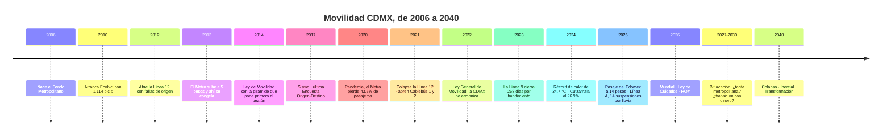
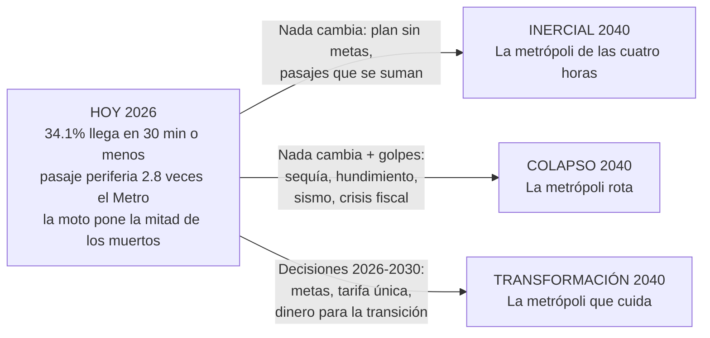

# Tres escenarios para la movilidad de la CDMX al 2040

**Colapso · Inercial · Transformación**

*Chilangatón · Laboratorio de Futuros · 25 de octubre de 2026*

Este documento parte de las tendencias y fuerzas motoras de la investigación y de la historia 2006–2026. Con eso dibuja **tres caminos posibles** para cómo nos moveremos en la Ciudad de México y su zona metropolitana en 2040.

---

## 1. Antes de empezar: ¿qué es un escenario?

Un escenario **no es una predicción**. Es una historia coherente, basada en datos, sobre cómo *podría* ser el futuro si ciertas fuerzas ganan y ciertas decisiones se toman o no se toman.

Imagina que estamos en una **bifurcación del camino**:

- **Inercial:** seguimos de frente, haciendo lo mismo de los últimos 20 años.
- **Colapso:** seguimos igual *y además* llegan golpes (agua, suelo, sismo, dinero) que el sistema ya no aguanta.
- **Transformación:** tomamos hoy decisiones distintas y cambiamos de rumbo.

Los tres siguen la tipología clásica de futuros de Jim Dator: colapso, continuación y transformación.

**Cómo leer las cifras:**
- Las cifras de **hoy** vienen de fuentes oficiales o de prensa citada.
- Las cifras de **2040** son proyecciones del equipo y van marcadas con ➕.
- Las del escenario **inercial** continúan la tendencia histórica con la aritmética de [retrospectiva-2006-2026.md](retrospectiva-2006-2026.md).
- Las de **colapso** y **transformación** son supuestos explícitos del equipo, no pronósticos.

**IDs:** S1, E2, P5… son las fuerzas de [investigacion.md](investigacion.md). Las de la guía rápida llevan F, TD y SD ([senales-tendencias-fuerzas.md](senales-tendencias-fuerzas.md)).

---

## 2. Línea del tiempo: de 2006 a 2040

La lección de los 20 años, en una frase: **avanzó lo que un solo gobierno podía hacer (Ecobici, Cablebús, trolebús eléctrico). Se quedó atorado lo que necesitaba acuerdo entre gobiernos (tarifa común, plan con metas, ley armonizada).** La tabla completa de hitos, con fuentes, está en [retrospectiva-2006-2026.md](retrospectiva-2006-2026.md#línea-de-tiempo-20062026).

### De hoy a los tres futuros

---

## 3. Lo que pasa en los tres escenarios (lo casi seguro)

Algunas cosas van a pasar **sin importar qué decidamos**. Son la base que comparten los tres escenarios:

| Lo casi seguro | Dato de hoy | Hacia 2040 ➕ |
| --- | --- | --- |
| **La ciudad envejece** (S1) | Edad mediana de 37 años (2025); 16.2% tenía 60 años o más (2020) | Edad mediana de unos 43 años; una de cada cuatro personas con 60 o más |
| **Más calor** (A1) | Récord de 34.7 °C en 2024; la isla de calor suma 3 a 4 °C en el oriente | Más días de calor extremo para quien camina y espera |
| **El suelo sigue bajando** (A5) | Pantitlán baja unos 10 cm al año | Mientras se bombee el acuífero, el oriente sigue hundiéndose |
| **La CDMX no crece; la periferia sí** (S2) | La CDMX es 42.2% de la metrópoli (2020) | Entre 35% y 39% |

Lo que **cambia** entre escenarios es cómo responde la ciudad a esto.

---

## 4. ¿Qué separa a un escenario de otro?

Dos preguntas que hoy nadie ha cerrado (las incertidumbres críticas de la matriz) y un factor de choque:

| | Colapso | Inercial | Transformación |
| --- | --- | --- | --- |
| **¿Quién fija la tarifa y el subsidio metropolitano?** (P5, P3) | Nadie, y la coordinación se rompe | Cada gobierno por su lado, como hoy | Una autoridad, una tarifa y un subsidio para quien vive lejos |
| **¿Qué tan a fondo va la transición?** (A7, E5) | Se detiene por falta de dinero | A medias: autos eléctricos y motos, el microbús sin relevo | Plena: cambio modal, electrificación y adaptación al clima |
| **¿Llegan golpes fuertes?** (comodines) | Sí, varios encadenados | No, o se absorben | Si llegan, la red está preparada |

---

## 5. Los tres escenarios en números

| Indicador | Hoy | Colapso 2040 ➕ | Inercial 2040 ➕ | Transformación 2040 ➕ |
| --- | --- | --- | --- | --- |
| Ocupados de la CDMX que llegan en 30 min o menos | 34.1% (2025) | ~23% | 28.7% | 50% (hoy, el promedio nacional es 51.5%) |
| Viaje al trabajo sin contar caminata, ZMVM | 63 min (2017) | 80 min o más | 72 min | 55 min (menos que en 2007) |
| Pasaje mínimo de la periferia frente al Metro | 2.8 veces (14 contra 5 pesos) | Más de 5 veces | 3.7 a 4.4 veces | Una sola tarifa integrada |
| Muertes viales al año, CDMX | 424 (2025) | Más de 600 | Unas 500 | Menos de 200 (la mitad, meta ONU) |
| Pasajeros del Metro al año | 1,115 millones (2023) | Menos de 1,000 millones | 1,366 millones | Más de 2,100 millones (vuelve a la tendencia de 2019) |
| Metrobuses eléctricos | 168 (2026) | Unos 300 | 672 | Flota 100% eléctrica desde 2033 (meta oficial) |
| Viajes diarios en bici | 456 mil (2024) | Unos 450 mil, sin crecer | 0.96 millones | 1.5 millones |
| Emisiones de la ciudad frente a 2016 | Sin inventario reciente | Sin baja | −36% (meta con recursos propios) | −83% (meta con financiamiento internacional) |
| Suspensiones de la Línea A por lluvia | Al menos 14 (2025) | Pantitlán fuera de servicio por meses | Una docena o más cada temporada | Casi ninguna: colectores y red alterna |

*Fuentes del "hoy": INEGI (Intercensal 2025, EOD 2017), SEMOVI, Expansión Política, Infobae, SEDEMA (ELAC), STC. Detalle en [retrospectiva-2006-2026.md](retrospectiva-2006-2026.md#escenario-inercial-2040-si-nada-cambia) e [investigacion.md](investigacion.md).*

### Las metas son

La **Transformación** es, en concreto, cumplir estas once metas. Los hitos de 2030 y 2035 son del equipo (➕): son pasos intermedios razonables entre el dato de hoy y la meta de 2040. Pueden servir como metas intermedias del plan a 2045, que hoy no trae metas numéricas.

| # | Meta | Hoy | 2030 ➕ | 2035 ➕ | 2040 |
| --- | --- | --- | --- | --- | --- |
| 1 | Ocupados que llegan a su trabajo en 30 min o menos | 34.1% | 38% | 44% | **50%** |
| 2 | Viaje promedio al trabajo | 63 min | 61 min | 58 min | **55 min** |
| 3 | Tarifa: pasaje de la periferia frente al Metro | La periferia paga 2.8 veces | Tarjeta y tarifa metropolitanas (2028–2030) | La periferia paga 1.5 veces o menos | **Una sola tarifa y una tarjeta (1 vez)** |
| 4 | Muertes viales al año | 424 | 330 | 260 | **Menos de 200** |
| 5 | Metrobús eléctrico | 168 unidades | La mitad de la flota | 100% (meta oficial 2033) | **100%** |
| 6 | Emisiones del transporte frente a 2016 | Sin inventario reciente | −25% | −55% | **−83%** |
| 7 | Viajes en bici al día | 456 mil | 800 mil | 1.1 millones | **1.5 millones** |
| 8 | Suspensiones de la Línea A por lluvia al año | 14 o más | 8 o menos | 3 o menos | **Casi ninguna** |
| 9 | Pasajeros del Metro al año | 1,115 millones | 1,450 millones | 1,800 millones | **Más de 2,100 millones** |
| 10 | Pobreza de tiempo | No se mide | Índice anual por alcaldía y municipio (desde 2027) | Es meta del plan a 2045 | **La mitad de personas con más de 2 h diarias de traslado** ➕ |
| 11 | Cuidado junto a las estaciones | No hay | 3 centros piloto en el oriente | En las estaciones de transbordo del oriente y el norte | **Un centro de cuidado a 15 min a pie o menos en toda la red masiva** |

**¿Qué metas cumple cada escenario?**

| Meta 2040 | 🔴 Colapso | 🟡 Inercial | 🟢 Transformación |
| --- | --- | --- | --- |
| 1. Llegan en 30 min o menos: 50% | ❌ ~23% | ❌ 28.7% | ✅ |
| 2. Viaje al trabajo: 55 min | ❌ 80 min o más | ❌ 72 min | ✅ |
| 3. Una sola tarifa | ❌ | ❌ | ✅ |
| 4. Muertes viales: menos de 200 | ❌ más de 600 | ❌ unas 500 | ✅ |
| 5. Metrobús 100% eléctrico | ❌ unos 300 | 🟡 672, diez años tarde | ✅ desde 2033 |
| 6. Emisiones: −83% | ❌ sin baja | ❌ −36% | ✅ |
| 7. Bici: 1.5 millones de viajes | ❌ | ❌ 0.96 millones | ✅ |
| 8. Línea A casi sin cortes | ❌ cierres de meses | ❌ una docena o más | ✅ |
| 9. Metro: más de 2,100 millones | ❌ menos de 1,000 millones | ❌ 1,366 millones | ✅ |
| 10. Pobreza de tiempo medida y a la baja | ❌ | ❌ seguimos con la EOD 2017 | ✅ |
| 11. Cuidado junto a las estaciones | ❌ | ❌ centros lejos de las estaciones | ✅ |
| **Total** | **0 de 11** | **0 de 11 (una a medias)** | **11 de 11** |

La propuesta para mover a la ciudad del Inercial a la Transformación está en [PROPUESTA.md](PROPUESTA.md).

---

## 6. Escenario 1 · COLAPSO: "La metrópoli rota"

> **En una frase:** la ciudad sigue igual que hoy, pero llegan golpes encadenados (sequía, hundimiento acelerado, un sismo, una crisis de dinero) y la red, sin mantenimiento ni acuerdos, se rompe por partes.

**Qué lo dispara**
1. No se invierte en mantener el Metro. Ya pasó: su presupuesto cayó 17% real entre 2018 y 2023.
2. Una sequía de varios años obliga a bombear más el acuífero y el suelo se hunde más rápido.
3. Un sismo fuerte encuentra viaductos del oriente ya deformados (Líneas 4, 9 y 12).
4. Un choque petrolero rompe el tope de la gasolina, sube el costo del transporte y aprieta las finanzas públicas.
5. Los gobiernos de la metrópoli dejan de estar alineados y la poca coordinación se acaba.

**Por qué es plausible:** cada pieza ya ocurrió por separado. La Línea 12 colapsó en 2021, la Línea 9 cerró 268 días por hundimiento, el Centro de Control se incendió en 2021, la pandemia vació el Metro en 2020 y el Cutzamala bajó a 26.9% en 2024.

**Fuerzas que mandan:** A5 (hundimiento), A6 (acuífero), A4 (lluvias), E4 (boleto barato, sistema caro), E9 (gasolina topada), P5 (metrópoli partida).

**Cómo se ve, paso a paso ➕**
- **2030:** la Línea A y Pantitlán cierran semanas en cada temporada de lluvias. El mototaxi y la moto llenan el hueco.
- **2035:** tramos elevados del oriente quedan fuera de servicio tras un sismo. El presupuesto se va a emergencias, no a mantenimiento.
- **2040:** el oriente queda medio desconectado del centro. Quien puede se muda o se compra una moto; quien no, pierde su empleo o lo busca cerca de casa, aunque pague menos.

**Un día de Rosa** (54 años, Valle de Chalco, limpia oficinas en Polanco): Pantitlán lleva cuatro meses cerrado. La ruta emergente tarda tanto que Rosa dejó el trabajo en Polanco y ahora vende comida en su colonia, ganando menos. Su mamá ya no va a la clínica porque el viaje es imposible a pie con el calor.

**Costo en salud:** el viaje enferma. Más estrés, más calor, más polvo y más miedo para quien sí tiene que moverse.

**Quién gana y quién pierde:** pierden el oriente, las personas mayores y quien cuida. "Ganan" solo quienes pueden pagar auto o mudarse.

**Señales tempranas de que vamos hacia aquí**
- Las suspensiones de la Línea A por lluvia pasan de 14 al año.
- Otro tramo del Metro cierra meses por hundimiento.
- El Cutzamala baja de 30% en temporada seca.
- El presupuesto real del Metro baja de nuevo.
- Se rompe el tope de la gasolina sin plan para el transporte público.

---

## 7. Escenario 2 · INERCIAL: "La metrópoli de las cuatro horas"

> **En una frase:** todo sigue como en los últimos 20 años. Se hacen obras una por una, pero nadie junta tarifas ni fija metas, y la gente vive cada vez más lejos.

**Qué lo dispara:** nada nuevo. Siguen las no-decisiones:
1. El plan rector a 2045 se aprueba sin metas, o no se aprueba (P3).
2. La CDMX y el Edomex suben sus pasajes cada uno por su lado (E2, P5).
3. La vivienda cara sigue expulsando a más de 23,000 hogares al año (E1).
4. Se electrifica lo público, pero el microbús se renueva por cientos, no por miles (E5).
5. La gasolina sigue subsidiada y la moto sigue creciendo (E9, E6).

**Fuerzas que mandan:** E1 (vivienda cara), S2 (se vive lejos), E2 (la periferia paga más), E6 (la moto crece), E7 (reparto por app), P5 (metrópoli partida).

**Cómo se ve, paso a paso ➕**
- **2030:** el Metrobús no llega a su meta de 700 eléctricos; la alcanza diez años tarde. Las motos siguen creciendo.
- **2035:** el pasaje mínimo de la periferia ronda los 18 pesos y el Metro sigue en 5. La brecha se agranda.
- **2040:** el viaje al trabajo ronda los 72 minutos y solo 29% llega en media hora. Unas 500 personas mueren cada año en la calle.

**Un día de Rosa:** sale a las 4:40 y deja a su nieta con una vecina. Combi, trolebús, Metro y camión: cuatro pagos, ningún descuento. Pantitlán vuelve a cerrar por la lluvia. A mediodía hay contingencia, y camina 20 minutos al sol para llevar a su mamá a consulta. Pasa **cuatro horas y media** moviéndose y gasta en pasajes una quinta parte de lo que gana.

**Costo en salud:** el estrés del traslado se vuelve normal. En un estudio de la UNAM, 35% de quienes vienen del Estado de México dijo estresarse siempre o casi siempre en el trayecto, contra 18% de quienes viven en la capital.

**Quién gana y quién pierde:** pierden la periferia y quien cuida. Gana quien vive en el centro bien conectado.

**Señales tempranas de que vamos hacia aquí**
- El plan a 2045 sale sin metas.
- Los pasajes vuelven a subir por separado.
- La encuesta origen-destino sigue siendo la de 2017.
- Las motos crecen más de 10% al año.

---

## 8. Escenario 3 · TRANSFORMACIÓN: "La metrópoli que cuida"

> **En una frase:** en 2026–2030 se toman las decisiones que llevan 20 años pendientes (metas, tarifa única y dinero para la transición) y la ciudad se reorganiza alrededor del tiempo y del cuidado de las personas.

**Qué lo dispara (decisiones concretas)**
1. **2026–2027:** el plan a 2045 se aprueba con metas medibles (tiempo de traslado, muertes viales, accesibilidad). La Ley de Movilidad se armoniza con límites de velocidad. Se levanta una nueva encuesta origen-destino y se empieza a medir la "pobreza de tiempo".
2. **2026–2030:** los centros de la Ley de Cuidados se construyen junto a estaciones de Cablebús, trolebús y Metro.
3. **2028–2030:** una tarjeta y una tarifa para toda la metrópoli, con subsidio a quien vive lejos.
4. **2030–2035:** financiamiento internacional para llegar a −83% de emisiones; el microbús se vuelve corredores eléctricos de empresas; la red se adapta al agua y al suelo.

**Fuerzas que se aprovechan:** T1 (electrificación pública), P4 (obra hacia la periferia), S3 y la Ley de Cuidados, S6 (bici), y las dos incertidumbres resueltas (P5 y A7).

**Por qué es plausible:** se construye con piezas que ya existen o están en obra: el trolebús Chalco–Santa Martha, el Cablebús 4, 5 y 6, la meta de Metrobús 100% eléctrico en 2033 y la Ley del Sistema Público de Cuidados de 2026. Lo que falta es integrarlas, financiarlas y medirlas.

**Cómo se ve, paso a paso ➕**
- **2030:** opera la tarifa metropolitana. Las muertes viales bajan a 330 o menos (eran 424 en 2025). Funcionan el Cablebús 4, 5 y 6.
- **2035:** existe una autoridad metropolitana de movilidad. Pantitlán y la Línea A tienen colectores y rutas alternas listas. El microbús es eléctrico y tiene horario.
- **2040:** la mitad de quienes trabajan llega en 30 minutos o menos. Cada barrio tiene un centro de cuidado y una estación a 15 minutos a pie.

**Un día de Rosa:** deja a su nieta en el centro de cuidado junto a la estación, a ocho minutos a pie por una calle arbolada. Con una sola tarjeta toma el trolebús y el Metro y paga un pasaje integrado. Su mamá pasa el día en la Casa de Día de la colonia. Cuando llueve, el aviso del desvío le llega antes de salir. Pasa **dos horas** moviéndose y le queda la tarde para ella.

**Costo en salud:** el viaje cuida. Hay esperas predecibles, sombra, unidades ventiladas, asiento para personas mayores y cuidadoras, y horarios escalonados en empresas y escuelas.

**Quién gana y quién pierde:** gana la mayoría, sobre todo la periferia y quien cuida. Pierden quienes lucran con el desorden: el negocio del pasaje sin reglas y la expansión de vivienda sin transporte.

**Señales tempranas de que vamos hacia aquí**
- El plan a 2045 se aprueba con metas numéricas.
- Se anuncia una nueva encuesta origen-destino.
- La CDMX y el Edomex firman una tarifa común.
- El Metrobús va en ruta a sus 700 eléctricos en 2030.
- Los centros de cuidado aparecen junto a estaciones.

---

## 9. Semáforo: ¿hacia cuál escenario vamos?

Un tablero sencillo para revisar cada año:

| Indicador | 🔴 Colapso | 🟡 Inercial | 🟢 Transformación |
| --- | --- | --- | --- |
| Plan a 2045 | No se aprueba | Se aprueba sin metas | Se aprueba con metas |
| Tarifa metropolitana | La coordinación se rompe | Cada gobierno sube por su lado | Una tarjeta y una tarifa |
| Línea A y Pantitlán | Cierres de meses | Una docena o más de suspensiones al año | Casi sin suspensiones |
| Muertes viales | Suben | Se estancan alrededor de 450 a 500 | Bajan a la mitad |
| Datos | No hay encuesta nueva | Seguimos con la de 2017 | Nueva encuesta y "pobreza de tiempo" publicada |
| Cuidado | Centros cerrados o sin presupuesto | Centros lejos de las estaciones | Centros junto a las estaciones |

---

## 10. Para decirlo en la mesa (30 segundos)

> "Desde el mismo punto de partida salen tres caminos. Si seguimos igual, llegamos a la metrópoli de las cuatro horas. Si además llegan golpes de agua, suelo o dinero, a la metrópoli rota. Y si en los próximos cuatro años decidimos lo que llevamos 20 años posponiendo (metas, tarifa única y dinero para la transición), llegamos a la metrópoli que cuida. El 2040 se decide entre 2026 y 2030."

---

## Fuentes principales

- [Retrospectiva 2006–2026 del equipo](retrospectiva-2006-2026.md), con todas las fuentes de la línea del tiempo y la aritmética del escenario inercial
- [Investigación del equipo](investigacion.md), con las 34 fuerzas y sus fuentes
- [INEGI, Encuesta Intercensal 2025, CDMX](https://www.inegi.org.mx/contenidos/saladeprensa/boletines/2026/ei/EIC2025-def_CDMX.pdf)
- [INEGI, Encuesta Origen-Destino 2017](https://www.inegi.org.mx/contenidos/programas/eod/2017/doc/resultados_eod_2017.pdf)
- [SEDEMA, ELAC 2021–2050](https://www.sedema.cdmx.gob.mx/storage/app/media/DGCPCA/PACCM_y_ELAC_uv.pdf)
- [Expansión Política, Metrobús eléctrico al 2033](https://politica.expansion.mx/cdmx/2026/08/27/metrobus-cdmx-electrico-2033)
- [Infobae, suspensiones de la Línea A en 2025](https://www.infobae.com/mexico/2026/01/01/linea-a-del-metro-cdmx-registra-nuevo-record-en-2025-por-las-veces-que-suspendio-servicio/)
- [Crónica, Línea 9 reabre tras nueve meses por hundimiento](https://www.cronica.com.mx/metropoli/reabren-tramo-l9-metro-nueve-meses-obras-hundimientos.html)
- [UNAM Global, estrés de usuarios del transporte público](https://unamglobal.unam.mx/usuarios-de-transporte-publico-se-estresan-en-sus-recorridos/)
- [Expansión Política, Ley del Sistema Público de Cuidados](https://politica.expansion.mx/mexico/2026/07/02/emancipacion-para-millones-de-mujeres-brugada-promulga-ley-del-sistema-de-cuidados)
