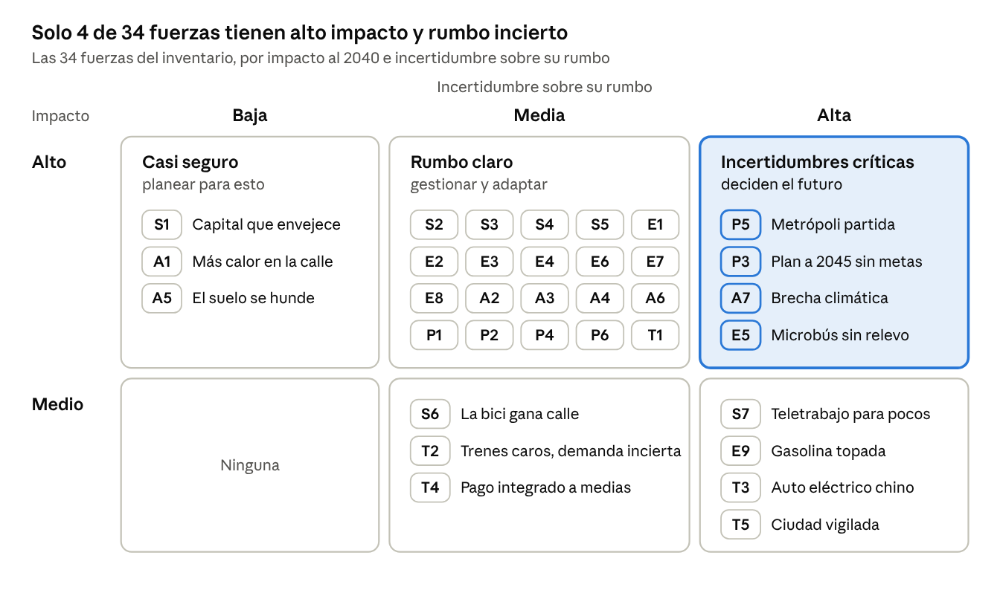
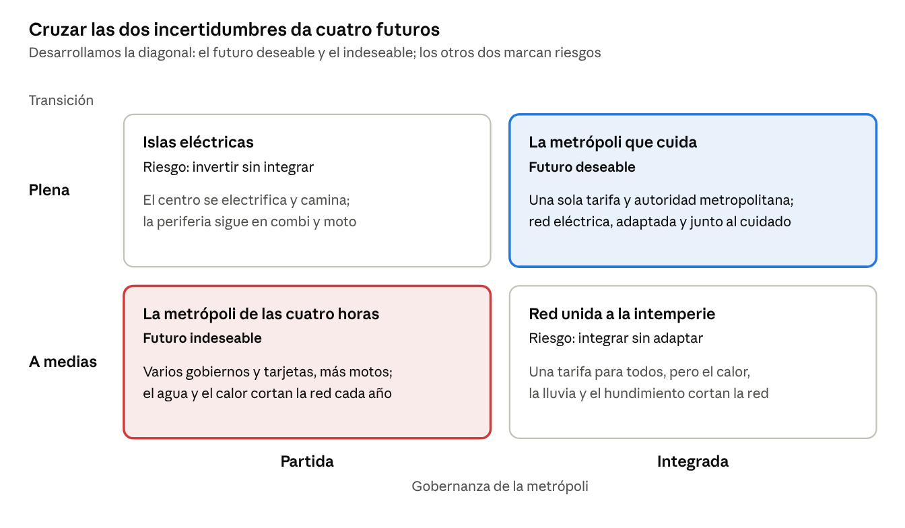
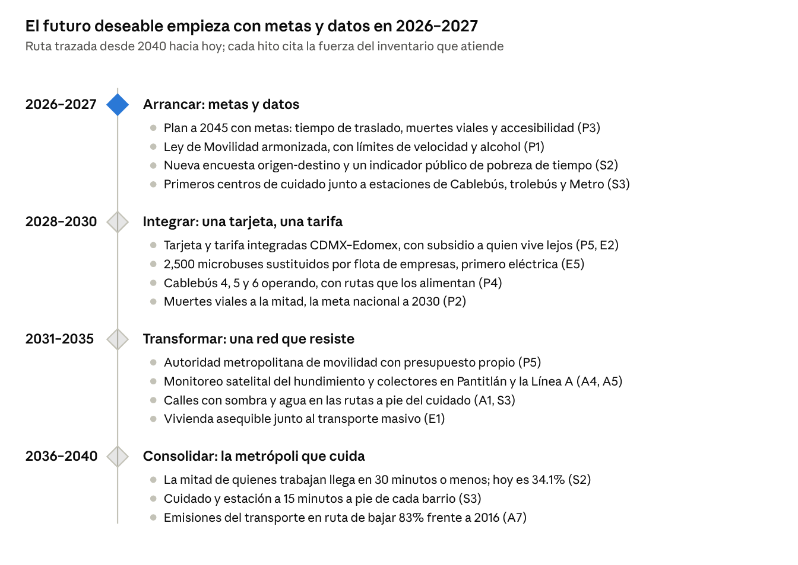

# Movilidad CDMX 2040: tendencias y fuerzas motrices

Chilangatón · Laboratorio de Futuros · Oct 25, 2026 · @iam\_josehugo

## Resumen para el jurado

**Tesis.** La movilidad de 2040 se decide en dos preguntas que nadie ha cerrado: si la metrópoli se gobierna como una sola y si la transición va a fondo. Si las dos salen bien, llegamos a la metrópoli que cuida; si salen mal, a la de las cuatro horas, y pierde primero quien vive lejos y quien cuida.

**Ruta del análisis:** 34 fuerzas en cinco dimensiones → 4 incertidumbres críticas → 2 ejes → 3 escenarios con 11 metas → una ruta 2026–2040 con señales de alerta → la propuesta [Trama](PROPUESTA.md).

**Cinco hallazgos**

1. Solo 34.1% de las personas ocupadas que viven en la CDMX llega a su trabajo en 30 minutos o menos, contra 51.5% en el país ([INEGI, Intercensal 2025](https://www.inegi.org.mx/contenidos/saladeprensa/boletines/2026/ei/EIC2025-def_CDMX.pdf)).
2. La moto crece y el auto no: las viviendas con moto pasaron de 8.1% a 13.3% en cinco años ([INEGI](https://www.inegi.org.mx/contenidos/saladeprensa/boletines/2026/ei/EIC2025-def_CDMX.pdf)), y casi la mitad de quienes murieron en la calle en 2025 iba en moto ([Posta con datos de SEMOVI](https://www.posta.com.mx/cdmx/este-es-el-nivel-mas-bajo-en-muertes-viales-de-cdmx/vl2193107)).
3. El oriente, que más depende del transporte masivo, es el más expuesto: hay zonas que se hunden más de 2 cm al mes ([NASA JPL](https://www.jpl.nasa.gov/news/us-indian-space-mission-maps-extreme-subsidence-in-mexico-city/)) y la lluvia cortó la Línea A al menos 14 veces en 2025 ([Infobae](https://www.infobae.com/mexico/2026/01/01/linea-a-del-metro-cdmx-registra-nuevo-record-en-2025-por-las-veces-que-suspendio-servicio/)).
4. Electrificar no basta: solo la electrificación con cambio modal cumple las metas climáticas ([ITDP y UC Davis](https://itdp.org/wp-content/uploads/2021/12/EN_Compact-Cities-BRIEF_SINGLEPAGE-1.pdf)), y la propia CDMX prevé bajar sus emisiones entre 36% y 83% a 2040 según el financiamiento que consiga ([SEDEMA](https://www.sedema.cdmx.gob.mx/storage/app/media/DGCPCA/PACCM_y_ELAC_uv.pdf)).
5. El plan oficial a 2045 hace del cuidado un pilar que arranca en las periferias, pero su línea de movilidad no menciona el cuidado ni trae metas ([cuadernillo del PGD, pp. 15 y 28](https://sedeco.cdmx.gob.mx/storage/app/media/Proyecto%20PGD/PGD_cuadernillo.pdf)). Ese hueco es el que cubre nuestra propuesta.

## Pregunta focal y método

**Pregunta focal:** ¿cómo se moverán las personas en la Ciudad de México y su zona metropolitana en 2040, y quién gana o pierde con ello?

**Horizonte 2040.** Catorce años bastan para que cambien la infraestructura, la tecnología y la forma de la ciudad, y están lo bastante cerca para que las decisiones de hoy los definan.

**Lente: cuidados y periferias.** A cada fuerza le preguntamos qué le hace a quien cuida, que encadena viajes a la escuela, el mercado y la clínica, y a quien cruza la metrópoli desde la periferia para llegar a su trabajo.

**Cómo lo hicimos**

1. **Escaneo STEEP:** buscamos cambios en cinco dimensiones (social, tecnológica, económica, ambiental y política) con datos de fuentes oficiales y de referencia.
2. **Clasificación:** separamos megatendencias, tendencias, fuerzas motrices, señales débiles y comodines.
3. **Matriz impacto × incertidumbre:** lo de alto impacto y baja incertidumbre es casi seguro y se planea; lo de alto impacto y alta incertidumbre son las incertidumbres críticas, que deciden el futuro.
4. **Tres escenarios:** cruzamos las dos incertidumbres críticas y los golpes externos para construir tres escenarios al 2040: Colapso, Inercial y Transformación ([escenarios-2040.md](escenarios-2040.md)), con once metas medibles.
5. **Ruta de regreso y propuesta:** desde la Transformación trazamos hitos hacia hoy, señales de alerta y una propuesta para empezar ya: [Trama](PROPUESTA.md).

**Glosario**

| Concepto | Qué es | Ejemplo en movilidad |
| --- | --- | --- |
| Megatendencia | Cambio global, de largo plazo y difícil de revertir | Envejecimiento de la población; electrificación del transporte |
| Tendencia | Cambio observable con dirección sostenida en los datos | Más motocicletas en circulación año con año |
| Fuerza motriz | Causa de fondo que empuja una o varias tendencias | El precio de la vivienda central, que empuja a vivir lejos del trabajo |
| Señal débil | Indicio temprano y pequeño de un cambio que podría crecer | Robotaxis operando en otras ciudades del mundo, aún no en México |
| Comodín | Evento poco probable y de alto impacto | Un sismo mayor que dañe la red del Metro |
| Incertidumbre crítica | Fuerza de alto impacto cuyo rumbo no se conoce | ¿La metrópoli se gobierna como una sola o sigue fragmentada? |

## Inventario de tendencias y fuerzas motrices

Identificamos 34 fuerzas y tendencias, y siguen un patrón: casi todas golpean primero a quien vive en la periferia oriente y norte, y a quien camina, espera y encadena viajes para cuidar a otros. Cada una lleva un ID para ubicarla en la matriz.

*Imp. · Inc.* = impacto en la movilidad al 2040 · incertidumbre sobre su rumbo.

### Social

| ID | Fuerza o tendencia | Qué dicen los datos | Golpea más a | Imp. · Inc. |
| --- | --- | --- | --- | --- |
| S1 | **Capital que envejece y deja de crecer** (megatendencia) | La CDMX creció 0.0% anual entre 2020 y 2025 y su edad mediana llegó a 37 años ([INEGI, CDMX](https://www.inegi.org.mx/contenidos/saladeprensa/boletines/2026/ei/EIC2025-def_CDMX.pdf)), contra 32 del país ([INEGI, nacional](https://www.inegi.org.mx/contenidos/saladeprensa/boletines/2026/ei/EIC2025-def_CP.pdf)); en el país, la población de 60 años o más pasaría de 15% en 2030 a 24% en 2050 ([CONAPO](https://www.snieg.mx/Documentos/Demografico/sesiones/doc_22023/4_proyecciones_cesnids.pdf)) | Mujeres mayores y sus cuidadoras | Alto · Baja |
| S2 | **Se vive lejos, se trabaja en el centro** (tendencia) | La CDMX bajó de 52.9% a 42.2% de la población metropolitana entre 1990 y 2020, y bajaría a 37.4% hacia 2035 ([IPDP](https://ipdp.cdmx.gob.mx/storage/app/uploads/public/648/27d/140/64827d1409a80943844442.pdf)); solo 34.1% de las personas ocupadas que viven en la CDMX llega a su trabajo en 30 minutos o menos, contra 51.5% en el país ([INEGI, CDMX](https://www.inegi.org.mx/contenidos/saladeprensa/boletines/2026/ei/EIC2025-def_CDMX.pdf); [INEGI, nacional](https://www.inegi.org.mx/contenidos/saladeprensa/boletines/2026/ei/EIC2025-def_CP.pdf)) | Trabajadores de bajos ingresos del Edomex | Alto · Media |
| S3 | **El cuidado viaja a pie** (fuerza motriz) | 71.4% de las mujeres que viajan en la ZMVM camina en algún tramo, contra 60.3% de los hombres, y menos de ellas usan transporte privado: 18.2% contra 26.4% ([INEGI, EOD 2017](https://www.inegi.org.mx/contenidos/programas/eod/2017/doc/resultados_eod_2017.pdf)); al menos 3.08 millones de personas cuidan sin pago en la CDMX ([La Razón, ago-2025](https://www.razon.com.mx/ciudad/2025/08/11/brugada-presenta-ley-del-sistema-publico-de-cuidados-incluye-reformas-al-articulo-9-de-la-constitucion-de-cdmx/)) | Madres, abuelas, cuidadoras | Alto · Media |
| S4 | **El miedo tiene género** (fuerza motriz) | 22.1% de las mujeres en ciudades sufrió acoso o violencia sexual en lugares públicos en el primer semestre de 2026, contra 8.9% de los hombres ([INEGI, ENSU](https://www.inegi.org.mx/contenidos/programas/ensu/doc/ensu2026_junio_presentacion_ejecutiva.pdf)) | Mujeres jóvenes; quien viaja de noche | Alto · Media |
| S5 | **Accesibilidad rezagada** (tendencia) | 5.2% de la población de la CDMX tiene discapacidad ([INEGI, Intercensal 2025](https://www.inegi.org.mx/contenidos/saladeprensa/boletines/2026/ei/EIC2025-def_CDMX.pdf)); en 2020 eran accesibles 76 de 195 estaciones del Metro y 261 de 265 del Metrobús ([SEMOVI](https://semovi.cdmx.gob.mx/storage/app/media/Accesibilidad%20para%20la%20Movilidad.pdf)) | Personas con discapacidad, mayores, carriolas | Alto · Media |
| S6 | **La bici gana calle** (tendencia) | Hay 456,000 viajes diarios en bici, 71% más que en 2018, y el plan es sumar 300 km de ciclovías ([Expansión Política, jun-2025](https://politica.expansion.mx/cdmx/2025/06/03/nuevas-ciclovias-y-expansion-de-ecobici-el-plan-ciclista-de-brugada-para-cdmx)); Ecobici pasará de 9,308 a 15,000 bicis y llegará a Iztapalapa, Tlalpan e Iztacalco ([Expansión Política, ago-2026](https://politica.expansion.mx/cdmx/2026/08/28/expansion-ecobici-expande-alcaldias-cdmx-precio)) | Jóvenes, estudiantes, repartidores | Medio · Media |
| S7 | **Teletrabajo para pocos** (tendencia) | Solo 10.6% del empleo del país se puede hacer desde casa: 19.4% del formal y 1.4% del informal independiente ([Banxico, 2021](https://www.sinembargo.mx/wp-content/uploads/2022/03/posibilidades-de-teletrabajo-en-mexico-banxico-home-office.pdf)) | Deja fuera a la mayoría informal | Medio · Alta |

### Tecnológica

| ID | Fuerza o tendencia | Qué dicen los datos | Golpea más a | Imp. · Inc. |
| --- | --- | --- | --- | --- |
| T1 | **El transporte público se electrifica** (tendencia) | El trolebús pasó de unas 100 unidades en operación en 2018 a 502 en 2026 ([Expansión Política, may-2026](https://politica.expansion.mx/cdmx/2026/05/12/la-cdmx-apuesta-por-la-movilidad-electrica-en-el-mundial)); el Metrobús tiene cerca de 20% de su flota eléctrica y promete llegar a 100% en 2033 ([Expansión Política, ago-2026](https://politica.expansion.mx/cdmx/2026/08/27/metrobus-cdmx-electrico-2033)) | Usuarios de bajos ingresos; vecinos de corredores | Alto · Media |
| T2 | **Trenes metropolitanos caros, demanda por probar** (tendencia) | El Insurgente llegó a Observatorio en febrero de 2026, tras 12 años y unos 100 mil millones de pesos; hasta enero movía unos 22 mil pasajeros diarios, contra una demanda estimada de 140 mil, y el viaje completo cuesta 90 pesos ([Posta](https://www.posta.com.mx/mexico/inauguran-estaciones-faltantes-de-el-insurgente-100-mil-millones-de-pesos-y-12-anos-despues/vl2159083)); el tren Buenavista–AIFA cuesta 110 pesos tras la promoción ([N+](https://www.nmas.com.mx/economia/cuanto-costara-tren-suburbano-buenavista-aifa-estas-son-nuevas-tarifas-por-tipo-viaje/)) | Poniente y norte del Edomex | Medio · Media |
| T3 | **Auto eléctrico con sello chino** (megatendencia) | En 2025 uno de cada cuatro autos nuevos del mundo fue eléctrico ([AIE](https://iea.org/reports/global-ev-outlook-2026/executive-summary)); en México híbridos y eléctricos fueron 9.5% de las ventas ([Expansión, dic-2025](https://expansion.mx/empresas/2025/12/31/el-auto-hibrido-se-queda-con-el-mercado-mexicano)), y desde enero de 2026 los autos chinos pagan 50% de arancel ([Expansión, ene-2026](https://expansion.mx/empresas/2026/01/14/autos-chinos-en-mexico-se-encarecen)) | Hogares de ingresos medios y altos | Medio · Alta |
| T4 | **Pago integrado a medias** (tendencia) | Metro y Metrobús aceptan tarjeta bancaria sin contacto desde 2024 ([InformaBTL](https://www.informabtl.com/metro-metrobus-cdmx-pago-con-tarjeta-de-cualquier-banco-contactless/)) y la tarjeta MI funciona en el celular desde 2025, aún sin RTP ni iPhone ([Expansión Política](https://politica.expansion.mx/cdmx/2025/12/09/tarjeta-movilidad-integrada-digital-pagar-metro-con-celular)); los trenes federales usan boletos propios ([La Jornada](https://www.jornada.com.mx/2026/02/05/capital/027n2cap)) | Personas sin banco o sin smartphone; mayores | Medio · Media |
| T5 | **Ciudad vigilada** (fuerza motriz) | El C5 llegó al Mundial con 119,653 cámaras en 48,387 puntos de la ciudad ([C5, jun-2026](https://www.c5.cdmx.gob.mx/storage/app/media/Boletin/2026/Junio/boletin-2426camaras-c5.pdf)); no hay datos públicos del avance de los semáforos con IA prometidos en 2024 ([Motorpasión](https://www.motorpasion.com.mx/industria/cdmx-ciudad-mexico-semaforos-inteligencia-artificial-clara-brugada)) | Peatones y usuarios; la privacidad de todos | Medio · Alta |

### Económica

| ID | Fuerza o tendencia | Qué dicen los datos | Golpea más a | Imp. · Inc. |
| --- | --- | --- | --- | --- |
| E1 | **Vivienda cara expulsa a la periferia** (fuerza motriz) | Una vivienda promedio cuesta 4.29 millones de pesos en la CDMX y 2.20 en el Edomex ([IIEG con datos de SHF, 2T-2026](https://iieg.gob.mx/ns/wp-content/uploads/2026/08/reporte_indice_precios_vivienda_mexico_2doT_2026.pdf)); la renta promedio pasó de 14,500 a casi 20,000 pesos entre 2020 y 2025 ([Grupo Animal con datos del Gobierno de la CDMX](https://grupoanimal.mx/estados/gentrificacion-cdmx-aumento-rentas-vivienda)) y la ciudad expulsa más de 23,000 hogares al año hacia la periferia ([IPDP](https://ipdp.cdmx.gob.mx/storage/app/uploads/public/648/27d/140/64827d1409a80943844442.pdf)) | Hogares jóvenes y de bajos ingresos | Alto · Media |
| E2 | **La periferia paga más por moverse** (fuerza motriz) | Desde oct-2025 el pasaje mínimo en el Edomex es de 14 pesos, contra 5 del Metro ([La Razón](https://www.razon.com.mx/estados/2025/10/11/aumentan-tarifas-del-transporte-publico-en-edomex-cuanto-costara-y-donde-aplica/)); 60 viajes al mes costaban 20.9% del ingreso del quintil más pobre de la CDMX, contra 7.8% del promedio ([BID, 2019](https://publications.iadb.org/publications/spanish/document/Qu%C3%A9_tan_asequible_es_el_transporte_en_Am%C3%A9rica_Latina_y_el_Caribe_es_es.pdf)) | Hogares pobres del oriente y norte mexiquense | Alto · Media |
| E3 | **Congestión: 211 horas al año** (fuerza motriz) | Cada persona que se traslada en la Ciudad de México pierde 211 horas y 10,721 pesos al año en el tráfico, el costo más alto del país; en las 44 zonas metropolitanas del estudio, quien usa transporte público pierde 140 horas y quien va en auto, 94 ([IMCO, 2026](https://imco.org.mx/costo-del-trafico-2026/)) | Usuarios de transporte público | Alto · Media |
| E4 | **Boleto barato, sistema caro** (fuerza motriz) | Cada viaje en Metro cuesta 13 pesos y se cobra en 5 ([N+, dic-2025](https://www.nmas.com.mx/ciudad-de-mexico/subira-tarifa-metro-cdmx-2026-gobierno-anuncia-precio-para-proximo-ano/)); el Metro tiene en 2026 su mayor presupuesto nominal, 25 mil millones, de los que 7,889 son para la Línea 3 y la infraestructura operativa ([Excélsior](https://www.excelsior.com.mx/comunidad/paquete-economico-2026-cdmx-inversion-publica-presupuesto-historico-movilidad/1754556)) | Usuarios de bajos ingresos del Metro | Alto · Media |
| E5 | **Microbús: la columna que se renueva lento** (tendencia) | 74.1% de los viajes en transporte público de la ZMVM usa micro o combi en algún tramo ([UNAM Global con la EOD 2017](https://unamglobal.unam.mx/global_revista/microbus-o-combi-transporte-publico-mas-utilizado-en-el-valle-de-mexico/)); la meta es sustituir 2,500 microbuses hacia 2030, con bono doble si la unidad es eléctrica ([Crónica, feb-2026](https://www.cronica.com.mx/metropoli/2026/02/19/arranca-chatarrizacion-de-microbuses-preven-sustituir-2-mil-500-unidades-hacia-2030/)) | Usuarios de rutas periféricas; choferes | Alto · Alta |
| E6 | **La moto crece, el auto no** (tendencia) | Las motos registradas en la CDMX pasaron de 260 mil en 2015 ([La Razón con INEGI](https://www.razon.com.mx/ciudad/2026/03/25/rechaza-la-semovi-mototaxis-por-app-y-uber-pide-dialogo/)) a 823 mil en 2025 ([Publimetro con INEGI](https://www.publimetro.com.mx/nacional/2026/09/03/por-que-hay-cada-vez-mas-motos-en-mexico-ya-van-mas-de-10-millones/)); las viviendas con moto subieron de 8.1% a 13.3% entre 2020 y 2025, y las que tienen auto se quedaron en 48% ([INEGI, Intercensal 2025](https://www.inegi.org.mx/contenidos/saladeprensa/boletines/2026/ei/EIC2025-def_CDMX.pdf)) | Jóvenes, repartidores, periferia | Alto · Media |
| E7 | **Reparto por app, formal a medias** (tendencia) | En junio de 2026, 237,627 personas de plataformas tenían seguridad social completa y 1.66 millones, seguro de riesgos de trabajo ([Mobile Time con STPS e IMSS](https://mobiletime.la/noticias/10/07/2026/trabajadores-de-apps-seguridad-social/)) | Repartidores en moto y bici | Alto · Media |
| E8 | **Cinturón logístico del norte** (tendencia) | En 2025 el Valle de México absorbió un récord de 1.6 millones de m² de naves, 91% para logística, y Zumpango–AIFA concentra 43% de lo que se construye ([MexicoIndustry con CBRE](https://mexicoindustry.com/noticia/boom-inmobiliario-industrial-en-la-cdmx-absorcion-historica-e-inversion-extranjera-sostienen-la-expansion-en-2026)) | Trabajadores de almacén del norte mexiquense | Alto · Media |
| E9 | **Gasolina topada** (fuerza motriz) | Hacienda perdonó 59.5% del IEPS de la Magna y 100% del diésel la semana del 17 al 23 de octubre de 2026 para sostener el tope de 24 pesos ([El Imparcial](https://www.elimparcial.com/dinero/2026/10/17/hacienda-sube-el-estimulo-fiscal-a-la-gasolina-y-deja-en-cero-el-ieps-del-diesel-del-17-al-23-de-octubre-lo-que-absorbera-hasta-485-pesos-por-tanque-en-mexico/)) | Transportistas y conductores de la periferia | Medio · Alta |

### Ambiental

| ID | Fuerza o tendencia | Qué dicen los datos | Golpea más a | Imp. · Inc. |
| --- | --- | --- | --- | --- |
| A1 | **Más calor sobre la calle** (megatendencia) | Récord de 34.7 °C en Tacubaya en mayo de 2024 ([El Financiero](https://www.elfinanciero.com.mx/cdmx/2024/05/25/cdmx-se-derrite-rompe-nuevo-record-historico-de-calor-con-347-grados/)); la isla de calor suma 3 a 4 °C en el oriente ([Gaceta UNAM](https://www.gaceta.unam.mx/las-islas-de-calor-aumentan-la-temperatura-en-cdmx-pincc/)); en abril de 2024 se midieron 39 °C dentro de un vagón del Metro ([Excélsior](https://www.excelsior.com.mx/nacional/sufren-desierto-urbano-calor-extremo-impacta-movilidad)) | Quien camina y espera: cuidadoras, personas mayores, oriente | Alto · Baja |
| A2 | **El transporte es el gran emisor** (fuerza motriz) | Genera 81.2% de los gases de efecto invernadero directos de la CDMX ([ELAC 2021–2050, SEDEMA](https://www.sedema.cdmx.gob.mx/storage/app/media/DGCPCA/PACCM_y_ELAC_uv.pdf)) y 85.8% de los óxidos de nitrógeno del valle ([Inventario ZMVM 2018](https://www.sedema.cdmx.gob.mx/storage/app/media/DGCA/InventarioDeEmisionesZMVM2018.pdf)) | Vecinos de vías rápidas; niñas y niños | Alto · Media |
| A3 | **Ozono que no cede** (tendencia) | 11 contingencias por ozono en 2024, récord, cuando antes eran de 3 a 6 al año ([UnoTV con la CAMe](https://www.unotv.com/estados/ciudad-de-mexico/temporada-de-ozono-2025-en-valle-de-mexico-preven-hasta-5-ondas-de-calor-y-11-contingencias/)); en 2026 empezaron desde enero ([N+](https://www.nmas.com.mx/ciudad-de-mexico/medio-ambiente/contingencia-ambiental-cdmx-edomex-sigue-se-levanta-came-hoy-9-de-enero-2026/)) | Personas con asma, ciclistas, repartidores | Alto · Media |
| A4 | **Lluvias que cortan la red** (tendencia) | 2025 tuvo 24 alertas rojas, contra 14 en 2024, y 1,085 mm de lluvia de enero a noviembre, contra 743 de promedio anual ([Expansión](https://politica.expansion.mx/cdmx/2025/11/18/cdmx-registra-aumento-historico-en-alertas-rojas-y-purpura-por-lluvia)); la Línea A tuvo al menos 14 suspensiones por lluvia en 2025 ([Infobae](https://www.infobae.com/mexico/2026/01/01/linea-a-del-metro-cdmx-registra-nuevo-record-en-2025-por-las-veces-que-suspendio-servicio/)) | Oriente: Iztapalapa, La Paz, Neza, Chalco | Alto · Media |
| A5 | **El suelo se hunde bajo el Metro** (tendencia) | Zonas que bajan más de 2 cm al mes según el satélite NISAR ([NASA JPL, 2026](https://www.jpl.nasa.gov/news/us-indian-space-mission-maps-extreme-subsidence-in-mexico-city/)); Pantitlán, nodo de cuatro líneas, acumula unos 80 cm y baja unos 10 al año ([Vanguardia con Reforma](https://vanguardia.com.mx/noticias/cerraran-tramo-elevado-de-la-linea-9-del-metro-de-la-cdmx-por-problemas-de-hundimiento-HB9012898)) | Usuarios de las líneas A, 9, 12 y 4 | Alto · Baja |
| A6 | **Acuífero sobreexplotado** (fuerza motriz) | En 2025 llovieron más de 1,600 millones de m³, el doble de lo que pueden almacenar las presas ([Expansión](https://politica.expansion.mx/cdmx/2025/11/18/cdmx-registra-aumento-historico-en-alertas-rojas-y-purpura-por-lluvia)), pero la ciudad trata menos de 15% de sus aguas residuales ([IPDP](https://www.ipdp.cdmx.gob.mx/storage/app/media/uploaded-files/14-gestion-sustentable-del-agua.pdf)) | Oriente, sobre todo Iztapalapa | Alto · Media |
| A7 | **La brecha climática de 2040** (fuerza motriz) | La ELAC prevé bajar las emisiones 36% a 2040 con recursos propios u 83% con financiamiento internacional, frente a 2016 ([SEDEMA](https://www.sedema.cdmx.gob.mx/storage/app/media/DGCPCA/PACCM_y_ELAC_uv.pdf)) | Quien depende del transporte colectivo | Alto · Alta |

### Política

| ID | Fuerza o tendencia | Qué dicen los datos | Golpea más a | Imp. · Inc. |
| --- | --- | --- | --- | --- |
| P1 | **Derecho a la movilidad sin dientes** (fuerza motriz) | La Ley General de Movilidad y Seguridad Vial es de 2022; en 2025 la CDMX seguía entre las 11 entidades sin armonizar ([Expansión](https://politica.expansion.mx/mexico/2025/05/07/11-estados-tres-anos-retrasados-ley-de-movilidad)), y la iniciativa de 2026, según Bicitekas, deja fuera los límites de velocidad y alcohol ([Excélsior](https://www.excelsior.com.mx/ciudad-de-mexico/reforma-ley-movilidad-es-simulacion-dicen-activistas)) | Peatones, personas mayores, niñas y niños | Alto · Media |
| P2 | **Meta vial incumplida** (tendencia) | La meta era bajar 30% las muertes viales entre 2019 y 2024, y subieron 34.3% ([Expansión con datos de SEMOVI](https://politica.expansion.mx/mexico/2025/05/07/11-estados-tres-anos-retrasados-ley-de-movilidad)); en 2025 murieron 424 personas, 208 de ellas en moto ([Posta](https://www.posta.com.mx/cdmx/este-es-el-nivel-mas-bajo-en-muertes-viales-de-cdmx/vl2193107)) | Hombres jóvenes en moto; peatones | Alto · Media |
| P3 | **Plan rector a 2045 sin metas** (fuerza motriz) | La línea de movilidad del Proyecto de Plan General de Desarrollo 2025–2045 no trae metas numéricas ([cuadernillo, p. 28](https://sedeco.cdmx.gob.mx/storage/app/media/Proyecto%20PGD/PGD_cuadernillo.pdf)); en agosto de 2026 aún no llegaba al Congreso ([Crónica](https://www.cronica.com.mx/metropoli/2026/08/19/reconoce-presidente-rezago-en-el-congreso-cdmx-advierte-que-retraso-del-pgd-frena-la-economia/)) | Periferias y suelo de conservación | Alto · Alta |
| P4 | **Obra eléctrica hacia la periferia** (tendencia) | Las Líneas 4, 5 y 6 del Cablebús suman 40 km en cinco alcaldías y llevaban 20% de avance en cimentación y torres en agosto de 2026 ([La Razón](https://www.razon.com.mx/ciudad/2026/08/04/lineas-4-5-y-6-del-cablebus-son-una-realidad-y-combatiran-la-pobreza-de-tiempo-asegura-clara-brugada/)); la movilidad recibe 43,749 millones en el presupuesto 2026, 13% más ([Excélsior](https://www.excelsior.com.mx/comunidad/paquete-economico-2026-cdmx-inversion-publica-presupuesto-historico-movilidad/1754556)) | Laderas del sur y del oriente | Alto · Media |
| P5 | **Metrópoli partida** (fuerza motriz) | El trolebús Chalco–Santa Martha promete bajar un viaje de 2 horas a 45 minutos ([Chilango, mar-2025](https://www.chilango.com/noticias/transporte/cuando-abrira-trolebus-chalco-santa-martha-asi-van-las-obras-ruta-conectara-cdmx-edomex/)), pero cobra 13 pesos contra 5 del Metro ([Chilango, may-2025](https://www.chilango.com/noticias/transporte/trolebus-chalco-santa-martha-costo/)); en el Consejo Metropolitano de 2026 no se reportó ningún acuerdo de transporte ([Excélsior](https://www.excelsior.com.mx/ciudad-de-mexico/brugada-propone-policia-metropolitana-entre-cdmx-edomex-morelos-e-hidalgo)) | Mexiquenses que trabajan en la CDMX | Alto · Alta |
| P6 | **Miedo en el transporte** (tendencia) | 61.1% de la población urbana del país se siente insegura en el transporte público ([INEGI, ENSU sep-2026](https://www.inegi.org.mx/contenidos/saladeprensa/boletines/2026/ensu/ENSU2026_10_CP.pdf)); en 2025 hubo 3,684 denuncias por robo en el transporte de la CDMX y solo 4% de detenciones en flagrancia ([Crónica](https://www.cronica.com.mx/metropoli/2026/07/16/denuncian-mas-de-4-mil-delitos-en-transporte-publico-en-16-meses-con-solo-4-detenidos-in-fraganti/)) | Mujeres; quien viaja de noche desde la periferia | Alto · Media |

## Señales débiles y comodines

Las señales débiles muestran por dónde puede torcerse el futuro; los comodines, qué podría romperlo de golpe. Ninguna entra a la matriz como certeza: sirven para darle textura a los futuros y para vigilar.

**Señales débiles**

| Señal | Qué vemos hoy | Qué podría abrir al 2040 |
| --- | --- | --- |
| "Pobreza de tiempo" en el discurso oficial | El gobierno presenta las Líneas 4, 5 y 6 del Cablebús como combate a la pobreza de tiempo, pero ningún indicador oficial la mide ([La Razón, ago-2026](https://www.razon.com.mx/ciudad/2026/08/04/lineas-4-5-y-6-del-cablebus-son-una-realidad-y-combatiran-la-pobreza-de-tiempo-asegura-clara-brugada/)) | Que el tiempo de traslado se vuelva una meta pública medible, o que quede como eslogan |
| Robotaxis en pruebas | La prensa reporta pruebas de 25 robotaxis de Mobileye en la CDMX, sin confirmación primaria ([AF.net, sep-2026](https://af.net/realtime/mobileye-launches-first-fully-autonomous-taxi-trials-in-mexico-city-pioneering-latin-america/)); México no tiene ley para vehículos autónomos ([Expansión, 2025](https://expansion.mx/tecnologia/2025/06/06/por-que-mexico-esta-lejos-de-tener-robotaxis)) | Un nicho en zonas de altos ingresos, o flotas compartidas que alimentan al Metro |
| Olinia, minieléctrico de barrio | Prototipo federal de junio de 2026: 125 km de autonomía, 50 km/h, 6 plazas con espacio para silla de ruedas, 150,000 pesos, entregas desde 2027 ([Zeta Tijuana](https://zetatijuana.com/2026/06/sheinbaum-presenta-olinia-el-primer-minivehiculo-electrico-disenado-y-fabricado-en-mexico/)) | Transporte vecinal compartido para viajes de cuidado, o un auto privado barato que suma tráfico |
| Repartidores al IMSS | Las plataformas registraron 1.27 millones de personas en el piloto de dic-2025 y 155,520 en mar-2026 ([Vanguardia con datos del IMSS](https://vanguardia.com.mx/noticias/mexico/se-desploma-el-registro-de-plataformas-en-el-imss-pierde-mas-de-11-millones-de-puestos-GH19876734)) | Reparto formal con menos rotación, o fuga a la informalidad y la automatización |
| Semana de 40 horas | La jornada baja de 48 a 46 horas en 2027 y a 40 en 2030 ([Expansión Política, mar-2026](https://politica.expansion.mx/mexico/2026/03/04/jornada-laboral-40-horas-publicada-dof-entra-en-vigor)) | Horas pico más planas y tiempo libre para cuidar, o nada si crecen las horas extra |
| Placas a scooters y bicis eléctricas | Desde julio de 2026 piden placa, licencia y casco; sus puntos de venta crecieron cerca de 2,000% entre 2020 y 2024 ([Expansión](https://politica.expansion.mx/cdmx/2026/06/30/placas-obligatorias-scooters-bicis-electricas-cdmx-1-julio)) | Un registro único de vehículos ligeros, o una norma que nadie cumple |
| Ensayos de gobierno metropolitano | El Consejo Metropolitano (84 municipios y alcaldías) discutió en ago-2026 una policía y un C5 metropolitanos, sin acuerdos de transporte ([Excélsior](https://www.excelsior.com.mx/ciudad-de-mexico/brugada-propone-policia-metropolitana-entre-cdmx-edomex-morelos-e-hidalgo)) | Una autoridad metropolitana con tarifa única, o convenios que mueren cada sexenio |
| Radar satelital del hundimiento | Datos del satélite NISAR muestran puntos que bajan unos 2 cm al mes y daños en la Línea 3 del Metro ([Motorpasión, may-2026](https://www.motorpasion.com.mx/industria/cdmx-se-esta-hundiendo-a-ritmo-alarmante-razon-problema-recurrente-cierres-metro)) | Mantenimiento que se anticipa y obras donde el suelo aguanta, o confirmar que tramos del oriente ya no son viables |

**Comodines**

| Comodín | Antecedente | Por qué rompería la movilidad |
| --- | --- | --- |
| Sismo que deje sin servicio líneas troncales del Metro | El sismo del 19-sep-2017 dejó 198 muertos en la CDMX ([Expansión](https://expansion.mx/nacional/2017/09/26/esto-es-lo-que-sabemos-una-semana-despues-del-sismo)); el hundimiento ya daña la Línea 3 | La red masiva tiene pocas rutas alternas: meses de ciudad partida y salto al auto y la moto |
| Día Cero hídrico | El Cutzamala bajó a 26.9% en junio de 2024 y subió a 97.1% en noviembre de 2025 ([Uno TV](https://www.unotv.com/nacional/sistema-cutzamala-al-52-86-en-junio-2025-frente-al-critico-26-91-en-junio-2024/), [Milenio](https://amp.milenio.com/estados/sistema-cutzamala-cual-es-el-nivel-de-pesas-edomex-noviembre-2025)) | Más bombeo acelera el hundimiento, rompe vías y puede vaciar el oriente |
| Nueva pandemia | En 2020 el Metro perdió hasta 68% de sus pasajeros y 3,074 mdp ([Expansión Política](https://politica.expansion.mx/cdmx/2021/02/10/el-metro-cdmx-perdio-3-074-mdp-durante-2020-por-covid-19)) | Quiebra las finanzas del transporte colectivo y empuja a lo privado |
| Apagón en una ciudad electrificada | En febrero de 2025 más de 98% de Chile se quedó sin luz y se detuvo el Metro de Santiago ([Noticias NQN](https://www.noticiasnqn.com.ar/noticias/2025/02/25/310092-apagon-masivo-en-chile-el-98_5por_ciento-del-pais-sin-energia)) | Mientras más eléctrico el transporte, más se detiene todo a la vez |
| Ciberataque a pagos y control | El ataque de 2024 a Transport for London obligó a avisar a más de 7 millones de usuarios ([The Register](https://www.theregister.com/2026/03/06/tfl_2024_breach_numbers/)) | Una red sin cobro u operación, y datos de millones expuestos |
| Robotaxis masivos antes de 2035 | Waymo hizo 15 millones de viajes en 2025 ([Gradually.ai](https://www.gradually.ai/en/robotaxi-statistics/)); el 74% de quienes usan transporte público en la ZMVM va en microbús o combi ([EOD 2017 vía Expansión](https://expansion.mx/nacional/2018/02/19/45-de-los-viajes-en-el-valle-de-mexico-son-en-transporte-publico)) | Compite de golpe con taxi, apps y microbús, con empleo y congestión en juego |

## Matriz impacto × incertidumbre

27 de las 34 fuerzas tienen alto impacto, pero solo 4 combinan alto impacto con un rumbo incierto: esas deciden qué futuro llega.

Lo casi seguro se planea, lo de rumbo claro se gestiona, y las cuatro críticas, arriba a la derecha, son los ejes de los futuros.

### Las dos incertidumbres críticas

1. **¿Quién gobierna la metrópoli?** (P5, P3). *Integrada:* una autoridad, una tarifa y un plan con metas para los 84 municipios y alcaldías. *Partida:* tres gobiernos, varias tarjetas y obras que no se conectan.
2. **¿Qué tan a fondo va la transición?** (A7, E5). *Plena:* cambio modal, electrificación y adaptación con financiamiento para bajar 83% las emisiones. *A medias:* autos eléctricos privados y motos, microbús sin relevo y una baja de 36%.

Son independientes: una metrópoli puede integrarse sin transformar su transporte, o transformarse solo en el centro. Por eso se cruzan en cuatro futuros.

### Cómo se conectan las fuerzas

La vivienda cara (E1) empuja a la gente a la periferia (S2), donde el pasaje cuesta más (E2) y el tiempo se va en el tráfico (E3). Eso empuja a la moto (E6), que ya pone la mitad de las muertes viales (P2), y aísla aún más a quien cuida a pie (S3). Ese círculo solo se rompe en las dos incertidumbres críticas.

## Dos futuros al 2040

> **Actualización (25-oct-2026, 13:20):** el equipo pasó de dos futuros a **tres escenarios**: Colapso, Inercial y Transformación. La versión vigente, con cifras y metas, está en [escenarios-2040.md](escenarios-2040.md). Esta sección se conserva como antecedente: el futuro "indeseable" equivale al **Inercial** y el "deseable" a la **Transformación**.

Los futuros salen de cruzar las dos incertidumbres críticas: quién gobierna la metrópoli (integrada o partida) y cuánta ambición tiene la transición (plena o a medias). Cada rasgo cita la fuerza del inventario de la que sale.

Si solo se resuelve una incertidumbre, la ciudad cae en uno de los dos futuros de riesgo.

### Indeseable: la metrópoli de las cuatro horas

Metrópoli partida y transición a medias.

- Tres gobiernos, varias tarjetas y pasajes que se suman: quien vive en la periferia mexiquense paga casi el triple que quien vive junto al Metro (E2, P5).
- Electrificar significó autos eléctricos privados y motos de reparto; el microbús sigue con unidades viejas y guerra del centavo (E5, E6, E7).
- Las lluvias y el hundimiento cortan la Línea A y Pantitlán cada temporada, y el oriente queda aislado por semanas (A4, A5).
- La calle es más caliente y más peligrosa: la moto pone la mitad de los muertos y nadie quiere esperar el camión al sol (A1, P2).
- El plan rector se aprobó sin metas; las emisiones bajan solo 36% frente a 2016 (P3, A7).
- Quien cuida pasa su doble jornada en el transporte; quien puede, se compra una moto o se va (S3, S4).

**Un día en 2040.** Rosa tiene 54 años, vive en Valle de Chalco y limpia oficinas en Polanco. Sale a las 4:40 y deja a su nieta con una vecina, porque la estancia más cercana está a dos combis. Combi, trolebús, Metro y otro camión: cuatro pagos, ningún descuento. Pantitlán vuelve a estar cerrado por la lluvia de anoche y la ruta emergente avanza a vuelta de rueda. A mediodía hay contingencia por ozono, pero Rosa camina 20 minutos al sol para llevar a su mamá a consulta. Ese día pasa cuatro horas y media moviéndose y gasta en pasajes una quinta parte de lo que gana, como hoy los hogares más pobres (E2).

### Deseable: la metrópoli que cuida

Metrópoli integrada y transición plena.

- Una autoridad metropolitana con una tarjeta y una tarifa para toda la zona; el subsidio va a quien vive lejos y cuida (P5, E2, E4).
- El microbús se volvió corredores de empresas con flota eléctrica, horario y pago electrónico (E5).
- Cablebús, trolebús y tren llegan a laderas y oriente, y conectan con calles caminables, con sombra y a 30 km/h (P4, A1, P1).
- Los centros de cuidado están junto a las estaciones: dejar a una niña o visitar a una persona mayor es un viaje a pie de menos de 15 minutos (S3, S1).
- La red se diseñó para el agua y el suelo que se mueve: monitoreo satelital, colectores y rutas alternas listas (A4, A5).
- Las emisiones del transporte van en la ruta de bajar 83% frente a 2016, con financiamiento internacional (A7).
- La pobreza de tiempo se mide y se publica, como hoy el desempleo.

**Un día en 2040.** Rosa sigue en Valle de Chalco. Deja a su nieta en el centro de cuidado infantil que está junto a la estación, a ocho minutos a pie por una calle arbolada. Con una sola tarjeta toma el trolebús y el Metro y paga un pasaje integrado. Su mamá pasa el día en la Casa de Día de la colonia. Cuando llueve, el aviso del desvío le llega antes de salir y la ruta alterna parte del mismo andén. Ese día pasa dos horas moviéndose y le queda la tarde para ella.

### Los otros dos futuros

- **Islas eléctricas** (partida y plena): la CDMX central se vuelve eléctrica y caminable, y la periferia mexiquense sigue en combi y moto. Es el riesgo de invertir sin integrar.
- **Red unida a la intemperie** (integrada y a medias): una tarifa para todos, pero el calor, las lluvias y el hundimiento cortan la red cada temporada. Es el riesgo de integrar sin adaptar.

## Ruta de regreso: de 2040 a hoy

La metrópoli que cuida depende de que 2026–2027 deje metas, datos y cuidado junto a las estaciones; sin eso, las fases siguientes no tienen con qué medirse.

Cada fase resuelve parte de una incertidumbre crítica: integrar atiende el gobierno de la metrópoli; transformar y consolidar, la profundidad de la transición.

### Señales de alerta del futuro indeseable

Si estas señales aparecen, la ciudad va hacia la metrópoli de las cuatro horas.

| Señal de alerta | Qué medir | Fuerza |
| --- | --- | --- |
| El plan rector se aprueba sin metas, o no se aprueba | Metas numéricas en la línea de movilidad del plan | P3 |
| El pasaje mexiquense vuelve a subir sin integración | Costo de un viaje combi más Metro frente al salario mínimo | E2, P5 |
| Las motos siguen creciendo y sus muertes no bajan | Motos registradas y motociclistas fallecidos al año | E6, P2 |
| Pantitlán o la Línea A cierran más cada temporada | Días de servicio suspendido por lluvia o hundimiento | A4, A5 |
| Crecen los autos eléctricos, pero no el transporte público | Ventas de autos eléctricos frente al reparto modal | T3 |
| Los centros de cuidado se construyen lejos de las estaciones | Distancia a pie entre centros de cuidado y estaciones | S3 |
| La encuesta origen-destino sigue siendo la de 2017 | Año de la última encuesta | S2 |

## Fuentes principales

Cada fila del inventario enlaza su fuente; estas son las de más peso, consultadas el 25 de octubre de 2026. Excluimos los datos que no pudimos verificar.

- [INEGI, Encuesta Origen-Destino 2017, ZMVM](https://www.inegi.org.mx/contenidos/programas/eod/2017/doc/resultados_eod_2017.pdf) (la más reciente)
- [INEGI, Encuesta Intercensal 2025, Ciudad de México](https://www.inegi.org.mx/contenidos/saladeprensa/boletines/2026/ei/EIC2025-def_CDMX.pdf)
- [INEGI, ENSU, septiembre de 2026](https://www.inegi.org.mx/contenidos/saladeprensa/boletines/2026/ensu/ENSU2026_10_CP.pdf)
- [Proyecto de Plan General de Desarrollo de la CDMX 2025–2045, cuadernillo](https://sedeco.cdmx.gob.mx/storage/app/media/Proyecto%20PGD/PGD_cuadernillo.pdf)
- [IPDP, diagnóstico ampliado del PGD](https://ipdp.cdmx.gob.mx/storage/app/uploads/public/648/27d/140/64827d1409a80943844442.pdf)
- [SEDEMA, ELAC 2021–2050 y PACCM 2021–2030](https://www.sedema.cdmx.gob.mx/storage/app/media/DGCPCA/PACCM_y_ELAC_uv.pdf)
- [SEDEMA, Inventario de Emisiones ZMVM 2018](https://www.sedema.cdmx.gob.mx/storage/app/media/DGCA/InventarioDeEmisionesZMVM2018.pdf)
- [IMCO, Costo del tráfico 2026](https://imco.org.mx/costo-del-trafico-2026/)
- [NASA JPL, hundimiento de la Ciudad de México con NISAR (2026)](https://www.jpl.nasa.gov/news/us-indian-space-mission-maps-extreme-subsidence-in-mexico-city/)
- [BID, ¿Qué tan asequible es el transporte en América Latina y el Caribe? (2019)](https://publications.iadb.org/publications/spanish/document/Qu%C3%A9_tan_asequible_es_el_transporte_en_Am%C3%A9rica_Latina_y_el_Caribe_es_es.pdf)
- [Banco Mundial, Foresight and Scenario Planning for Smart Mobility in Latin America and the Caribbean (2023)](https://openknowledge.worldbank.org/entities/publication/8c5b55d8-a679-4641-8dc0-66cae48aa4f8)
- [ITDP y UC Davis, The Compact City Scenario – Electrified (2021)](https://itdp.org/wp-content/uploads/2021/12/EN_Compact-Cities-BRIEF_SINGLEPAGE-1.pdf)
- [ITF-OCDE, Transport Outlook 2023](https://www.itf-oecd.org/sites/default/files/repositories/itf-transport-outlook-2023-summary-en.pdf)
- [AIE, Global EV Outlook 2026](https://iea.org/reports/global-ev-outlook-2026/executive-summary)
- [CONAPO, proyecciones de población 2020–2070](https://www.snieg.mx/Documentos/Demografico/sesiones/doc_22023/4_proyecciones_cesnids.pdf)
