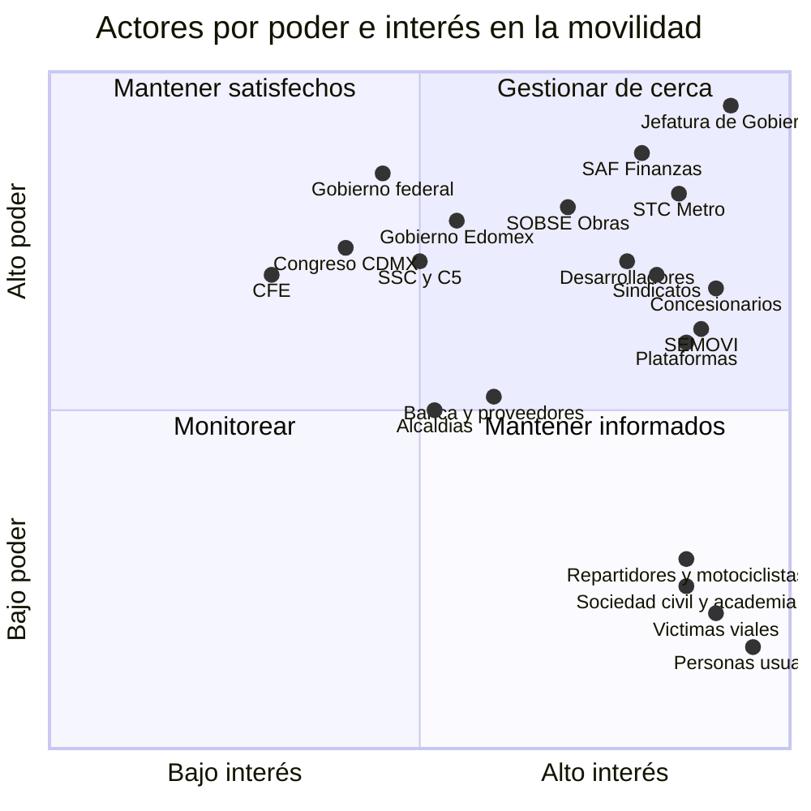

# Actores del sistema de movilidad

> Quién decide, quién opera, quién usa y quién presiona, consolidado de las tablas de actores de M1 a M8.
> Poder e interés son juicios de las dimensiones, ajustados para todo el sistema **[inferencia]**.

## Mapa de poder e interés

## Por grupo

| Grupo | Actores | Qué controlan | Postura dominante | Dimensiones |
|---|---|---|---|---|
| Gobierno de la ciudad | Jefatura de Gobierno, SAF, SEMOVI, SOBSE, IPDP, Secretaría de Vivienda, SEDEMA, SEGIAGUA, SGIRPC | Tarifa, presupuesto, concesiones, obra, planeación, vivienda, gestión de riesgos | Más inversión eléctrica y vivienda pública con tarifa del Metro congelada; planeación rezagada | M1-M8 |
| Operadores públicos | STC Metro, Metrobús, STE (Trolebús, Tren Ligero, Cablebús), RTP | Oferta, mantenimiento, accesibilidad, datos de afluencia | Modernización por línea; reactivos ante el clima y el hundimiento | M1, M5, M6 |
| Federación | Presidencia, SHCP, Banobras y Fonadin, SICT, ATTRAPI, SEDATU, IMSS, STPS, CFE, CONAGUA | Deuda, trenes metropolitanos (compró el Suburbano y opera el Tren Felipe Ángeles), Cablebús 4, vivienda, seguridad social de plataformas, energía y agua | Alineada políticamente con la ciudad; la coordinación depende de esa afinidad. Ya opera trenes urbanos con tarifa propia ([M1](dimensiones/M1-transporte-masivo.md)) | M1, M2, M4, M5, M7 |
| Estado de México y municipios | Gobierno estatal, SEMOV, municipios conurbados | Concesionado conurbado (tarifa de 14 pesos), suelo y vivienda, Mexibús, GTFS mexiquense | Coordinación desigual; absorbe el crecimiento | M2, M4, M5, M8 |
| Legisladores y jueces | Congreso de la CDMX, SCJN | Leyes, presupuesto, armonización con la ley general, tope a rentas, accesibilidad | Mayoría oficialista; reformas pendientes; fallos que obligan | M3, M4, M6, M7 |
| Alcaldías (16) | Gobiernos de alcaldía | Banquetas, vialidad secundaria, comercio en vía pública, mototaxis | Fragmentadas | M3, M4 |
| Operadores privados | Concesionarios hombre-camión y sus frentes; empresas de corredor (COTAXASA, COREVSA); taxis | Mayoría de los viajes en transporte público; poder de bloqueo | Piden tarifa o subsidio; resisten el recaudo central; algunos electrifican | M2, M8 |
| Plataformas | Uber, DiDi, inDrive, Rappi | Viajes, reparto, datos propios | Litigan la regulación; trasladan costos; autorregulan con IA | M2, M8 |
| Trabajadores | Sindicatos del Metro, del STE y de RTP; choferes; repartidores y motociclistas | Operación (poder de veto); última milla | Defienden condiciones. El sindicato del Metro ya fija la agenda de riesgo: advirtió que suspenderá tramos de la Línea A ([M1](dimensiones/M1-transporte-masivo.md)). Los choferes no tienen voz propia organizada | M1, M2, M7 |
| Mercado | Desarrolladores, plataformas de renta corta, banca, fintech (Mercado Pago), redes de pago (Visa, Mastercard), proveedores de trenes y autobuses (CRRC) | Suelo y vivienda, financiamiento, recaudo, tecnología | Buscan contratos largos y expansión | M4, M7, M8 |
| Seguridad | SSC, C5, Fiscalía, Guardia Nacional | Vigilancia, registro de víctimas | Más cámaras y analítica, sin marco público de uso | M3, M6, M8 |
| Sociedad civil y academia | Colectivos de víctimas viales, ITDP, WRI, Bicitekas, Liga Peatonal, colectivos feministas y de personas con discapacidad, inquilinos, UNAM, CENTRO | Evidencia, litigio, presión pública | Críticos: piden datos, seguridad vial, accesibilidad y justicia territorial | M3, M4, M6, M7 |
| Personas usuarias | Mujeres, personas mayores y con discapacidad, niñez y quienes cuidan, periferias, población migrante | Su elección de modo y su voto | Muy alto interés y casi ningún poder formal | M6 |

## Alianzas y conflictos que mueven los escenarios

| Tensión | Actores | Qué está en juego | Escenario que favorece cada lado |
|---|---|---|---|
| Tarifa contra financiamiento | Jefatura (tarifa como «programa social») frente a la necesidad de una fuente estable (SAF, operadores) | Quién paga la operación | Congelar: continuidad o colapso. Regla estable: disciplina o transformación |
| Recaudo central contra efectivo | SEMOVI y ADIP frente a los concesionarios | Datos, subsidio focalizado, tarifa integrada | Integrar: transformación. Mantener la dualidad: continuidad |
| Regular o tolerar la moto por app | Congreso (iniciativa de prohibición) frente a plataformas, motociclistas y usuarias de la periferia | Seguridad vial frente a ingreso y acceso | Prohibir sin alternativa: disciplina, con riesgo de informalidad. Integrar con reglas: transformación |
| Suelo central | Desarrolladores y plataformas de renta corta frente a inquilinos y gobierno | Expulsión y distancia de viaje | Mercado libre: continuidad. Captura de plusvalías y vivienda cerca del transporte: transformación |
| Ciudad contra federación y Edomex | Afinidad política frente a una autoridad formal | Integración metropolitana | Por proyecto: continuidad. Autoridad con fondo: transformación |
| Vigilancia contra privacidad | C5, plataformas y seguridad frente a sociedad civil | Uso de cámaras, biometría y datos de viaje | Control: disciplina. Datos abiertos y auditados: transformación |

## Quién falta en la mesa

- Las **personas usuarias de la periferia metropolitana**: viajan más, pagan más y no votan en la CDMX.
- Los **choferes del concesionado**: trabajan «por cuenta» y no tienen organización propia ([M2](dimensiones/M2-concesionado-informal-plataformas.md)).
- Las **personas mayores y con discapacidad**: la sentencia de la SCJN de 2023 sobre accesibilidad del Metro sigue sin cumplirse del todo ([M6](dimensiones/M6-personas-equidad-genero-seguridad.md)).
- Las **generaciones futuras**: la deuda de mantenimiento y la climática se transfieren a 2040 [inferencia].
