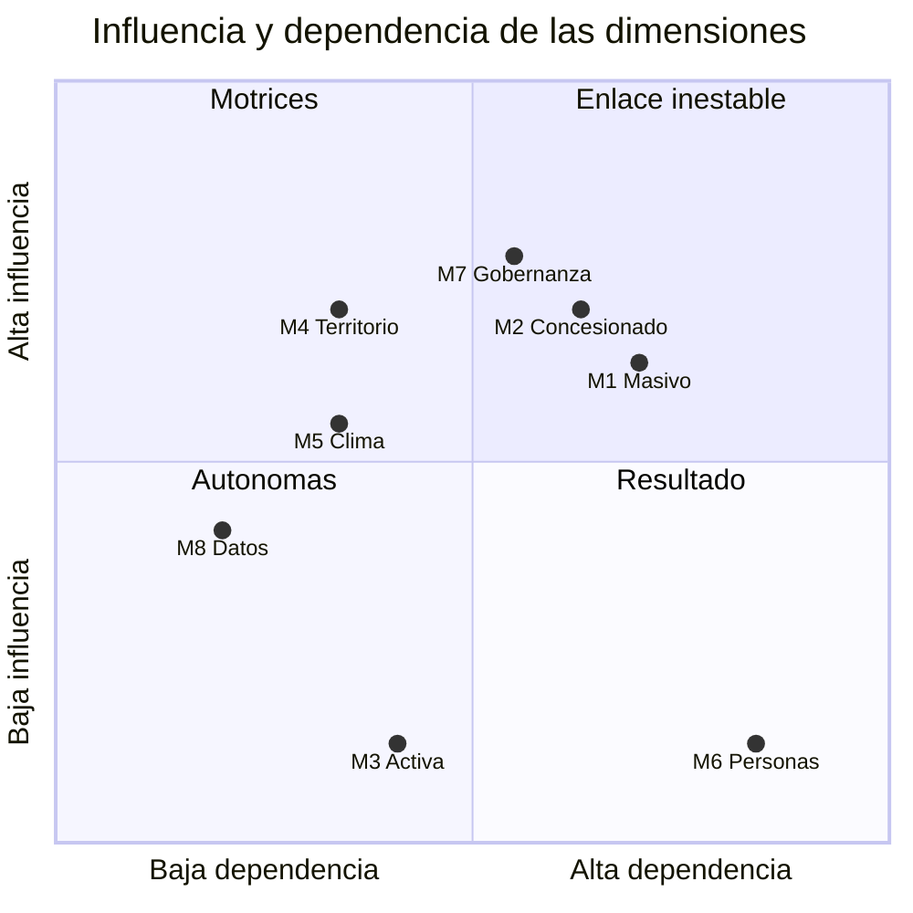

# Matriz de impacto cruzado entre dimensiones

> Cuánto influye cada dimensión sobre las demás al 2040, para distinguir las palancas (motrices), los nodos inestables (de enlace) y los resultados (dependientes).
> Es un juicio experto **[inferencia]**, sostenido por las conexiones sistémicas que documenta cada dimensión en su sección 9. Conviene recalibrarlo en taller.

## Escala

0 = sin influencia · 1 = débil · 2 = media · 3 = fuerte. Se lee de la fila (influye) a la columna (es influida).

## Matriz

| Influye ↓ / Es influida → | M1 | M2 | M3 | M4 | M5 | M6 | M7 | M8 | **Motricidad** |
|---|---|---|---|---|---|---|---|---|---|
| **M1** Transporte masivo | — | 3 | 1 | 2 | 2 | 3 | 2 | 1 | **14** |
| **M2** Concesionado, informal y plataformas | 2 | — | 3 | 1 | 2 | 3 | 2 | 2 | **15** |
| **M3** Movilidad activa y seguridad vial | 1 | 1 | — | 1 | 1 | 2 | 1 | 0 | **7** |
| **M4** Territorio, vivienda y metrópoli | 3 | 3 | 1 | — | 2 | 3 | 2 | 1 | **15** |
| **M5** Ambiente, energía, clima y riesgos | 3 | 1 | 2 | 2 | — | 2 | 2 | 1 | **13** |
| **M6** Personas usuarias | 1 | 1 | 1 | 1 | 0 | — | 2 | 1 | **7** |
| **M7** Gobernanza y finanzas | 3 | 3 | 2 | 2 | 2 | 2 | — | 2 | **16** |
| **M8** Tecnología, datos y logística | 2 | 2 | 1 | 1 | 1 | 2 | 2 | — | **11** |
| **Dependencia** | **15** | **14** | **11** | **10** | **10** | **17** | **13** | **8** | |

## Justificación de las relaciones fuertes (3)

| De → A | Por qué |
|---|---|
| M1 → M2 | La calidad del transporte masivo decide cuánta gente queda en el colectivo, la moto o las apps ([M2](dimensiones/M2-concesionado-informal-plataformas.md), §9; [M1](dimensiones/M1-transporte-masivo.md), §9) |
| M1 → M6 | Tiempo, saturación, accesibilidad y seguridad del viaje de la mayoría ([M6](dimensiones/M6-personas-equidad-genero-seguridad.md)) |
| M2 → M3 | La moto concentra 49% de las muertes viales ([M3](dimensiones/M3-movilidad-activa-espacio-publico.md)) |
| M2 → M6 | El colectivo define costo, tiempo e inseguridad en la periferia ([M6](dimensiones/M6-personas-equidad-genero-seguridad.md), T5) |
| M4 → M1 | La concentración del empleo central produce la saturación radial en hora pico ([M4](dimensiones/M4-territorio-vivienda-metropoli.md), §9) |
| M4 → M2 | La vivienda periférica sin transporte masivo depende del colectivo y de la moto ([M4](dimensiones/M4-territorio-vivienda-metropoli.md)) |
| M4 → M6 | La distancia entre vivienda y empleo es tiempo y gasto ([M6](dimensiones/M6-personas-equidad-genero-seguridad.md), §9) |
| M5 → M1 | Lluvia, calor y hundimiento cierran tramos y acortan la vida útil de la red ([M5](dimensiones/M5-ambiente-energia-clima-riesgos.md); [M1](dimensiones/M1-transporte-masivo.md), §9: marcha lenta por lluvia en toda la red en 2026) |
| M7 → M1 | Tarifa, subsidio, mantenimiento y obra ([M7](dimensiones/M7-gobernanza-finanzas-instituciones.md)). RTP lo muestra: con presupuesto, más unidades en operación y más pasajeros; sin presupuesto, lo contrario ([M1](dimensiones/M1-transporte-masivo.md), §9) |
| M7 → M2 | Concesiones, tarifa del colectivo, bonos y regulación de motos y apps ([M7](dimensiones/M7-gobernanza-finanzas-instituciones.md), [M2](dimensiones/M2-concesionado-informal-plataformas.md)) |

## Plano de influencia y dependencia

Medias: motricidad 12.25 y dependencia 12.25. Los ejes están centrados en esas medias: cada punto es 0.5 más la diferencia con la media, dividida entre 14.

| Grupo | Dimensiones | Lectura |
|---|---|---|
| **Motrices** (influyen mucho y dependen poco) | M4 Territorio, M5 Clima | Moldean el sistema desde afuera de la política de movilidad. No se resuelven con transporte, pero el transporte tiene que anticiparlas. Son las fuentes principales de incertidumbre al 2040 |
| **Enlace** (influyen y dependen mucho) | M7 Gobernanza, M2 Concesionado, M1 Masivo | Ahí está la palanca y también la inestabilidad: un cambio en ellas se propaga a todo el sistema. Son el centro de los escenarios |
| **Resultado** (dependen mucho e influyen poco) | M6 Personas usuarias | La experiencia de quien viaja es el resultado del sistema: el mejor tablero de monitoreo y lo que debe juzgar si un futuro es preferible |
| **Autónomas o de apoyo** | M3 Activa, M8 Datos | Influyen poco en el conjunto hoy, pero M8 es la condición para que M7 funcione (bucle R6 del mapa sistémico) y M3 es la base de un futuro de proximidad. Su peso puede crecer [inferencia] |

## Implicaciones

1. **Los ejes de los escenarios salen de las motrices y del enlace.** La capacidad institucional y financiera (M7, con M2 y M1) y la presión territorial y climática (M4 y M5) son las dos dimensiones que separan los futuros posibles. Ver [05-incertidumbres-comodines](../05-incertidumbres-comodines/README.md).
2. **El monitoreo se lee en M6.** Si el tiempo, el costo, la seguridad y la accesibilidad de las personas usuarias no mejoran, el sistema no está mejorando, aunque se inauguren kilómetros.
3. **M8 es la palanca subestimada.** Sin datos del concesionado ni recaudo electrónico, M7 no puede pagar por servicio, focalizar subsidios ni rendir cuentas.
