# Mapa sistémico de la movilidad en la Ciudad de México

> Cómo se conectan las dimensiones M1 a M8: qué variables pesan, qué bucles se refuerzan o se frenan, qué arquetipos se repiten y dónde están las palancas.
> Las cifras vienen de los documentos de cada dimensión, enlazados entre paréntesis. Las relaciones causales sin evidencia directa van marcadas **[inferencia]**.

## 1. Lectura en una página

1. **La continuidad no es estabilidad, es desgaste.** El sistema tiene más dinero que nunca: 43,749 millones de pesos en 2026, 14% del presupuesto **[inferencia]** ([M7](dimensiones/M7-gobernanza-finanzas-instituciones.md)). Pero está atrapado en dos bucles: una tarifa congelada que se compensa con subsidio y una preferencia por la obra nueva sobre el mantenimiento. Cada línea nueva agrega costo permanente **[inferencia]**.
2. **El concesionado es el nodo ciego.** Hacía 74% de los viajes en transporte público de la zona metropolitana en 2017 y recibía cerca de 4% de la inversión en 2022. Cobra en efectivo, no genera datos y su tarifa sube a saltos sin subsidio ([M2](dimensiones/M2-concesionado-informal-plataformas.md), [M8](dimensiones/M8-tecnologia-datos-logistica.md)). Ahí se decide la experiencia de la periferia.
3. **La moto es la válvula de escape del sistema.** Las viviendas con moto pasaron de 8.1% a 13.3% entre 2020 y 2025, y los motociclistas son casi la mitad de las muertes viales ([M2](dimensiones/M2-concesionado-informal-plataformas.md), [M3](dimensiones/M3-movilidad-activa-espacio-publico.md)). Cuando el transporte público falla, aumenta la moto, no el auto **[inferencia]**.
4. **El territorio alimenta la demanda desde fuera.** La mitad del personal ocupado (2023) está en tres alcaldías con 15% de la población (2020), y cada año salen de la ciudad más de 20 mil hogares, en promedio de dos décadas ([M4](dimensiones/M4-territorio-vivienda-metropoli.md)). El transporte carga con las consecuencias de una política de vivienda que no controla.
5. **El clima y el suelo ya son variables de operación.** Lluvias récord en 2025 y 2026, calor récord en 2024 y hundimientos de más de 2 cm al mes cierran tramos y desgastan la red ([M5](dimensiones/M5-ambiente-energia-clima-riesgos.md)). Ningún plan fija metas de resiliencia del transporte.
6. **Las personas usuarias son la variable de resultado.** Inseguridad, tiempo, costo y accesibilidad se acumulan en las mismas alcaldías y en las mismas personas: mujeres, personas mayores y periferia ([M6](dimensiones/M6-personas-equidad-genero-seguridad.md)). Dependen de casi todo y casi no influyen en las decisiones.

## 2. Variables clave

| # | Variable | Tipo | Dimensión | Estado reciente | Tendencia |
|---|---|---|---|---|---|
| V1 | Confiabilidad del transporte masivo | Auxiliar | M1 | 290 trenes del Metro en servicio, máximo desde 2009 (ago-2026, [M7](dimensiones/M7-gobernanza-finanzas-instituciones.md)). La Línea 3 operaba 40 de los 54 trenes que requiere (dic-2024). En una semana de octubre de 2026 hubo incidentes en cuatro líneas, y un incendio cerró 6 de las 12 estaciones de la Línea 9 ([M1](dimensiones/M1-transporte-masivo.md)). Hay cierres por lluvia cada temporada ([M5](dimensiones/M5-ambiente-energia-clima-riesgos.md)) | Mejora en oferta; empeora por clima y fallas |
| V2 | Mantenimiento diferido | Acervo | M1, M7 | Renovar una línea cuesta de 37 mil mdp (Línea 1) a más de 40 mil (Línea 3). La Línea 1 terminó unos 32 meses después de lo previsto, y la Línea 3 arranca en 2027 sin fecha de término. Al ritmo declarado, renovar 10 líneas llevaría hasta 2042 [inferencia] ([M1](dimensiones/M1-transporte-masivo.md)) | Se atiende por línea, no por sistema |
| V3 | Viajes en transporte público | Flujo | M1, M2 | Metro: 1,241.6 millones de viajes en 2025, 75% de los de 2019; crece de +0.6% a +1.5% anual en junio-agosto de 2026. RTP perdió 49% de pasajeros entre dic-2022 y dic-2024 y rebotó 22.5% al reponer autobuses (ago-2026) ([M1](dimensiones/M1-transporte-masivo.md)) | Meseta en el Metro; superficie eléctrica al alza |
| V4 | Tarifa real del Metro | Auxiliar | M7 | 5 pesos desde diciembre de 2013; costo de unos 13 pesos por viaje ([M7](dimensiones/M7-gobernanza-finanzas-instituciones.md)) | Baja en términos reales |
| V5 | Subsidio operativo | Flujo | M7 | Unos 9,900 mdp al año para el Metro [inferencia] ([M7](dimensiones/M7-gobernanza-finanzas-instituciones.md)) | Sube |
| V6 | Obra nueva | Flujo | M7, M1 | Cablebús 4 a 6 por más de 17,000 mdp; 100 de 140 km eléctricos ([M7](dimensiones/M7-gobernanza-finanzas-instituciones.md)) | Sube |
| V7 | Ingreso y tarifa del concesionado | Auxiliar | M2 | 7.50 pesos desde noviembre de 2025, sin subsidio; 14 pesos en el Edomex ([M2](dimensiones/M2-concesionado-informal-plataformas.md)) | Saltos negociados |
| V8 | Estado de la flota concesionada | Acervo | M2 | 2,500 unidades con vida útil vencida (2025) ([M2](dimensiones/M2-concesionado-informal-plataformas.md)) | Renovación detrás de la meta |
| V9 | Motorización en dos ruedas | Acervo | M2 | 13.3% de las viviendas con moto (2025); 822,871 motos registradas ([M2](dimensiones/M2-concesionado-informal-plataformas.md)) | Sube rápido |
| V10 | Muertes viales | Flujo | M3 | 424 en 2025; 49% motociclistas ([M3](dimensiones/M3-movilidad-activa-espacio-publico.md)) | Baja el total; sube la parte de la moto |
| V11 | Congestión | Auxiliar | M2, M7 | Primera del índice TomTom 2025, con 75.9% ([M7](dimensiones/M7-gobernanza-finanzas-instituciones.md)); otra edición da 52% y 152 horas perdidas al año ([M9](dimensiones/M9-futuros-existentes-y-casos.md)) **[por verificar]** | Alta y estable |
| V12 | Emisiones y ozono | Flujo | M5 | El transporte emite 58.3% de los GEI de la ZMVM (2018); 12 contingencias en 2024 ([M5](dimensiones/M5-ambiente-energia-clima-riesgos.md)) | Estable alta |
| V13 | Eventos climáticos extremos | Exógena | M5 | 84.5 mm en el Zócalo el 10 de agosto de 2025; 34.7 °C en mayo de 2024 ([M5](dimensiones/M5-ambiente-energia-clima-riesgos.md)) | Se intensifican |
| V14 | Hundimiento del suelo | Exógena | M5 | Más de 2 cm al mes en zonas críticas ([M5](dimensiones/M5-ambiente-energia-clima-riesgos.md)) | Sostenido |
| V15 | Rentas centrales | Auxiliar | M4 | Renta de vivienda +4.10% en la CDMX contra +3.32% nacional (2025); 31,430 anuncios de renta corta ([M4](dimensiones/M4-territorio-vivienda-metropoli.md)) | Suben |
| V16 | Expulsión de hogares | Flujo | M4 | Más de 20 mil hogares al año en promedio de dos décadas; 30 mil según la jefa de Gobierno (2025) ([M4](dimensiones/M4-territorio-vivienda-metropoli.md)) | Sostenida |
| V17 | Distancia y tiempo de viaje | Auxiliar | M4, M6 | 36% de los viajes al trabajo desde municipios conurbados dura más de una hora (2017) ([M4](dimensiones/M4-territorio-vivienda-metropoli.md)) | Probablemente sube [inferencia] |
| V18 | Inseguridad percibida en el transporte | Auxiliar | M6 | 61.1% en las ciudades del país; mujeres 66.6% (sep-2026) ([M6](dimensiones/M6-personas-equidad-genero-seguridad.md)) | Baja lenta |
| V19 | Recaudo electrónico y datos | Acervo | M8 | 81% de los viajes con TMI (2023; la fuente no precisa el universo, probablemente la red de gobierno [inferencia]); concesionado en efectivo ([M8](dimensiones/M8-tecnologia-datos-logistica.md)) | Dos velocidades |
| V20 | Confianza institucional | Acervo | M7, M6 | SEMOVI entregó tres informes con datos distintos (2025) ([M7](dimensiones/M7-gobernanza-finanzas-instituciones.md)) | Sin medición reciente |
| V21 | Coordinación metropolitana | Acervo | M7 | No hay autoridad ni fondo metropolitano de movilidad ([M7](dimensiones/M7-gobernanza-finanzas-instituciones.md)) | Por proyecto |
| V22 | Planeación vinculante | Acervo | M7, M4 | PGD y PGOT sin aprobar; plan metropolitano de 1998 ([M4](dimensiones/M4-territorio-vivienda-metropoli.md)) | Estancada |
| V23 | Reparto en moto y comercio electrónico | Flujo | M8, M2 | Motos: la mitad de las muertes viales; 37.3% compra en línea (nacional) ([M8](dimensiones/M8-tecnologia-datos-logistica.md)) | Sube |
| V24 | Accesibilidad | Acervo | M6, M1 | 184 elevadores en el Metro (2024); 76 de 195 estaciones accesibles en 2020 ([M6](dimensiones/M6-personas-equidad-genero-seguridad.md)) | Más lenta que el envejecimiento |
| V25 | Red de movilidad activa | Acervo | M3 | 573 km mapeados: 474 activos, 62 fuera de servicio y 37 en otra condición (ago-2024); 34 de 300 km nuevos, 17 por sentido en Tlalpan ([M3](dimensiones/M3-movilidad-activa-espacio-publico.md)) | Crece y se deteriora a la vez |

## 3. Diagrama general

Las flechas indican influencia: **+** quiere decir que las dos variables se mueven en el mismo sentido y **−**, en sentido contrario.

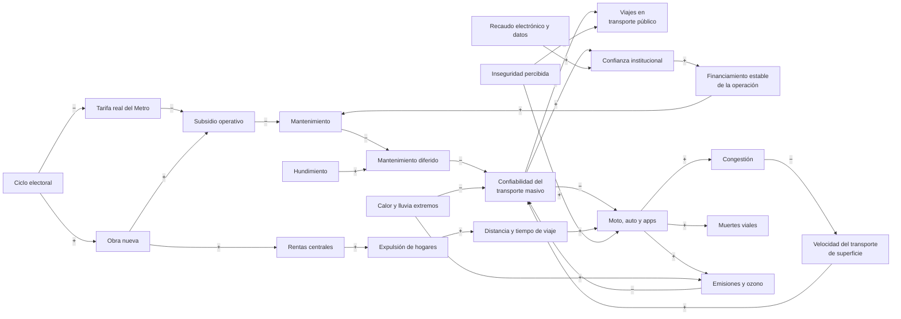

## 4. Bucles

### R1 · La espiral de la fuga (refuerzo)

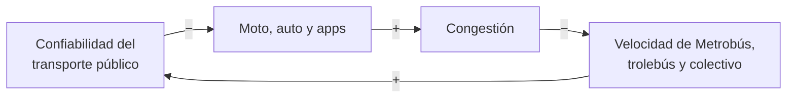

**Cómo funciona:** cuando el servicio falla, quien puede se va a la moto, al auto o a una app. Eso congestiona las calles, frena al transporte de superficie y vuelve a bajar la confiabilidad.

**Evidencia:**
- El escenario tendencial de P25 describe este desplazamiento ([P25](../estudios/P25-garcia-2025-futuros-transporte-publico.md)).
- RTP funciona como experimento natural del bucle en sentido inverso ([M1](dimensiones/M1-transporte-masivo.md)):
  - Cuando tenía entre 606 y 703 de sus 1,360 autobuses parados, perdió la mitad de sus pasajeros.
  - Al pasar de 690 a 900 unidades en operación, rebotó 22.5%.
  - La demanda responde a la oferta confiable **[inferencia]**. Una parte de la caída fue otra cosa: al terminar el servicio emergente de la Línea 12, sus pasajeros regresaron al Metro.
- La congestión es la más alta del índice TomTom ([M7](dimensiones/M7-gobernanza-finanzas-instituciones.md)).
- La moto crece más rápido que cualquier modo ([M2](dimensiones/M2-concesionado-informal-plataformas.md)).
- 23% de la población del país dejó de usar el transporte público por temor (ENVIPE) ([M6](dimensiones/M6-personas-equidad-genero-seguridad.md)).

**Demora:** media, de años.

**Qué lo frena:** carriles confinados que aíslan al transporte de la congestión y regulación de la moto. La moto barata, de unos 20 mil pesos, lo acelera ([M2](dimensiones/M2-concesionado-informal-plataformas.md)).

### R2 · Desplazamiento de la carga tarifaria (arquetipo)

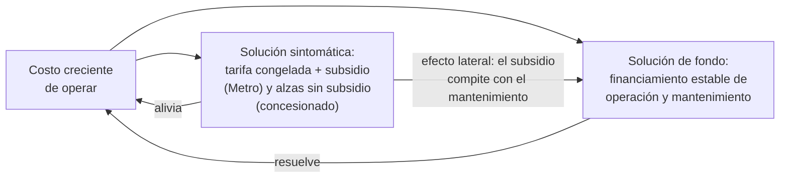

**Cómo funciona:**
- **Metro:** la tarifa de 5 pesos es un consenso político y se sostiene con subsidio, que crece cada año en términos reales.
- **Concesionado:** la tarifa sube a saltos y sin subsidio, bajo amenaza de bloqueo, y la renovación de flota queda sin fuente propia.

En los dos casos, la solución de fondo (una regla estable de financiamiento) se pospone. Así lo identifican [M7](dimensiones/M7-gobernanza-finanzas-instituciones.md) (T4, S-M7-04, S-M7-12) y [M2](dimensiones/M2-concesionado-informal-plataformas.md) (T3).

En el masivo, la consecuencia es la renovación a cuentagotas: cada línea cuesta de 37 mil mdp (Línea 1) a más de 40 mil (Línea 3), y la Línea 3 depende de una «coinversión» sin detalle público ([M1](dimensiones/M1-transporte-masivo.md), I1).

**Resultado:** un doble régimen. El ajuste lo pagan las periferias que dependen del colectivo, y el congelamiento, el presupuesto [inferencia].

**Demora:** larga. El efecto en el mantenimiento se nota años después.

### R3 · La obra inaugurable (refuerzo político)

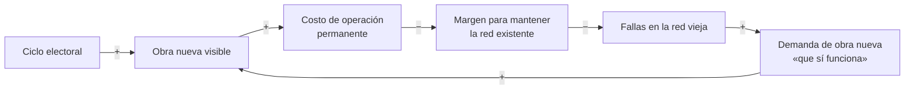

**Evidencia:**
- Los futuros oficiales son de obra (kilómetros, líneas, unidades), no de gobernanza ([M7](dimensiones/M7-gobernanza-finanzas-instituciones.md)).
- El urbanismo táctico y las ciclovías siguen el calendario de los eventos ([M3](dimensiones/M3-movilidad-activa-espacio-publico.md), D25-20).
- El Mundial adelantó obra sin costo consolidado ni balance de legado ([M7](dimensiones/M7-gobernanza-finanzas-instituciones.md)).
- Dejó 8,989 mdp en obras de movilidad, pero la afluencia del Metro apenas se movió: +1.5% en junio y +0.6% en julio ([M1](dimensiones/M1-transporte-masivo.md), S-M1-11).
- La fecha dura funciona en las dos direcciones ([M1](dimensiones/M1-transporte-masivo.md), T2):
  - Con la fecha del Mundial, el Tren Ligero llegó casi a tiempo.
  - Sin fecha, la Línea 1 terminó unos 32 meses tarde y la ampliación de la 12 lleva más de seis años de atraso.
  - Es una palanca útil si se aplica al mantenimiento y no solo a la inauguración [inferencia].

### R4 · La estación que expulsa (refuerzo territorial)

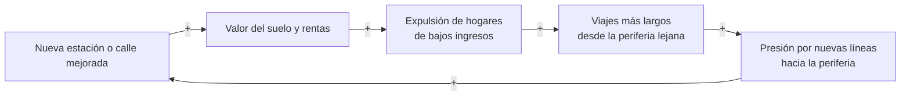

**Cómo funciona:** sin captura de plusvalías ni vivienda asequible cerca del transporte, cada mejora sube el precio del suelo y desplaza a quienes más necesitan el servicio. La ciudad termina persiguiendo con rieles a la población que expulsó.

**Evidencia:**
- La expulsión, la turistificación y la falta de instrumentos de suelo ([M4](dimensiones/M4-territorio-vivienda-metropoli.md)).
- El efecto de las mejoras de calle en el valor del suelo [inferencia] ([M3](dimensiones/M3-movilidad-activa-espacio-publico.md)).

### R5 · Clima y emisiones (refuerzo)

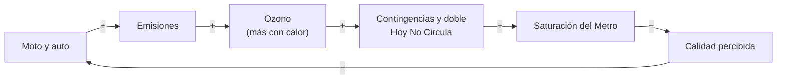

**Evidencia:**
- Cada grado adicional sube el ozono unas 4.7 ppb.
- Las contingencias saturan el Metro.
- Los túneles llegan a 38 °C.

Todo esto se documenta en [M5](dimensiones/M5-ambiente-energia-clima-riesgos.md).

### R6 · Datos que construyen confianza (refuerzo virtuoso, hoy débil)

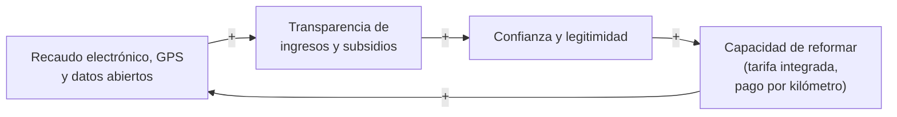

**Por qué está apagado:**
- El concesionado no está en el recaudo electrónico.
- El GTFS pasa más de un año sin actualizarse.
- El órgano de transparencia (INFO CDMX) ordenó a SEMOVI entregar datos de rutas.
- SEMOVI presentó informes contradictorios.

Ver [M8](dimensiones/M8-tecnologia-datos-logistica.md) y [M7](dimensiones/M7-gobernanza-finanzas-instituciones.md). Es el bucle que más vale encender, porque habilita a todos los demás [inferencia].

### R7 · El miedo que vacía (refuerzo social)

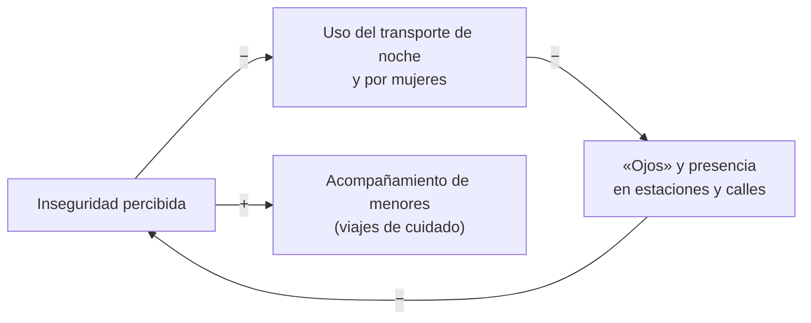

**Evidencia:**
- 44.7% de la población del país dejó de salir de noche por temor (ENVIPE).
- 57.3% de la población capitalina ya no deja salir solos a los menores.

Ver [M6](dimensiones/M6-personas-equidad-genero-seguridad.md). El vínculo entre menos presencia y más inseguridad es [inferencia], apoyada en la literatura urbana.

### B1 · Regulación reactiva (balance, con demora larga)

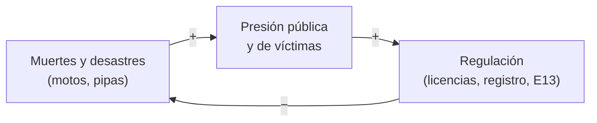

La regla llega después del daño y se aplica poco: unos 2,000 vehículos personales registrados un año después de la reforma ([M7](dimensiones/M7-gobernanza-finanzas-instituciones.md); [M8](dimensiones/M8-tecnologia-datos-logistica.md), S-M8-12; [M3](dimensiones/M3-movilidad-activa-espacio-publico.md), S-M3-13).

### B2 · La saturación como freno (límites al crecimiento)

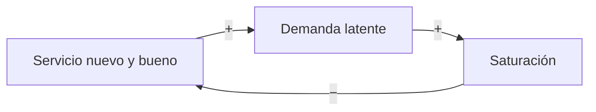

**Evidencia:**
- El Trolebús Elevado superó en 25% la demanda prevista (D25-23, sin fuente original) **[por verificar]**.
- Cada Ecobici hace 8.3 viajes diarios contra 4.5 previstos ([M3](dimensiones/M3-movilidad-activa-espacio-publico.md)).
- En mayo de 2026, Cablebús (+16.6%) y Trolebús (+41.7%) crecieron mientras otros sistemas caían ([M4](dimensiones/M4-territorio-vivienda-metropoli.md)).

Hay demanda esperando un servicio de calidad. El límite es la capacidad, no el interés [inferencia].

### B3 · Erosión de metas (arquetipo)

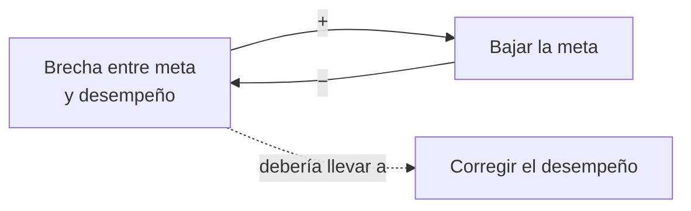

**Ejemplos:**
- Ciclovías: los únicos 34 km nuevos de los 300 prometidos son los de Tlalpan, anunciada con 50 km (17 por sentido) ([M3](dimensiones/M3-movilidad-activa-espacio-publico.md)).
- Sustitución de microbuses: de 5,800 a 2,500 unidades «chatarra» ([M2](dimensiones/M2-concesionado-informal-plataformas.md)).
- Ecobici: de 15 mil bicis para el Mundial a un contrato hasta 2036 ([M3](dimensiones/M3-movilidad-activa-espacio-publico.md)).
- PGD: seis años de retraso ([M7](dimensiones/M7-gobernanza-finanzas-instituciones.md)).

## 5. Presiones exógenas

Son variables que el sistema de movilidad no controla, pero que lo desgastan:

| Presión | Mecanismo | Dónde pega | Dimensión |
|---|---|---|---|
| Extracción del acuífero | Hundimiento diferencial: pendientes, frenado, inundación de vías, menor vida útil de los tramos elevados | Líneas 9, 3, A y 12; tramos elevados | [M5](dimensiones/M5-ambiente-energia-clima-riesgos.md) |
| Régimen de lluvia | Lluvias cortas e intensas que superan el drenaje | Indios Verdes, Pantitlán, Línea A, Cablebús | [M5](dimensiones/M5-ambiente-energia-clima-riesgos.md) |
| Calor | Ozono, contingencias, temperatura en vagones y andenes | Toda la red; salud de personas usuarias y operadoras | [M5](dimensiones/M5-ambiente-energia-clima-riesgos.md), [M6](dimensiones/M6-personas-equidad-genero-seguridad.md) |
| Mercado de vivienda y turismo | Rentas, renta corta, expulsión | Viajes radiales largos | [M4](dimensiones/M4-territorio-vivienda-metropoli.md) |
| Economía de plataformas | Reparto y viajes en moto como colchón de empleo | Seguridad vial, congestión | [M2](dimensiones/M2-concesionado-informal-plataformas.md), [M8](dimensiones/M8-tecnologia-datos-logistica.md) |
| Ciclo político y transferencias federales | 47% de los ingresos de 2025 fueron federales; elecciones en 2027 y 2030 | Obra, tarifa, planeación | [M7](dimensiones/M7-gobernanza-finanzas-instituciones.md) |

## 6. Puntos de apalancamiento

Ordenados de menor a mayor fuerza, según la jerarquía de Meadows (2008) [inferencia]:

| Nivel | Palanca | Qué cambiaría | Bucles que toca |
|---|---|---|---|
| Parámetros | Tarifas, límites de velocidad, bonos de sustitución | Efecto rápido pero limitado; se negocian cada vez | R2, B1 |
| Demoras | Monitoreo satelital del hundimiento y mantenimiento predictivo | Detectar el daño antes de la falla | R2, presiones de M5 |
| Bucles de balance | Fiscalización efectiva (registro de motos, velocidad) | Que la regla funcione antes del siguiente desastre | B1 |
| Flujos de información | Recaudo y GPS en el concesionado, GTFS en tiempo real, nueva encuesta origen-destino, informes consistentes | Encender R6: medir para pagar por servicio, focalizar subsidios y rendir cuentas | R6, R2 |
| Reglas | Regla de financiamiento de la operación: tarifa indexada con descuento focalizado, cargos al auto, captura de plusvalías, pago por kilómetro | Romper el desplazamiento de la carga | R2, R3, R4 |
| Estructura | Autoridad y fondo metropolitanos | Coordinar tarifa, rutas y datos entre la CDMX, el Edomex y la federación | R1, R2, R6 |
| Metas | Del «kilómetro inaugurado» al «acceso y desempeño» (tiempo de viaje, confiabilidad, seguridad, accesibilidad) | Cambiar lo que se premia | R3, B3 |
| Paradigma | De «más obra radial» a «red metropolitana que cuida»: proximidad, vivienda cerca del transporte, movilidad como derecho | Reordenar todo lo anterior | Todos |

## 7. Lo que el mapa todavía no sabe

- **Reparto modal actual:** no hay encuesta origen-destino desde 2017. La Intercensal 2025 solo da el medio de traslado al trabajo y a la escuela ([M3](dimensiones/M3-movilidad-activa-espacio-publico.md), [M6](dimensiones/M6-personas-equidad-genero-seguridad.md)).
- **Concesionado:** no hay padrón consistente; las cifras de rutas no cuadran (94, 139 o «unas 1,000») ([M2](dimensiones/M2-concesionado-informal-plataformas.md)).
- **Costo real por viaje de cada modo:** no hay metodología pública ([M7](dimensiones/M7-gobernanza-finanzas-instituciones.md)).
- **Horas de servicio perdidas por clima:** nadie las registra ([M5](dimensiones/M5-ambiente-energia-clima-riesgos.md)).
- **Temperatura en vagones y andenes, y golpes de calor:** no se miden ([M5](dimensiones/M5-ambiente-energia-clima-riesgos.md), [M6](dimensiones/M6-personas-equidad-genero-seguridad.md)).
- **Confianza institucional:** no hay medición reciente localizada ([M7](dimensiones/M7-gobernanza-finanzas-instituciones.md)).
- **Fallas del masivo:** no hay serie pública de incidentes ni de afluencia por línea. Tampoco se explican las caídas del Metrobús y del Suburbano ([M1](dimensiones/M1-transporte-masivo.md)).
- **Parque total del Metro:** 313 son los trenes disponibles según el Segundo Informe y 290 los que operaron en agosto de 2026 según la ETUP. El parque total no se publica **[por verificar]** ([M1](dimensiones/M1-transporte-masivo.md), [M7](dimensiones/M7-gobernanza-finanzas-instituciones.md)).
