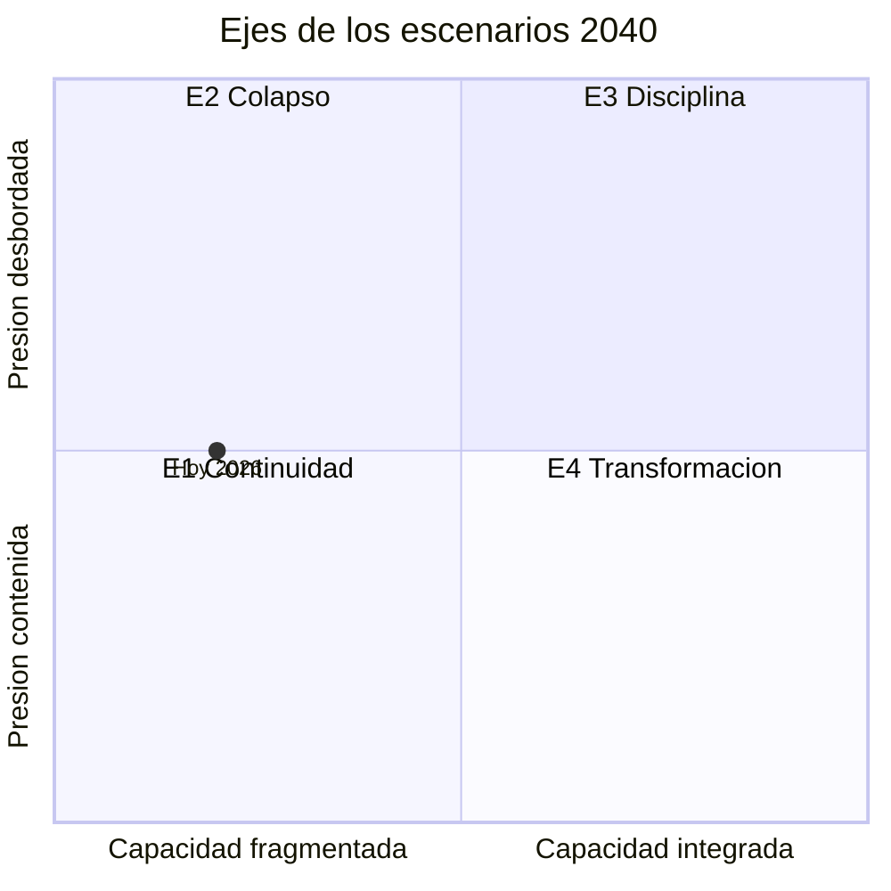

# 05 · Incertidumbres críticas y comodines

> Qué no se puede predecir y, aun así, define el futuro de la movilidad al 2040. Se consolidan aquí las incertidumbres de cada dimensión, se agrupan y se eligen los dos ejes que ordenan los escenarios.

## 1. Incertidumbres de las dimensiones

| Grupo | Incertidumbre | Extremos al 2040 | Dimensiones |
|---|---|---|---|
| **A. Financiamiento y gobierno** | ¿Quién paga la operación? | Tarifa simbólica y subsidio que se come el mantenimiento ↔ regla estable con tarifa indexada, descuento focalizado y fuentes dedicadas | [M7](../02-sistema-movilidad/dimensiones/M7-gobernanza-finanzas-instituciones.md) I1, [M2](../02-sistema-movilidad/dimensiones/M2-concesionado-informal-plataformas.md) I1, [M9](../02-sistema-movilidad/dimensiones/M9-futuros-existentes-y-casos.md) 7.1-1 |
| | ¿Alcanza el dinero para renovar el masivo? | Dinero por eventos y crisis: dos o tres líneas renovadas y deuda de mantenimiento creciente ↔ fondo multianual etiquetado que renueva casi todas las líneas antiguas | [M1](../02-sistema-movilidad/dimensiones/M1-transporte-masivo.md) I1 |
| | ¿Habrá gobierno metropolitano de la movilidad? | Proyectos sueltos según la afinidad partidista ↔ autoridad con fondo, tarifa y datos comunes | M7 I2, [M5](../02-sistema-movilidad/dimensiones/M5-ambiente-energia-clima-riesgos.md) 4, M1 I3, M9 7.1-2 |
| | ¿Se integra el concesionado? | Dualidad en efectivo y sin datos ↔ empresas con pago por kilómetro, recaudo integrado y GPS auditado | M7 I3, M2 I4, [M8](../02-sistema-movilidad/dimensiones/M8-tecnologia-datos-logistica.md) I1, M9 7.1-4 |
| | ¿Sobrevive la planeación a los ciclos de 2030 y 2036? | Planes declarativos y obra sexenal ↔ metas medibles, presupuesto multianual y evaluación independiente | M7 I4, [M4](../02-sistema-movilidad/dimensiones/M4-territorio-vivienda-metropoli.md) I3 |
| | ¿Se sostiene el flujo federal? | Choque fiscal o alternancia que deja obras a medias ↔ convergencia con fondos para trenes y cablebuses | M7 I5 |
| | ¿Quién gobierna los datos de movilidad? | Datos cerrados en plataformas y seguridad ↔ datos abiertos, anonimizados y auditados | M8 I2, M9 7.1-6 |
| **B. Territorio** | ¿Dónde se construye la vivienda asequible? | Menos de 40 mil viviendas, casi todas periféricas ↔ más de 150 mil cerca del transporte masivo | M4 I1 |
| | ¿Qué geografía del empleo? | Reconcentración central (más de 55%) ↔ metrópoli policéntrica (menos de 40% en las tres alcaldías centrales) | M4 I2 |
| | ¿Se captura el valor del suelo? | Zonificación por excepción y especulación junto a los rieles ↔ plusvalías que financian vivienda y transporte | M4 I3 |
| | ¿Turistificación regulada? | Más de 60 mil anuncios de renta corta ↔ padrones operando y menos de 15 mil | M4 I4 |
| **C. Clima y riesgos** | ¿Qué tan severo será el régimen de lluvia y calor, y alcanzará la adaptación? | Interrupciones semanales en cada temporada ↔ drenaje, infiltración y estaciones adaptadas | M5 3, [M3](../02-sistema-movilidad/dimensiones/M3-movilidad-activa-espacio-publico.md) I5, M1 I2, M9 7.1-3 |
| | ¿Cómo evoluciona el hundimiento? | 40 cm al año o más, con tramos del oriente cerrados más de un año ↔ menos de 5 cm al año con menor extracción y recarga | M5 2, M1 I2 |
| | ¿Electrificación con red resiliente? | Electrificación parcial sobre una red frágil, con paros simultáneos ↔ flota 100% eléctrica con redundancia y almacenamiento | M5 1, M8 I5 |
| **D. Demanda y modos emergentes** | ¿Se recupera la demanda del masivo o la sustituyen la moto y las apps? | Red de personas cautivas, con menos ingresos y menos presión política para invertir ↔ el masivo supera 2019 por confiabilidad y cobro a la congestión | M1 I4, M9 7.1-5 |
| | ¿Qué lugar ocupa la moto? | Masiva y sin control ↔ integrada y regulada, con licencia práctica, seguro y cupos | M2 I2, M3 I4 |
| | ¿Aguanta el trabajo de plataformas la reforma laboral? | Retirada e informalización ↔ formalización amplia | M2 I3 |
| | ¿Gestión de la velocidad o fiscalización reactiva? | Más de 600 muertes al año ↔ Visión Cero con menos de 150 | M3 I1 |
| | ¿Logística ordenada o desbordada? | Más motos y más muertes ↔ centros de consolidación y flotas eléctricas | M8 I4 |
| **E. Personas** (resultados) | ¿Convergen o divergen las periferias? | Brecha de más de 60 puntos en percepción de inseguridad ↔ menos de 15 | [M6](../02-sistema-movilidad/dimensiones/M6-personas-equidad-genero-seguridad.md) I1 |
| | ¿Qué modelo de asequibilidad? | Tarifa al costo con descuentos excluyentes ↔ tarifa integrada con tarifa social por ingreso | M6 I2 |
| | ¿Seguridad por diseño o por segregación? | Vagones exclusivos y cámaras con denuncia mínima ↔ acoso por debajo de 8% | M6 I3 |
| | ¿Llega la accesibilidad antes que el envejecimiento? | Menos de 60% de la red accesible ↔ 100% antes de 2035 | M6 I4 |
| | ¿Llega la red activa a la periferia y quién gobierna la banqueta? | Red concentrada en el centro y banqueta privatizada de hecho ↔ 1,500 km con 40% en la periferia y banqueta con un solo responsable | M3 I2, I3 |
| | ¿Se elimina el efectivo antes de cerrar la brecha digital? | Accesos solo digitales que excluyen ↔ tarjeta anónima y recarga en efectivo garantizadas | M8 I3 |

Ya están integradas las incertidumbres de las nueve dimensiones. Antes de usar los ejes conviene revisar los supuestos que [M9](../02-sistema-movilidad/dimensiones/M9-futuros-existentes-y-casos.md) propone cuestionar ([§7.3](../02-sistema-movilidad/dimensiones/M9-futuros-existentes-y-casos.md#73-supuestos-que-conviene-cuestionar)). Entre ellos están «la demanda seguirá creciendo» y «más obra trae más usuarios».

## 2. Los dos ejes

Los ejes salen de la [matriz de impacto cruzado](../02-sistema-movilidad/impacto-cruzado.md): uno del grupo de enlace (M7, M2, M1) y otro de las dimensiones motrices (M4, M5) **[inferencia]**.

| Eje | Polo bajo | Polo alto | Qué agrupa | Por qué se eligió |
|---|---|---|---|---|
| **1. Capacidad de gobernar la movilidad como sistema metropolitano** | Fragmentada y reactiva: tarifa congelada sin regla, concesionado en efectivo, planes sin aprobar, coordinación por afinidad | Integrada: regla de financiamiento, autoridad y fondo metropolitanos, recaudo y datos comunes, metas de desempeño | Grupos A y D | Es la palanca: está en las dimensiones de enlace, que más influyen y más dependen. Su dirección no está decidida |
| **2. Presión externa sobre el sistema** | Contenida: choques aislados y moderados (calor, lluvia, suelo, sismos, energía, finanzas externas), con tiempo para adaptarse | Desbordada: choques severos y encadenados, como un verano extremo con lluvias récord, hundimiento acelerado, un sismo o una recesión con recorte de transferencias federales | Grupos B y C | Viene de las motrices y del exterior, que el sistema de movilidad no controla. Define cuánta capacidad hace falta para no colapsar. Se mide con choques y no con resultados: las interrupciones, la expulsión o las contingencias dependen también de la respuesta, es decir, del eje 1 |

**Lógica de los cuatro cuadrantes:**

| Cuadrante | Escenario | Lógica |
|---|---|---|
| Capacidad fragmentada + presión contenida | **E1 Continuidad** | Desgaste gradual: el sistema aguanta porque los choques no son extremos, pero no se reforma |
| Capacidad fragmentada + presión desbordada | **E2 Colapso** | Choques que un sistema sin regla ni coordinación no puede absorber |
| Capacidad integrada + presión desbordada | **E3 Disciplina** | La capacidad se usa para imponer límites bajo emergencia: racionamiento, reglas duras, control |
| Capacidad integrada + presión contenida | **E4 Transformación** | La capacidad se usa de forma proactiva para cambiar el paradigma |

El punto «Hoy 2026» se calcula con el tablero núcleo de [09](../09-monitoreo/README.md#2-tablero-núcleo): capacidad 0.20, presión externa 0.50.

- **Dónde queda:** en la frontera entre la continuidad y el colapso. La capacidad sigue fragmentada, y la presión externa ya está en la línea media: la lluvia extrema rebasó su umbral, mientras el calor, el suelo, la red eléctrica y los sismos están en nivel tenso.
- **Qué significa:** el futuro probable no es E1 a secas, sino la frontera E1-E2. Si los choques se encadenan, la trayectoria tendencial cae en E2. Lo que la evita es subir la capacidad (eje 1), porque la presión no la controla la ciudad **[inferencia]**.
- **Qué no significa:** que el sistema haya colapsado. Los cuadrantes describen 2040; el punto marca hacia dónde empujan hoy las fuerzas.
- **Qué tan firme es la lectura:** depende sobre todo de la lluvia extrema. Si bajara un nivel, la presión quedaría en 0.42, del lado de E1.
- **Cambio de método:** una primera versión daba 0.60 porque mezclaba choques con resultados. Ver la nota de [09, §3](../09-monitoreo/README.md#3-ubicación-en-el-cuadrante).

## 3. Comodines

| Comodín | Efecto en la movilidad | Señal temprana | Dimensiones |
|---|---|---|---|
| Sismo mayor con daño en tramos elevados ya debilitados por el hundimiento | Cierre de líneas por meses; regreso masivo a la calle; aislamiento de personas mayores | Velocidad de hundimiento bajo los trazos; dictámenes estructurales | M5, M4, M6, M8 |
| Falla estructural con víctimas en el Metro o el Cablebús | Reconstrucción en lugar de obra nueva; caída de confianza; rendición de cuentas lenta | Mantenimiento diferido; trenes fuera de servicio | M7, M1, M6 |
| Inundación catastrófica del oriente (Pantitlán, Línea A) | Meses sin servicio en el nodo más cargado | Alertas púrpura; capacidad del drenaje | M5 |
| Apagón regional en plena onda de calor | Paro simultáneo de Metro, trolebuses, Cablebús, semáforos y bombeo | Fallas de subestaciones; demanda pico | M5 |
| «Día cero» de agua | Racionamiento, bloqueos, más pipas, abandono de conjuntos periféricos | Niveles del Cutzamala y del acuífero | M5, M4, M7 |
| Choque fiscal (recesión, aranceles, caída de participaciones) | Elegir entre subir la tarifa y recortar mantenimiento | Participaciones federales; recaudación del ISN | M7 |
| Paro metropolitano de transportistas o choque del precio del diésel | Millones sin transporte; quiebra de rutas; rescate o estatización de corredores | Amenazas de megabloqueo; precio del diésel | M2, M6 |
| Huelga prolongada en el Metro o el STE | Parálisis de la red troncal | Avisos de huelga (como el del STE en marzo de 2026) | M7 |
| Ciberataque o falla masiva del recaudo o del CBTC | Torniquetes inútiles, pérdida de ingresos, vuelta al efectivo | Incidentes de seguridad; dependencia de pocos proveedores | M8, M6 |
| Salida de una plataforma dominante | Pérdida de ingreso para cientos de miles; servicios sin registro | Litigios laborales; caídas en el registro del IMSS | M2 |
| Siniestro vial emblemático (por ejemplo, frente a una escuela) | «Momento Visión Cero»: reformas rápidas de velocidad y diseño | Muertes de motociclistas y peatones | M3 |
| Reforma metropolitana repentina (comodín positivo) | Autoridad con fondo propio: cambia quién decide y quién paga | Convenios ciudad-Edomex-federación | M7 |
| Caída del precio de las baterías o auto eléctrico nacional masivo (positivo) | Electrificación rápida del parque privado; presión sobre la red | Precio por kWh; ventas de eléctricos | M5 |
| Salto del trabajo remoto impulsado por IA | Caen 30% o más los viajes al centro; oficinas que se vuelven vivienda; menos ingreso tarifario | Ocupación de oficinas; afluencia en hora pico | M4, M7, M8 |
| Robotaxis o reparto autónomo a escala | Presión sobre taxis, plataformas y empleo de conducción; nuevas reglas de responsabilidad | Pilotos regulatorios | M8, M2 |
| Colapso de la renta corta | Se liberan de 15 a 20 mil viviendas completas en el centro | Crisis turística o fallo regulatorio | M4 |
