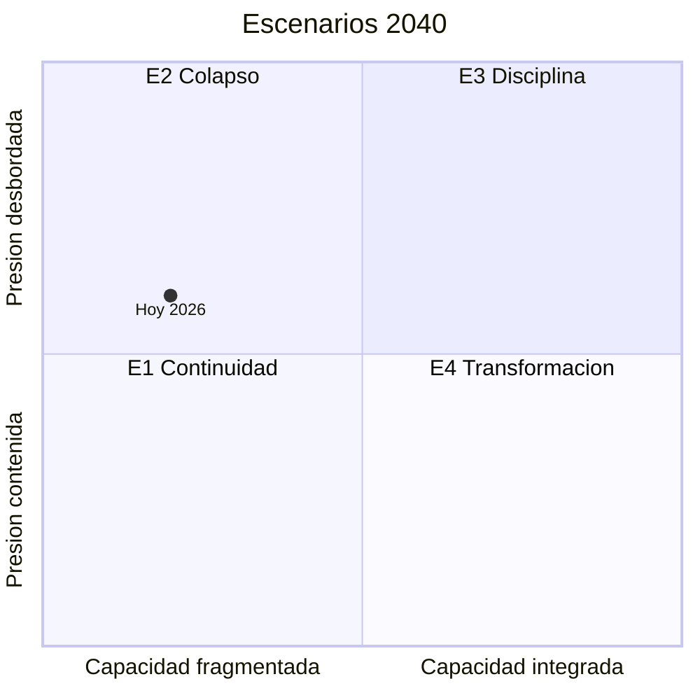

# 06 · Escenarios 2040 de la movilidad en la Ciudad de México

> Cuatro futuros plausibles de la movilidad de la ciudad al 2040, construidos con los arquetipos de Dator e integrando las nueve dimensiones del sistema.
> No son predicciones: sirven para probar decisiones de hoy contra futuros distintos.

## Los cuatro escenarios

| | [E1 · Continuidad](E1-continuidad.md) | [E2 · Colapso](E2-colapso.md) | [E3 · Disciplina](E3-disciplina.md) | [E4 · Transformación](E4-transformacion.md) |
|---|---|---|---|---|
| **Nombre** | «Islas eléctricas, red partida» | «El archipiélago» | «Pagar, registrar, cumplir» | «La red que cuida» |
| **En una línea** | Mucha obra y poca gobernanza: el centro mejora y la periferia sigue en micro y moto | Choques fiscales, climáticos y técnicos rompen una red con mantenimiento diferido | Tras crisis encadenadas, una autoridad fuerte impone reglas, cargos y contratos | Un pacto fiscal e institucional metropolitano convierte la movilidad en un servicio que cuida |
| **Capacidad de gobernar** | Fragmentada | Fragmentada | Integrada y vertical | Integrada y participativa |
| **Presión externa** | Tensa: choques frecuentes pero aislados | Desbordada: choques severos y encadenados | Desbordada entre 2027 y 2030; legitima los límites | Contenida: choques moderados, con tiempo para adaptarse |
| **En el cono de futuros** | **Probable**, en la frontera con E2 | Plausible; hacia aquí deriva la tendencia si los choques se encadenan | Plausible | Plausible y **preferible** (juicio de valor; ver [07](../07-futuro-preferible/README.md)) |
| **Escenario de P25** | *Tendential*, reinterpretado | *Collapse* | *Disciplinary* | *Transformative* |

## Cómo se construyeron

1. **Insumos:**
   - Las nueve dimensiones de [02-sistema-movilidad](../02-sistema-movilidad/README.md), cada una con sus propios escenarios 2040.
   - Las 40 señales del diccionario D25 y 99 señales nuevas de 2025-2026.
   - El póster P25.
2. **Estructura:** el [mapa sistémico](../02-sistema-movilidad/mapa-sistemico.md) y la [matriz de impacto cruzado](../02-sistema-movilidad/impacto-cruzado.md) identifican qué mueve al sistema.
3. **Ejes:** de las incertidumbres críticas salen dos ([05](../05-incertidumbres-comodines/README.md)):
   - Capacidad de gobernar la movilidad como sistema metropolitano.
   - Presión externa sobre el sistema: choques de clima, suelo, sismos, energía y finanzas que la movilidad no controla.
4. **Arquetipos:** se usan los de Dator, como en P25. Cada cuadrante de los ejes corresponde a un arquetipo.
5. **Integración:** las narrativas de cada dimensión se integran en un futuro de ciudad. Los indicadores 2040 retoman, cuando existen, los valores que propuso cada dimensión; todos son **[supuesto]**.

El punto «Hoy 2026» se calcula con el tablero núcleo de [09](../09-monitoreo/README.md#2-tablero-núcleo). Su lectura está en [05](../05-incertidumbres-comodines/README.md#2-los-dos-ejes).

## Cono de futuros

| Tipo | Qué incluye aquí |
|---|---|
| **Posibles** | Todo lo anterior más los comodines de [05](../05-incertidumbres-comodines/README.md#3-comodines): sismo mayor sobre tramos debilitados, «día cero» de agua, robotaxis a escala, autoridad metropolitana repentina |
| **Plausibles** | E1, E2, E3 y E4 |
| **Probable** | La frontera entre E1 y E2. Hoy la presión externa está en la línea media (0.50) y la capacidad, fragmentada (0.20) ([09](../09-monitoreo/README.md#3-ubicación-en-el-cuadrante)). Si los choques se encadenan, la tendencia cae en E2; subir la capacidad es lo que la evita **[inferencia]** |
| **Preferible** | E4, declarado como juicio de valor, con elementos de E3 que conviene adoptar (gestión de la velocidad, registro de motos, contratos de servicio). Ver [07](../07-futuro-preferible/README.md) |

## Comparación de indicadores 2040

Valores 2040 **[supuesto]**. La columna «Hoy» indica el último dato disponible y la dimensión donde se documenta su fuente.

| Indicador | Hoy | E1 | E2 | E3 | E4 |
|---|---|---|---|---|---|
| Viajes anuales en el Metro | 1,241.6 millones (2025, 75% de 2019, [M1](../02-sistema-movilidad/dimensiones/M1-transporte-masivo.md)) | Unos 1,330 millones | Menos de 1,000 millones | Unos 1,570 millones | Unos 1,800 millones |
| Trenes del Metro en operación | 290 (ago-2026, [M7](../02-sistema-movilidad/dimensiones/M7-gobernanza-finanzas-instituciones.md)) | 270 a 290 | Menos de 240 | Más de 300 | Más de 320 |
| Tarifa del Metro (pesos nominales) | 5, con costo de unos 13 ([M7](../02-sistema-movilidad/dimensiones/M7-gobernanza-finanzas-instituciones.md)) | 7 a 8 | Igual o mayor que su costo real tras una crisis | 15 indexada, con 50% de descuento focalizado | Tarifa integrada por tiempo, equivalente a 7.50 de 2026, más tarifa social por ingreso |
| Colectivo en los viajes en transporte público | 74% (ZMVM, 2017, [M2](../02-sistema-movilidad/dimensiones/M2-concesionado-informal-plataformas.md)) | 62% | 45% (lo informal cubre el hueco) | 70%, bajo contrato | 58%, integrado, de un transporte público que gana viajes |
| Viajes en transporte público pagados en electrónico | 81% (2023; red de gobierno [inferencia]); concesionado en efectivo ([M8](../02-sistema-movilidad/dimensiones/M8-tecnologia-datos-logistica.md)) | 65% | 40% | 90% | 90% con tope tarifario metropolitano |
| Viviendas con moto | 13.3% (2025, [M2](../02-sistema-movilidad/dimensiones/M2-concesionado-informal-plataformas.md)) | 24% | 35% | 17% | 20%, en su mayoría eléctricas |
| Muertes viales al año | 424, 49% motociclistas (2025, [M3](../02-sistema-movilidad/dimensiones/M3-movilidad-activa-espacio-publico.md)) | 420 a 480, con 55% a 60% motociclistas | 650 a 750 | 150 a 200 | Menos de 100 |
| Mujeres que se sienten inseguras en el transporte | 66.6% (ciudades del país, sep-2026, [M6](../02-sistema-movilidad/dimensiones/M6-personas-equidad-genero-seguridad.md)) | 55% | 80% | 40% | 30%, con brecha de género menor a 5 puntos |
| Viajes al trabajo de más de una hora desde municipios conurbados | 36% (2017, [M4](../02-sistema-movilidad/dimensiones/M4-territorio-vivienda-metropoli.md)) | 40% | 55% | 32% | Menos de 25%, con un tiempo medio al trabajo de 40 minutos |
| Hogares expulsados de la CDMX por año | Más de 20 mil, promedio de dos décadas ([M4](../02-sistema-movilidad/dimensiones/M4-territorio-vivienda-metropoli.md)) | 22 mil | 40 mil | 10 mil | Menos de 5 mil |
| Emisiones de GEI del transporte frente a 2018 | Base 2018: el transporte era 58.3% del total de la ZMVM ([M5](../02-sistema-movilidad/dimensiones/M5-ambiente-energia-clima-riesgos.md)) | Sin baja | Suben | −40% | −60% |
| Contingencias ambientales al año | 12 (2024); 5 en 2025, hasta agosto ([M5](../02-sistema-movilidad/dimensiones/M5-ambiente-energia-clima-riesgos.md)) | 6 a 10 | Más de 15 | 2 a 4 | 0 a 2 |
| Días de suspensión parcial del Metro por lluvia, por temporada | Sin dato ([M5](../02-sistema-movilidad/dimensiones/M5-ambiente-energia-clima-riesgos.md)) | 20 a 30 | Más de 60 | Unos 10 | Menos de 5 |
| Estaciones del Metro accesibles | 76 de 195 (2020, [M6](../02-sistema-movilidad/dimensiones/M6-personas-equidad-genero-seguridad.md)) | 75% | Elevadores al 50% de operación | 90% | 100% |
| Red ciclista | 573 km mapeados: 474 activos, 62 fuera de servicio y 37 en otra condición (ago-2024, [M3](../02-sistema-movilidad/dimensiones/M3-movilidad-activa-espacio-publico.md)) | Unos 850 km, 20% deteriorada | Menos de 400 km activos | Unos 1,000 km | 1,500 km, más de 40% en la periferia |
| Autoridad metropolitana de movilidad | No existe ([M7](../02-sistema-movilidad/dimensiones/M7-gobernanza-finanzas-instituciones.md)) | No; coordinación por proyecto | No; rescates según conveniencia política | Sí, con mando vertical | Sí, con fondo propio y al menos 30% de fuentes dedicadas |

Los valores que no vienen de una dimensión ni del archivo de cada escenario son supuestos propios de esta tabla: los trenes en operación de E1, E3 y E4; menos de 25% de viajes de más de una hora en E4; unos 10 días de suspensión en E3, y 90% de estaciones accesibles en E3.

## Personajes de las narrativas

Las cuatro narrativas siguen a las mismas tres personas, ficticias, para que los futuros se comparen desde la vida cotidiana:

| Personaje | Perfil en 2026 |
|---|---|
| **Rosa** | 52 años. Vive en Valle de Chalco (Estado de México) y limpia oficinas en Polanco. Hoy combina microbús, Metro y caminata: más de dos horas por trayecto |
| **Don Ernesto** | 78 años. Vive solo en la colonia Doctores (Cuauhtémoc) y va a su clínica y al mercado |
| **Daniela** | 24 años. Vive en San Miguel Teotongo (Iztapalapa) y reparte en moto para dos aplicaciones |

## Cómo usar estos escenarios

- **Para probar una decisión:** ¿funciona en los cuatro? Si solo funciona en uno, es una apuesta, no una estrategia robusta. Ver [08-estrategias](../08-estrategias/README.md).
- **Para vigilar:** las señales tempranas de cada escenario están en su archivo y en [09-monitoreo](../09-monitoreo/README.md).
- **Para talleres:** cada narrativa se puede leer en voz alta y discutir con las preguntas de la sección «Quién gana y quién pierde».
