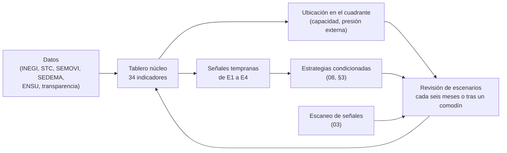
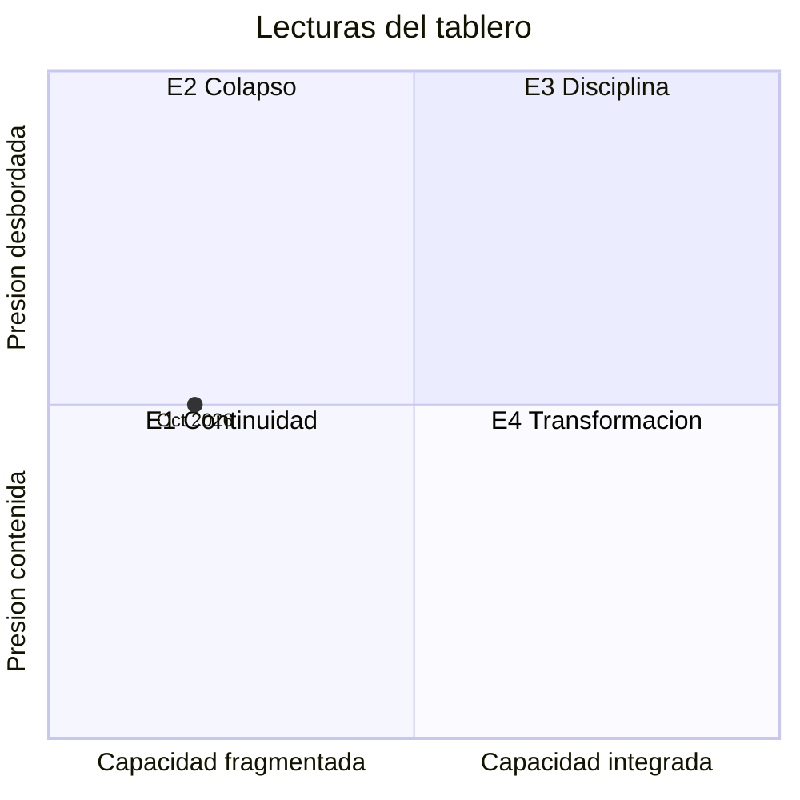

# 09 · Monitoreo

> Cómo saber hacia cuál escenario se mueve la ciudad:
> - Un tablero núcleo ubica cada año a la Ciudad de México en el cuadrante de escenarios.
> - Las señales tempranas de cada escenario activan estrategias.
> - La lista completa de indicadores sirve para analizar cada dimensión.
>
> Los umbrales de los niveles y las metas son **[supuesto]**: se proponen para discutir y se calibran con cada lectura. Las cifras vienen de las dimensiones enlazadas; cada una tiene su fuente en ese documento.

## 1. Cómo funciona

| Capa | Qué es | Para qué sirve |
|---|---|---|
| Tablero núcleo ([§2](#2-tablero-núcleo)) | 34 indicadores en cuatro bloques: 10 de capacidad, 6 de presión externa, 8 de desempeño bajo presión y 10 de resultados | Ubicar a la ciudad en los ejes de [05](../05-incertidumbres-comodines/README.md#2-los-dos-ejes) y seguir las metas de [07](../07-futuro-preferible/README.md) |
| Señales tempranas ([§4](#4-señales-tempranas-por-escenario)) | Las que cada escenario de [06](../06-escenarios-2040/README.md) define como aviso | Activar las estrategias condicionadas de [08](../08-estrategias/README.md#3-estrategias-condicionadas) |
| Lista completa ([§7](#7-lista-completa-por-dimensión)) | Los indicadores de la sección 12 de cada dimensión | Analizar cada dimensión a detalle |
| Escaneo de señales ([03](../03-senales/README.md)) | Señales débiles nuevas | Detectar lo que el tablero todavía no mide |

Los IDs de este documento (G, P, D, R) son locales. Desde otro documento se citan con prefijo, por ejemplo «09-R2», para no confundirlos con los bucles R del mapa sistémico.

## 2. Tablero núcleo

### Eje 1 · Capacidad de gobernar la movilidad como sistema metropolitano

0 = fragmentada · 1 = parcial · 2 = integrada.

| # | Indicador | Niveles (0 · 1 · 2) | Línea base | 2026 | Fuente y frecuencia |
|---|---|---|---|---|---|
| G1 | Programa General de Desarrollo (PGD) y Programa General de Ordenamiento Territorial (PGOT) aprobados | Ninguno · aprobados sin metas o sin presupuesto multianual · con metas, indicadores y presupuesto multianual | No aprobados (oct-2026) ([M7](../02-sistema-movilidad/dimensiones/M7-gobernanza-finanzas-instituciones.md), [M4](../02-sistema-movilidad/dimensiones/M4-territorio-vivienda-metropoli.md)) | 0 | Gaceta Oficial, Congreso de la CDMX · semestral |
| G2 | Ley de Movilidad armonizada con la ley general de 2022 | Pendiente · dictamen o reforma parcial · armonizada y con reglamento | Pendiente (oct-2026) ([M7](../02-sistema-movilidad/dimensiones/M7-gobernanza-finanzas-instituciones.md)) | 0 | Congreso de la CDMX · semestral |
| G3 | Regla de financiamiento de la operación | Sin regla ni fuentes etiquetadas · fuentes etiquetadas sin regla tarifaria · regla de ajuste y fuentes dedicadas por ley | Tarifa del Metro de 5 pesos desde 2013, sin regla. El punto adicional del ISN (de 3% a 4%) está etiquetado al FIMAS y las licencias permanentes pagan autobuses de RTP ([M7](../02-sistema-movilidad/dimensiones/M7-gobernanza-finanzas-instituciones.md), [M1](../02-sistema-movilidad/dimensiones/M1-transporte-masivo.md)) | 1 | Gaceta Oficial, Secretaría de Administración y Finanzas (SAF) · anual |
| G4 | Rendición de cuentas de fideicomisos y fuentes etiquetadas | Sin informe público · informe parcial · informe periódico con evaluación independiente | No se localizó informe público de aplicación del FIMAS ([M7](../02-sistema-movilidad/dimensiones/M7-gobernanza-finanzas-instituciones.md)) | 0 | SAF, Auditoría Superior de la CDMX · semestral |
| G5 | Coordinación metropolitana | Capas separadas · convenios parciales de tarjeta, datos o rutas · autoridad con fondo propio | Tres capas con tarifas y operadores separados. El nivel 1 se sostiene solo porque la Tarjeta MI funciona en el Tren Felipe Ángeles; el GTFS metropolitano todavía es una propuesta ([M1](../02-sistema-movilidad/dimensiones/M1-transporte-masivo.md), [M8](../02-sistema-movilidad/dimensiones/M8-tecnologia-datos-logistica.md)) | 1 | Convenios publicados, Gaceta Oficial · semestral |
| G6 | Integración del pago y de la tarifa | Medios separados · medio de pago común sin tarifa integrada · tarifa integrada por tiempo en la mayoría de los viajes | 81% de los viajes con Tarjeta MI (oct-2023; la fuente no precisa el universo, probablemente la red de gobierno [inferencia]); no se encontraron descuentos por transbordo ([M8](../02-sistema-movilidad/dimensiones/M8-tecnologia-datos-logistica.md), [M1](../02-sistema-movilidad/dimensiones/M1-transporte-masivo.md)) | 1 | SEMOVI, ADIP · anual |
| G7 | Recaudo electrónico en el concesionado | Menos de 25% de las unidades · de 25% a 75% · más de 75% | No hay dato público del porcentaje, pero está documentado que el concesionado opera en efectivo ([M2](../02-sistema-movilidad/dimensiones/M2-concesionado-informal-plataformas.md), [M8](../02-sistema-movilidad/dimensiones/M8-tecnologia-datos-logistica.md)) | 0 [inferencia] | ORT-SEMOVI · anual |
| G8 | Datos abiertos de operación | GTFS con más de 12 meses · GTFS al día y tiempo real en algunos sistemas · tiempo real en todos | Última versión en mar-2026, tras casi 15 meses sin actualizar; tiempo real solo en Metrobús ([M8](../02-sistema-movilidad/dimensiones/M8-tecnologia-datos-logistica.md)) | 1 | Mobility Database, datos.cdmx.gob.mx · trimestral |
| G9 | Encuesta origen-destino vigente | Más de 8 años · levantamiento en curso · menos de 5 años, con módulos de cuidados y percepción | La última es de 2017 ([M4](../02-sistema-movilidad/dimensiones/M4-territorio-vivienda-metropoli.md)) | 0 | INEGI · al publicarse |
| G10 | Registro de motos y vehículos eléctricos personales | Menos de 20% del universo estimado · de 20% a 60% · más de 60% | Unos 2,000 vehículos personales registrados (ago-2026) ([M7](../02-sistema-movilidad/dimensiones/M7-gobernanza-finanzas-instituciones.md)) | 0 | SEMOVI · semestral |
| | **Puntaje del eje** | | | **4 de 20 = 0.20** | |

### Eje 2 · Presión externa sobre el sistema

Mide los choques que el sistema de movilidad no controla: clima, suelo, sismos, energía y finanzas externas. No incluye resultados que la política puede mover, como las contingencias, la saturación o la expulsión de hogares; esos van en el bloque de desempeño. Así el tablero puede distinguir una buena respuesta (E3, E4) de una presión leve.

0 = contenida (choques aislados) · 1 = tensa · 2 = desbordada (choques severos o encadenados).

| # | Indicador | Niveles (0 · 1 · 2) | Línea base | 2026 | Fuente y frecuencia |
|---|---|---|---|---|---|
| P1 | Días de calor extremo entre marzo y junio | Menos de 30 · de 30 a 75 · más de 75, o una onda de calor de 15 días | 40 (2025); 76 en 2024 ([M5](../02-sistema-movilidad/dimensiones/M5-ambiente-energia-clima-riesgos.md)) | 1 | SMN · anual |
| P2 | Lluvia extrema | Ninguna alerta púrpura · una o dos · tres o más, o más de 1,000 mm al año | 5 alertas púrpura y 1,085 mm de enero a noviembre de 2025 ([M5](../02-sistema-movilidad/dimensiones/M5-ambiente-energia-clima-riesgos.md)) | 2 | SEGIAGUA, SGIRPC, CONAGUA · anual |
| P3 | Hundimiento | Sin puntos de más de 1 cm al mes · puntos de más de 1 cm al mes · aceleración sostenida o nuevos puntos de más de 2 cm al mes bajo las vías | Más de 2 cm al mes en zonas críticas; no hay serie bajo las vías ([M5](../02-sistema-movilidad/dimensiones/M5-ambiente-energia-clima-riesgos.md), [M1](../02-sistema-movilidad/dimensiones/M1-transporte-masivo.md)) | 1 [inferencia] | NISAR, Instituto de Geofísica de la UNAM · trimestral |
| P4 | Fallas de la red eléctrica que detienen el transporte masivo | Ninguna · una o dos al año · tres o más | Una en 2025, un cortocircuito por agua en la Línea 2. La de 2026 vino del sismo y cuenta en P5 ([M5](../02-sistema-movilidad/dimensiones/M5-ambiente-energia-clima-riesgos.md)) | 1 | STC, CFE, CENACE · por evento |
| P5 | Sismos con daño en la red de transporte | Sin daño · daño menor sin cierre de tramos · cierre de tramos o daño estructural | Sismo de 6.5 del 2-ene-2026: semáforos caídos y explosión de una subestación, sin cierre de tramos ([M5](../02-sistema-movilidad/dimensiones/M5-ambiente-energia-clima-riesgos.md)) | 1 | Servicio Sismológico Nacional, STC · por evento |
| P6 | Choque fiscal externo | Sin choque · recorte de transferencias federales o alza fuerte del diésel · recesión con recorte de transferencias | Presupuesto 2026 aprobado sin cambios y 13% mayor que el de 2025; 47% de los ingresos son federales ([M7](../02-sistema-movilidad/dimensiones/M7-gobernanza-finanzas-instituciones.md)) | 0 [inferencia] | SHCP, SAF · anual |
| | **Puntaje del eje** | | | **6 de 12 = 0.50** | |

### Desempeño bajo presión

No entran en los ejes: muestran cómo absorbe la presión el sistema. Con capacidad fragmentada empeoran (E1, E2); con capacidad integrada mejoran aunque la presión siga alta (E3) o baje (E4).

| # | Indicador | Línea base | Alerta | Fuente y frecuencia |
|---|---|---|---|---|
| D1 | Contingencias ambientales por año | 5 en 2025, contadas hasta agosto; 12 en 2024; al menos 6 entre enero y abril de 2026 ([M5](../02-sistema-movilidad/dimensiones/M5-ambiente-energia-clima-riesgos.md)) | 10 o más en un año, o cualquier Fase II | CAMe, SEDEMA · anual |
| D2 | Suspensiones del Metro por clima | No hay dato consolidado. En 2026 hubo marcha lenta por lluvia en todas las líneas ([M1](../02-sistema-movilidad/dimensiones/M1-transporte-masivo.md), [M5](../02-sistema-movilidad/dimensiones/M5-ambiente-energia-clima-riesgos.md)). Para la Línea A, un recuento de prensa citado por el equipo da al menos 14 suspensiones por lluvia en 2025 ([Infobae, 1-ene-2026](https://www.infobae.com/mexico/2026/01/01/linea-a-del-metro-cdmx-registra-nuevo-record-en-2025-por-las-veces-que-suspendio-servicio/)) **[por verificar]** | Más de 20 días-línea por temporada | STC, por transparencia · por temporada |
| D3 | Interrupciones graves del transporte masivo | Incidentes en cuatro líneas en una semana de oct-2026; un incendio cerró 6 de las 12 estaciones de la Línea 9 ([M1](../02-sistema-movilidad/dimensiones/M1-transporte-masivo.md)) | Más de cuatro incidentes por semana con suspensión de más de una hora, o tramos cerrados más de un mes | Avisos del STC, prensa · semanal |
| D4 | Saturación: pasajeros por kilómetro recorrido en la zona metropolitana | 5.8 (jun-2026) [inferencia] ([M1](../02-sistema-movilidad/dimensiones/M1-transporte-masivo.md)) | Más de 6.2 | INEGI, ETUP · mensual |
| D5 | Congestión vial | 152 horas perdidas al año y 13 km/h (índice TomTom, [M1](../02-sistema-movilidad/dimensiones/M1-transporte-masivo.md)). El nivel de congestión cambia según la edición del índice: 52% ([M9](../02-sistema-movilidad/dimensiones/M9-futuros-existentes-y-casos.md)) o 75.9% ([M7](../02-sistema-movilidad/dimensiones/M7-gobernanza-finanzas-instituciones.md)) **[por verificar]** | Más de 150 horas al año | TomTom Traffic Index · anual |
| D6 | Hogares que se van de la CDMX | Más de 20 mil al año en promedio de dos décadas; 30 mil según la jefa de Gobierno (2025) ([M4](../02-sistema-movilidad/dimensiones/M4-territorio-vivienda-metropoli.md)) | Más de 30 mil | CONAPO, censo · anual o quinquenal |
| D7 | Anuncios activos de renta corta | 31,430 (jun-2026) ([M4](../02-sistema-movilidad/dimensiones/M4-territorio-vivienda-metropoli.md)) | Más de 35 mil | Inside Airbnb, padrón de anfitriones · trimestral |
| D8 | Viajes al trabajo de más de una hora desde municipios conurbados | 36% (2017) ([M4](../02-sistema-movilidad/dimensiones/M4-territorio-vivienda-metropoli.md)) | Más de 40% | Encuesta origen-destino, censo · al publicarse |

### Resultados para las personas y desempeño de la red

Tampoco entran en los ejes: miden si la ciudad avanza hacia el [futuro preferible](../07-futuro-preferible/README.md).

| # | Indicador | Línea base | Meta 2030 [supuesto] | Alerta | Fuente y frecuencia |
|---|---|---|---|---|---|
| R1 | Tiempo medio de viaje al trabajo | 54 min (EOD 2017, ajuste de WRI) ([M6](../02-sistema-movilidad/dimensiones/M6-personas-equidad-genero-seguridad.md)) | 50 min | Sube en la nueva encuesta origen-destino | Encuesta origen-destino · al publicarse |
| R2 | Costo diario de pasajes de una persona sobre el ingreso de su hogar (decil I) | Entre 6.6% y 10.9% [inferencia] ([M6](../02-sistema-movilidad/dimensiones/M6-personas-equidad-genero-seguridad.md)) | 8% | Tarifa mínima del colectivo por arriba de 3% del salario mínimo diario | ENIGH · bienal |
| R3 | Mujeres que se sienten inseguras en el transporte | 66.6% en las ciudades del país (sep-2026) ([M6](../02-sistema-movilidad/dimensiones/M6-personas-equidad-genero-seguridad.md)) | 55% | Más de 70%, o brecha con los hombres de más de 15 puntos | ENSU · trimestral |
| R4 | Muertes viales | 424 (2025), 49% de ellas motociclistas ([M3](../02-sistema-movilidad/dimensiones/M3-movilidad-activa-espacio-publico.md)) | Unas 212, la meta oficial de reducir las muertes a la mitad ([M3](../02-sistema-movilidad/dimensiones/M3-movilidad-activa-espacio-publico.md)) | Más de 480, o motociclistas por arriba de 55% | SEMOVI, SSC · trimestral |
| R5 | Estaciones del Metro accesibles | 76 de 195 (2020); 184 elevadores (2024) ([M6](../02-sistema-movilidad/dimensiones/M6-personas-equidad-genero-seguridad.md)) | 75% | Menos de 15 elevadores nuevos al año | STC, por transparencia · semestral |
| R6 | Viajes del Metro frente a 2019 | 75% (2025) ([M1](../02-sistema-movilidad/dimensiones/M1-transporte-masivo.md)) | 85% | Menos de 72%, o tres años sin crecer | STC, INEGI · anual |
| R7 | Trenes del Metro en operación | 290 (ago-2026) ([M7](../02-sistema-movilidad/dimensiones/M7-gobernanza-finanzas-instituciones.md)) | Más de 300 | Menos de 270 | INEGI, ETUP · mensual |
| R8 | Autobuses de RTP en operación | Unos 900 (ago-2026) ([M1](../02-sistema-movilidad/dimensiones/M1-transporte-masivo.md)) | 1,200 o más | Menos de 750 | RTP, por transparencia · trimestral |
| R9 | Viviendas con moto | 13.3% (2025) ([M2](../02-sistema-movilidad/dimensiones/M2-concesionado-informal-plataformas.md)) | Menos de 15% | Más de 18% | INEGI · quinquenal |
| R10 | Emisiones de gases de efecto invernadero del transporte | Base 2018: el transporte era 58.3% del total de la zona metropolitana ([M5](../02-sistema-movilidad/dimensiones/M5-ambiente-energia-clima-riesgos.md)) | −20% frente a 2018 | Sin baja en el siguiente inventario | SEDEMA · cada dos años |

El dato de R3 es nacional urbano. Para tener una serie propia de la CDMX, hay que procesar los microdatos de la ENSU de las 16 alcaldías **[por verificar]**.

**Seguimiento de las metas de [07](../07-futuro-preferible/README.md#2-visión-2040):**

| Compromiso de 07 | Tiempo | Asequibilidad | Integración | Seguridad personal | Seguridad vial | Accesibilidad | Clima | Resiliencia | Territorio | Gobierno |
|---|---|---|---|---|---|---|---|---|---|---|
| Indicador | R1 | R2 | G6 | R3 | R4 | R5 | R10 | D2 | D6 | G5 |

## 3. Ubicación en el cuadrante

**Cálculo:** cada eje vale la suma de sus niveles dividida entre el máximo posible, que es 2 por cada indicador con dato. Los indicadores sin dato no se puntúan y se reportan como hueco. Los que se puntúan con evidencia parcial llevan [inferencia].

| Lectura | Capacidad | Presión externa | Cuadrante | Nota |
|---|---|---|---|---|
| Oct-2026 | 0.20 | 0.50 | En la frontera entre E1 y E2 | Primera lectura. La interpretación está en [05](../05-incertidumbres-comodines/README.md#2-los-dos-ejes) |

**Cambio de método.** La primera versión del eje 2 mezclaba choques externos con resultados que la política mueve, como contingencias, congestión, renta corta y expulsión de hogares, y daba una presión de 0.60. La verificación de consistencia mostró dos problemas: con esa escala, E1 caía en el cuadrante de E2 y E3 en el de E4, y el tablero no podía distinguir una buena respuesta de una presión leve. Por eso se separaron los choques (P) del desempeño (D) ([AUDITORIA](../fuentes/AUDITORIA.md)).

**Qué tan firme es la lectura:**
- **Presión.** Depende sobre todo de P2, la lluvia extrema. Si bajara a 1, la presión quedaría en 0.42, del lado de E1. Un año con calor extremo y fallas eléctricas encadenadas (P1 y P4 en 2) la llevaría a 0.67, del lado de E2.
- **Capacidad.** No cruzaría la mitad ni con G7, G9 y G10 en nivel 1: subiría a 0.35. Las palancas de mayor peso sistémico son G1, G3 y G5: el plan, la regla de financiamiento y la autoridad metropolitana. En nivel 2 llevarían la capacidad a 0.40 por sí solas y arrastrarían a los demás indicadores **[inferencia]**.
- **Dónde caería cada escenario en 2040 con estos niveles [supuesto]:**

| Escenario | Choques que supone | Presión |
|---|---|---|
| E1 | Aislados | Entre 0.33 y 0.42 |
| E2 | Severos y encadenados | Unos 0.92 |
| E3 | Severos entre 2027 y 2030 | Unos 0.75 |
| E4 | Moderados | Unos 0.25 |

## 4. Señales tempranas por escenario

Vienen de cada escenario de [06](../06-escenarios-2040/README.md). Si se cumplen dos o más del mismo escenario, se activa su estrategia condicionada ([08, §3](../08-estrategias/README.md#3-estrategias-condicionadas)) **[supuesto]**. «09 §7, Mx» remite a la lista completa de esta página, en la dimensión indicada.

| Escenario | Señal temprana | Indicador |
|---|---|---|
| [E1 Continuidad](../06-escenarios-2040/E1-continuidad.md) | El PGD se aprueba sin metas ni presupuesto multianual | G1 |
| | No hay regla de ajuste tarifario al cierre de 2028 | G3 |
| | Se sustituyen menos de 400 unidades concesionadas al año | 09 §7, M2 · Unidades con vida útil vencida |
| | El GTFS pasa más de 12 meses sin actualizarse | G8 |
| | Los motociclistas superan 55% de las muertes viales | R4 |
| [E2 Colapso](../06-escenarios-2040/E2-colapso.md) | Los viajes del Metro caen más de 5% en un año | 09 §7, M7 · Viajes en Metro |
| | Hay menos de 270 trenes en operación | R7 |
| | El servicio de la deuda supera 15% de los ingresos propios | 09 §7, M7 · Servicio de la deuda |
| | Ocurren tres o más fallas eléctricas al año que detienen el transporte masivo | P4 |
| | Hay más de 20 días-línea de suspensión por lluvia en una temporada | D2 |
| | Hay más de dos megabloqueos de transportistas al año | 09 §7, M2 · Megabloqueos o paros |
| [E3 Disciplina](../06-escenarios-2040/E3-disciplina.md) | Se aprueba un cargo por congestión o una zona de bajas emisiones | Sin indicador: hay que agregarlo a la sección 12 de M5 |
| | Entra al Congreso una ley de indexación tarifaria con subsidio focalizado | G3 |
| | El registro de motos supera la mitad del universo estimado | G10 |
| | Se crea por decreto una autoridad metropolitana después de una crisis | G5 |
| | Se usa reconocimiento facial en el transporte, con o sin marco legal | 09 §7, M8 · Cámaras del C5 y usos analíticos |
| [E4 Transformación](../06-escenarios-2040/E4-transformacion.md) | Se crea por convenio o por ley un fondo metropolitano con fuentes dedicadas | G5 |
| | Se firman los primeros contratos de pago por kilómetro en corredores concesionados | Sin indicador: hay que agregarlo a la sección 12 de M2 |
| | Todos los sistemas publican GTFS en tiempo real | G8 |
| | Se levanta una nueva encuesta origen-destino con módulo de cuidados | G9 |
| | Hay vivienda pública a menos de 800 m de estaciones, financiada con plusvalías | 09 §7, M4 · Vivienda para el Bienestar a más de 1 km (mide lo contrario) |
| | La brecha de inseguridad entre alcaldías baja dos años seguidos | 09 §7, M6 · Brecha entre la alcaldía más y la menos insegura |

## 5. Ciclo de monitoreo

| Cada | Qué se hace | Dónde se registra |
|---|---|---|
| Mes o trimestre | Actualizar los indicadores con datos nuevos: ETUP, ENSU, reportes de SEMOVI, avisos del STC | Este documento, columna 2026 o la del año en curso |
| Seis meses, o tras un comodín | Recalcular los ejes, agregar una fila a [§3](#3-ubicación-en-el-cuadrante), revisar las señales tempranas, el tablero de [03](../03-senales/README.md), los escenarios y las estrategias, como pide el [método](../00-marco/metodo.md) | §3, [06](../06-escenarios-2040/README.md), [08](../08-estrategias/README.md) y [BITACORA](../BITACORA.md) |
| Cuando se publiquen la encuesta origen-destino, el censo, la ENIGH o el inventario de emisiones | Actualizar G9, D8, R1, R2 y R10, y recalibrar los niveles | Este documento |

## 6. Huecos de información

Indicadores que hoy no se pueden medir, o que se puntúan con evidencia parcial. Cerrarlos es parte de la estrategia S2 de [08](../08-estrategias/README.md).

| Hueco | Afecta a | Cómo cerrarlo |
|---|---|---|
| Días-línea de suspensión del Metro por clima | D2 | Solicitud de transparencia al STC; registro propio con los avisos oficiales |
| Serie de incidentes con suspensión de más de una hora | D3 | Registro sistemático de los avisos del STC |
| Hundimiento bajo las vías, por línea y estación | P3, que hoy se puntúa con evidencia parcial | Datos de NISAR e Instituto de Geofísica de la UNAM |
| Unidades concesionadas con recaudo electrónico y GPS operativo | G7, que hoy se puntúa por la operación en efectivo documentada | ORT-SEMOVI, por transparencia |
| Temperatura en vagones y andenes | P1 y el indicador de temperatura de M5 (§7) | Medición propia o del STC en temporada seca |
| Inseguridad en el transporte para la CDMX, por sexo | R3 | Microdatos de la ENSU de las 16 alcaldías |
| Reparto modal y tiempos de viaje actuales | R1, D8, G9 | Nueva encuesta origen-destino |

## 7. Lista completa por dimensión

Los indicadores de la sección 12 de cada dimensión. Los números entre corchetes remiten a las fuentes de ese documento (sección 14). Esta tabla se genera a partir de las dimensiones: si cambia una dimensión, se regenera.

<!-- INDICADORES:INICIO -->
Total: 93 indicadores en 8 dimensiones.

### M1 · Transporte masivo y trenes

Detalle: [M1, sección 12](../02-sistema-movilidad/dimensiones/M1-transporte-masivo.md#12-qué-vigilar).

| Indicador | Línea base | Umbral de alerta | Fuente | Frecuencia |
|---|---|---|---|---|
| Pasajeros mensuales del Metro | 107.0 millones (ago-2026) [3] | Variación anual negativa tres meses seguidos | INEGI, ETUP | Mensual |
| Viajes anuales del Metro frente a 2019 | 75 % (2025) [1, 2] | Menos de 72 % o tres años sin crecer | STC; INEGI | Anual |
| Pasajeros por kilómetro recorrido en la ZMVM | 5.8 (jun-2026) [inferencia con datos de 11] | Más de 6.2 | INEGI, ETUP | Mensual |
| Trenes en servicio en la Línea 3 | 40 de 54 (dic-2024) [10] | Menos de 38 | STC, transparencia | Trimestral |
| Autobuses de RTP en operación | Unos 900 (ago-2026) [19] | Menos de 750 | RTP, transparencia | Trimestral |
| Pasajeros del Metrobús | 35.9 millones (ago-2026) [3] | Menos de 33 millones | INEGI, ETUP | Mensual |
| Pasajeros del Tren Felipe Ángeles | 3.2 millones (ago-2026) [3] | Menos de 3 millones con la tarifa de 110 pesos | INEGI; ATTRAPI | Mensual |
| Incidentes con suspensión parcial de más de una hora | Sin línea base pública [por verificar] | Más de cuatro por semana, como en octubre de 2026 [61] | Avisos del STC; prensa | Semanal |
| Avance de la renovación de la Línea 3 | Arranque previsto en 2027 [27] | Sin contrato firmado a mediados de 2027 | Gobierno de la CDMX; Cuenta Pública | Semestral |
| Kilómetros de Cablebús en operación | 24.75 km (2026) [23] | Línea 4 o 5 sin abrir a fines de 2028 | STE | Semestral |
| Hundimiento en vías del oriente | Sin dato verificado [por verificar] | Aceleración frente a la serie | SGIRPC, UNAM, InSAR | Anual |

### M2 · Transporte concesionado, informal y de plataformas

Detalle: [M2, sección 12](../02-sistema-movilidad/dimensiones/M2-concesionado-informal-plataformas.md#12-qué-vigilar).

| Indicador | Línea base | Umbral de alerta | Fuente | Frecuencia |
|---|---|---|---|---|
| Unidades con vida útil vencida | 2,500 (2025) [5] | Menos de 400 sustituciones al año | SEMOVI | Anual |
| Tarifa mínima de la CDMX y brecha con el Edomex | 7.50 y 14 pesos (2025) [6][27] | Dos años sin ajuste y diésel 15% más caro | Gacetas oficiales | Continua |
| Unidades eléctricas en el concesionado | ~100 trolebuses (2026) **[inferencia]** | Menos de 500 en 2030 | SEMOVI y STE | Anual |
| Viviendas con moto, CDMX | 13.3% (2025) [2] | Más de 18% en 2030 | INEGI | Quinquenal |
| Motos registradas, CDMX | 822,871 (2025) [17] | Crecimiento mayor a 10% anual | INEGI (vehículos registrados) | Anual |
| Muertes de motociclistas, CDMX | 208 conductores (2025) [19] | Más de 50% de las muertes viales | SEMOVI | Trimestral |
| Personas de plataformas con seguridad social completa, nacional | 207,387; 11.3% (sep-2026) [14] | Menos de 10% o caídas mensuales mayores a 40 mil | IMSS | Mensual |
| Motos en servicio de pasajeros por app | ~30 mil (2026) [22] | Más de 50 mil o legalización sin seguro | SEMOVI, Congreso, estudios | Semestral |
| Unidades con GPS, cámaras y botones operando | Sin dato | Menos de 80% en la revista de 2027 | SEMOVI y C5 | Anual |
| Megabloqueos o paros de transportistas | Amenaza de octubre de 2025 [11] | Más de dos al año | Prensa y SSC | Mensual |

### M3 · Movilidad activa, espacio público y seguridad vial

Detalle: [M3, sección 12](../02-sistema-movilidad/dimensiones/M3-movilidad-activa-espacio-publico.md#12-qué-vigilar).

| Indicador | Línea base | Umbral de alerta | Fuente | Frecuencia |
|---|---|---|---|---|
| Muertes viales (SSC) | 424 (2025) [5] | Más de 480 en un año, o dos trimestres seguidos con más de 120 | Reporte trimestral de SEMOVI | Trimestral |
| Diferencia entre las muertes que cuentan la FGJ y la SSC | 750 contra 533 (2024): +41% [1] | Más de 50% | Reporte trimestral (serie de la FGJ) | Trimestral |
| Motociclistas entre las muertes | 49% (2025) [7] | Más de 55% | Reporte trimestral | Trimestral |
| Peatones fallecidos | 99 (2025) [6] | Más de 140 | Reporte trimestral | Trimestral |
| Personas lesionadas | 31,741 (2025) [49] | Más de 35,000 | Reporte trimestral | Trimestral |
| Km nuevos del Plan Ciclista | 34 (jul-2026) [18] | Menos de 100 a dic-2027; menos de 200 a 2030 | SEMOVI; capa de datos abiertos | Semestral |
| Km de red fuera de servicio | 61.98 (ago-2024) [14] | Más de 80 km | Capa de infraestructura vial ciclista (datos.cdmx.gob.mx) | Anual |
| Viajes diarios en bici | 456,892 (2024) [12] | Menos de 500 mil en el próximo conteo | Conteo ciclista de SEMOVI | Cada 2 o 3 años **[supuesto]** |
| Flota de Ecobici en operación | 9,308 (2026) [26] | Menos de 12 mil a dic-2027 | SEMOVI y Ecobici | Mensual |
| Estudiantes que caminan a la escuela | 53.2% (2025) [35] | Menos de 48% en el Censo 2030 | INEGI | Quinquenal |
| Fonacipe | 10.8 millones de pesos (2026) [21] | Recorte o subejercicio | Paquete económico de la CDMX | Anual |
| Eléctricos ligeros registrados | Sin línea base **[por verificar]** | Más siniestros con eléctricos sin registro | SEMOVI y SSC | Semestral |
| Banquetas en mal estado | 80% (2026, estudio privado) [40] | Que en 2028 siga sin haber diagnóstico oficial | INEGI (inventario 2030) y alcaldías | Quinquenal |

### M4 · Territorio, vivienda y metrópoli

Detalle: [M4, sección 12](../02-sistema-movilidad/dimensiones/M4-territorio-vivienda-metropoli.md#12-qué-vigilar).

| Indicador | Línea base | Umbral de alerta | Fuente | Frecuencia |
|---|---|---|---|---|
| Anuncios activos de renta corta | 31,430 (jun-2026) [5] | Más de 35 mil después del Mundial | Inside Airbnb; padrón de anfitriones | Trimestral |
| Inflación de la renta, CDMX menos nacional | +0.78 puntos (2025) [29] | Más de 1 punto dos años seguidos | INEGI, INPC | Mensual |
| Viviendas sociales locales entregadas por año | ≈3 mil al año en 2024-2026 [7] **[inferencia]** | Menos de 10 mil al año desde 2027 | Secretaría de Vivienda; informes de gobierno | Semestral |
| Hogares expulsados de la CDMX | Más de 20 mil al año, en promedio de dos décadas [3][4] | Más de 30 mil | Censo 2030; CONAPO; Observatorio de Suelo y Vivienda | Anual o quinquenal |
| Personal ocupado en las tres alcaldías centrales (Censos Económicos) | 49.5% (2023) [1] | Más de 52% | Censos Económicos 2029; IMSS | Quinquenal |
| Viajes al trabajo de más de una hora desde conurbados | 36% (2017) [12] | Más de 40% | Nueva EOD; Censo 2030 | Al publicarse |
| Planes de ordenamiento aprobados (PGD, PGOT, POZMVM) | Ninguno (oct-2026) | Sin PGOT aprobado a fines de 2027 | Gaceta Oficial; Congreso | Semestral |
| Peso de la CDMX en la población metropolitana | 42.2% (2020) [3] | Menos de 39% en 2030 | Censo 2030; CONAPO | Quinquenal |
| Vivienda para el Bienestar en la ZMVM a más de 1 km de transporte masivo | Sin dato | Más de 50% de las unidades | Conavi, Infonavit y análisis SIG | Anual |
| Contratos inscritos en el padrón de rentas | No existe (oct-2026) [7] | Menos de 10% de los hogares inquilinos en 2028 | Secretaría de Vivienda; Defensoría | Anual |
| Pasajeros del Suburbano | 3.4 millones al mes (may-2026) [31] | Caída anual mayor a 10% | INEGI, ETUP | Mensual |

### M5 · Ambiente, energía, clima y riesgos

Detalle: [M5, sección 12](../02-sistema-movilidad/dimensiones/M5-ambiente-energia-clima-riesgos.md#12-qué-vigilar).

| Indicador | Línea base | Umbral de alerta | Fuente | Frecuencia |
|---|---|---|---|---|
| Contingencias ambientales por año | 12 (2024); 5 (2025, hasta agosto); 1 por ozono en enero de 2026 [3][4][7] | 10 o más en un año, cualquier Fase II o 2 por ozono entre octubre y enero | CAMe, SEDEMA (SIMAT) | Anual; diario de febrero a mayo, cuando ocurre más de la mitad [50] |
| Días de calor extremo (marzo a junio) | 76 (2024); 40 (2025) [4] | Más de 76 o una onda de calor de 15 días | SMN, CAMe | Anual |
| Temperatura dentro de vagones y andenes | Sin medición sistemática; 38 °C en túneles [19] | Más de 35 °C en hora pico | STC Metro (no existe; proponer medición) | Mensual en temporada seca |
| Lluvia acumulada anual y alertas púrpura | 1,085 mm de enero a noviembre y 5 alertas (2025) [22] | Más de 1,000 mm o 3 alertas púrpura | SEGIAGUA, SGIRPC, CONAGUA | Anual |
| Horas o días de suspensión de servicio por clima, por línea | Sin dato consolidado | Más de 20 días-línea por temporada **[supuesto]** | STC Metro, Metrobús, STE (solicitar por transparencia) | Por temporada |
| Velocidad de hundimiento en trazos del Metro | Más de 2 cm/mes en zonas críticas [35] | Aumento sostenido o nuevos puntos con más de 2 cm/mes bajo vías | NISAR (NASA-ISRO), Instituto de Geofísica de la UNAM | Trimestral |
| Participación del transporte en los GEI de la ZMVM | 58.3 % (2018) [1] | Sin baja en el siguiente inventario | SEDEMA, inventario de emisiones | Cada 2 años |
| Flota de transporte público eléctrica | Metrobús: 168 unidades, cerca de 20 % (2026) [59]; resto sin dato consolidado | Metrobús con menos de 700 unidades eléctricas en 2030, su propia meta [59] | SEMOVI, STE, Metrobús, RTP | Anual |
| Autos eléctricos registrados y puntos de carga públicos | Sin dato verificado | Crecimiento menor a 30 % anual **[supuesto]** | INEGI, SEMOVI, CFE | Anual |
| Fallas eléctricas que detienen el transporte masivo | Casos aislados (2021, 2025, 2026) [25][41][45] | 3 o más por año | STC Metro, CFE, CENACE | Por evento |

### M6 · Personas usuarias: equidad, género, cuidados, salud y seguridad

Detalle: [M6, sección 12](../02-sistema-movilidad/dimensiones/M6-personas-equidad-genero-seguridad.md#12-qué-vigilar).

| Indicador | Línea base | Umbral de alerta | Fuente | Frecuencia |
|---|---|---|---|---|
| Mujeres que se sienten inseguras en el transporte público, ciudades del país | 66.6% (sep. 2026) | Más de 70% o brecha con hombres mayor a 15 puntos | ENSU (INEGI) | Trimestral |
| Brecha entre la alcaldía más y la menos insegura | 53.3 puntos (sep. 2026) | Más de 55 puntos dos trimestres seguidos | ENSU | Trimestral |
| Mujeres víctimas de acoso o violencia sexual en lugares públicos | 22.1% (1.er sem. 2026) | Más de 24% | ENSU | Semestral |
| Delitos sexuales contra mujeres | 3,365 por 100 mil (2025) | Regreso a más de 4,000 | ENVIPE | Anual |
| Población que dejó de usar transporte público por temor | 23.0% (2025, nacional) | Más de 25% | ENVIPE | Anual |
| CDMX: no deja salir solos a menores | 57.3% (2025) | Más de 60% | ENVIPE | Anual |
| Elevadores del Metro en operación | 184 instalados (2024) | Menos de 15 nuevos al año o disponibilidad menor a 90% [supuesto] | STC Metro (transparencia) | Semestral |
| Tarifa mínima del concesionado frente al salario mínimo diario | 7.50 / 315.04 pesos = 2.4% [salario por verificar] | Más de 3% | Gaceta Oficial; CONASAMI | Anual |
| Transporte y comunicaciones en el gasto de hogares CDMX | 15.7% (2024) | Más de 18% | ENIGH | Bienal |
| Beneficiarios de la Beca para Transporte y Más | 28 mil (may. 2026) | Menos de 100 mil en diciembre de 2026 | Sectei | Trimestral |
| Violencia comunitaria contra mujeres, CDMX (12 meses) | 27.6% (2021) | Igual o mayor en la ENDIREH 2026 | ENDIREH | Quinquenal |
| Llamadas a la Línea *765 por hechos en el transporte | Sin dato | Crear el indicador en 2027 | Semujeres, C5 | Mensual |

### M7 · Gobernanza, finanzas e instituciones de la movilidad

Detalle: [M7, sección 12](../02-sistema-movilidad/dimensiones/M7-gobernanza-finanzas-instituciones.md#12-qué-vigilar).

| Indicador | Línea base | Umbral de alerta | Fuente | Frecuencia |
|---|---|---|---|---|
| Función Transporte / gasto total | 14.0% (2026) [4] | Menos de 12% | Decreto de Presupuesto de Egresos; Cuenta Pública | Anual |
| Inversión / gasto en movilidad | 24% a 33% (2026) **[inferencia]** | Menos de 20% dos años seguidos | Cuenta Pública; informes trimestrales de la SAF | Anual |
| Subsidio por viaje del Metro | 8 pesos (2025-2026) [23] | Más de 10 pesos | STC; Jefatura de Gobierno | Anual |
| Regla de ajuste de la tarifa del Metro | 5 pesos desde 2013 [29] | Sin regla aprobada en 2028 | Gaceta Oficial | Anual |
| Saldo de la deuda pública | 107,264 mdp (2025) [1] | Crecimiento real mayor a 3% anual | Informes trimestrales de deuda (SAF) | Trimestral |
| Servicio de la deuda / ingresos propios | 12% (2025) [1][11] **[inferencia]** | Más de 15% | SAF | Anual |
| Destino de los recursos del FIMAS y otros fideicomisos | 10,000 mdp previstos (2026) [6] | Sin informe público de aplicación | SAF; Congreso; Auditoría Superior de la CDMX | Semestral |
| Avance físico de Cablebús 4-6 | ≈20% (ago-2026) [17] | Menos de 40% al cierre de 2026 | SOBSE | Trimestral |
| Trenes del Metro en servicio | 290 (ago-2026) [27] | Menos de 270 | INEGI, ETUP | Mensual |
| Viajes en Metro | 1,241.6 millones (2025) [26] | Caída anual mayor a 5% | INEGI, ETUP | Mensual |
| Estado del PGD y del PGOT | No aprobados (oct-2026) [32] | Sin aprobación al cierre de 2027 | Congreso de la CDMX; IPDP | Semestral |
| Armonización con la ley general | Pendiente (oct-2026) [40] | Sin dictamen antes de la elección de 2027 | Congreso de la CDMX | Semestral |
| Registro de motos y vehículos personales | ≈2,000 vehículos personales (ago-2026) [39] | Menos de 20% del universo estimado en 2028 | SEMOVI | Semestral |
| Unidades concesionadas sustituidas | ≈3,000 chatarrizadas en total (dic-2025) [43] | Menos de 1,000 al año | SEMOVI; Gaceta Oficial | Anual |

### M8 · Tecnología, datos, logística y nuevos modelos

Detalle: [M8, sección 12](../02-sistema-movilidad/dimensiones/M8-tecnologia-datos-logistica.md#12-qué-vigilar).

| Indicador | Línea base | Umbral de alerta | Fuente | Frecuencia |
|---|---|---|---|---|
| Viajes pagados en electrónico (red de gobierno **[inferencia]**) | 81 % con TMI (oct. 2023) [4] | Sin dato público actualizado en 2027 | Informe de Gobierno, SEMOVI | Anual |
| Usuarias y usuarios de TMI virtual | >60 mil (dic. 2025) [7] | Menos de 500 mil en 2027 **[supuesto]** | ADIP | Trimestral |
| Unidades concesionadas con GPS y cámara operativos | 10,398, ≈70 % (2020, último dato localizado) [25] | Menos de 70 % o sin reporte en 2027 | ORT-SEMOVI, C5 | Anual |
| Rutas concesionadas con validador de TMI | Sin dato público | Ninguna ruta nueva en 2028 | ORT-SEMOVI | Anual |
| Antigüedad del GTFS oficial | Casi 15 meses entre versiones (dic. 2024-mar. 2026) [27] | Más de 12 meses sin actualizar o calendario vencido | Mobility Database, datos.cdmx.gob.mx | Trimestral |
| Sistemas con GTFS en tiempo real público | 1 (Metrobús) [29] | Ninguno nuevo en 2028 | Google Maps, portal de datos | Anual |
| Cámaras del C5 y usos analíticos | ≈119,700 (jul. 2026) [34] | Reconocimiento facial sin marco legal publicado | C5, Congreso de la CDMX | Semestral |
| Población que usa sobre todo efectivo en compras de hasta 500 pesos | 85 % (2024) [17][57] | Retiro de la recarga en efectivo antes de bajar de 60 % | ENIF (INEGI-CNBV) | Trienal |
| Uso de internet desde los 65 años | 57.8 % (65-74) y 30.3 % (75+) [19] | Accesos solo digitales con menos de 60 % | ENDUTIH (INEGI) | Anual |
| Recargas de transporte a crédito | 12 % (2025) [11] | Más de 20 % | Mercado Pago, CONDUSEF | Anual |
| Muertes de motociclistas | 50 % de las muertes viales (1er semestre de 2024) [45] | Alza dos años seguidos | SEMOVI | Semestral |
| Interrupciones del recaudo, CBTC o C5 | Sin registro público | Cualquier interrupción de más de 4 horas | STC, ADIP, C5 | Continua |
<!-- INDICADORES:FIN -->
