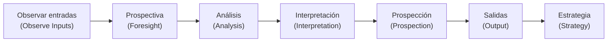

# P25 · Futuros del transporte público en la Ciudad de México (García, 2025)

Esta ficha recoge el póster completo. Cada sección tiene una versión en español (traducción propia ➕) y el texto original en inglés, que la licencia CC BY permite reproducir con atribución. Los diagramas se rehacen en Mermaid o en tablas porque el repositorio guarda todo en Markdown. Los títulos de sección siguen los diez encabezados del póster o traducen el título de una figura; los que son de este repositorio llevan ➕.

El texto original se cotejó con la imagen del póster. Donde difieren, manda la imagen: la capa de texto del PDF (lo que extrae `pdftotext`) pierde el último carácter de algunas líneas, por ejemplo «Reference» por «References» o «pp.10-2» por «pp.10-21». El archivo recibido es, además, una versión con comentarios de revisión: trae tres anotaciones de otra persona, que no forman parte del póster y se registran en [§20](#20-notas-del-archivo-anotaciones-de-revisión).

**Atribución:** García Ramírez, J. R. (2025). *Exploring the Futures of Public Transportation in Mexico City* [póster]. Especialidad en Diseño del Mañana, CENTRO. Licencia CC BY; el sello no indica versión y el póster no enlaza la licencia. Traducción y reconstrucción de diagramas: este repositorio.

**Contenido**

1. [Introducción](#1-introducción)
2. [Metodología](#2-metodología)
3. [Diagrama: modelo prospectivo genérico](#3-diagrama-modelo-prospectivo-genérico)
4. [Entradas](#4-entradas)
5. [Prospectiva](#5-prospectiva)
6. [Diagrama: escenarios de transporte urbano](#6-diagrama-escenarios-de-transporte-urbano)
7. [Hallazgos](#7-hallazgos)
8. [Mapa: rutas de transporte público por agencia](#8-mapa-rutas-de-transporte-público-por-agencia)
9. [➕ Actores clave](#9--actores-clave)
10. [Gráfica: pronóstico de afluencia mensual de RTP al 2030](#10-gráfica-pronóstico-de-afluencia-mensual-de-rtp-al-2030)
11. [➕ El futuro más probable: escenario tendencial](#11--el-futuro-más-probable-escenario-tendencial)
12. [Salida](#12-salida)
13. [Estrategia y diagrama de implementación](#13-estrategia-y-diagrama-de-implementación)
14. [Acciones](#14-acciones)
15. [Conclusiones](#15-conclusiones)
16. [➕ Recursos del autor (códigos QR)](#16--recursos-del-autor-códigos-qr)
17. [Referencias](#17-referencias)
18. [➕ Análisis crítico](#18--análisis-crítico)
19. [➕ Cómo se integra al repositorio](#19--cómo-se-integra-al-repositorio)
20. [Notas del archivo: anotaciones de revisión](#20-notas-del-archivo-anotaciones-de-revisión)

---

## 1. Introducción

El proyecto explora los futuros posibles de las personas usuarias del transporte público en la Ciudad de México, una ciudad con retos profundos de movilidad como la fragmentación, la inequidad y el estrés ambiental. Al analizar señales de cambio e imaginar escenarios alternativos, la investigación muestra cómo podrían evolucionar los sistemas de transporte ante presiones sociales, políticas y ambientales. Su valor está en alimentar el pensamiento de largo plazo y la toma de decisiones, con aportes estratégicos para construir un sistema de movilidad más equitativo, sostenible y centrado en quien lo usa. Invita a la ciudadanía, a quienes diseñan políticas y a los actores involucrados a imaginar y construir un futuro en el que el transporte sostenga la resiliencia urbana y el bienestar social.

Texto original

> This project explores the possible futures of the users of public transportation in Mexico City, which faces deep mobility challenges such as fragmentation, inequity and environmental stress. By analysing signals of change and envisioning alternative scenarios, the research highlights how transportation systems could evolve in response to social, political and environmental pressures. The relevance of this work lies in its capacity to inform long-term thinking and decision-making, offering strategic insights for building a more equitable, sustainable and user-centered mobility system. It invites citizens, policymakers and stakeholders to imagine and shape a future where transportation support urban resilience and social wellbeing.

## 2. Metodología

Para reunir y evaluar información, el estudio siguió el modelo prospectivo genérico de Joseph Voros y combinó varios enfoques de futuros:

- **Escaneo del entorno** para detectar señales débiles, organizadas en una base de conocimiento.
- **Análisis de tendencias** con datos abiertos.
- **Marco PESTLE** para evaluar factores políticos, económicos, sociales, tecnológicos, legales y ambientales.
- **Investigación etnográfica de futuros** (➕ ver ref. 2, Textor).
- **Mapa de actores** (*stakeholders*).
- **Taller Tenkuä** con especialistas en transporte público para explorar escenarios alternativos con los arquetipos de Jim Dator: continuidad, colapso, disciplina y transformación.

Estos métodos permitieron entender de forma estructurada y sistémica cómo podría evolucionar el transporte público de la ciudad y qué decisiones estratégicas llevarían a resultados más deseables.

Texto original

> To gather and evaluate information, the study followed Joseph Voros’ generic prospective model and relied on multiple future-oriented approaches. These included environmental scanning for weak signals, which were organized in a knowledge base, trend analysis based on open data and a PESTLE framework to assess political, economic, social, technological, legal and environmental factors along with Etnographic Futures Research and Stakeholders Mapping. Public Transport experts were invited to a Tenkuä workshop to explore alternative scenarios based on Jim Dators’ archetypes of continuity, collapse, discipline and transformation. These methods allowed for a structured, systemic understanding of how public transportation in Mexico City might evolve and which strategic decision could shape more desirable outcomes.

## 3. Diagrama: modelo prospectivo genérico

Título original: *Generic Prospective Model*. El póster muestra siete engranes encadenados, en este orden (rótulos originales entre paréntesis):

➕ En el marco original de Voros (2003), «prospectiva» (*foresight*) no es un paso aparte: es el nombre del trabajo que agrupa análisis, interpretación y prospección, entre las entradas y las salidas. El póster lo dibuja como un engrane más. Este repositorio usa el marco original; ver [00-marco/metodo.md](../00-marco/metodo.md).

## 4. Entradas

Las personas usuarias del transporte público de la ciudad enfrentan:

- Saturación (Metro, Metrobús).
- Interrupciones del servicio por accidentes, mantenimiento, inundaciones y protestas.
- Inseguridad, sobre todo para las mujeres.
- Una conectividad que se siente fragmentada.
- Infraestructura deteriorada y afectada por el hundimiento del suelo.
- Un diseño urbano que históricamente ha priorizado al auto sobre las personas peatonas.
- Una accesibilidad que sigue siendo limitada.

Texto original

> Users of public transport in Mexico City face overcrowding (Metro, Metrobús), service interruptions (accidents, maintenance, flooding, protests), and safety concerns, particularly for women. Connectivity feels fragmented, and infrastructure suffers from deterioration and ground subsidence. Urban design has historically prioritized cars over pedestrians, and accessibility remains limited.

## 5. Prospectiva

**Mejoras recientes:**

- Ampliación del Trolebús Elevado.
- Electrificación del Metrobús.
- Nuevas líneas de Cablebús.
- Integración de los sistemas de pago (tarjeta TMI y pago sin contacto). ➕ TMI es la Tarjeta de Movilidad Integrada, como la nombra [D25-31](../03-senales/diccionario-2025/D25-31-integrando-pagos-movilidad.md).
- Vagones exclusivos para mujeres.
- Modernización de los CETRAM con inversión privada.
- Mapeo de las rutas concesionadas.

**Problemas de fondo:** pese a los avances, persisten la inversión limitada, el mantenimiento deficiente y la planeación fragmentada. La dependencia sistémica del auto y la complejidad de las dinámicas urbanas frenan los esfuerzos positivos, así que el cambio transformador avanza lento.

Cuatro escenarios prospectivos muestran futuros posibles para la movilidad de la ciudad.

Texto original

> Recent improvements include: Elevated Trolebús expansion, Metrobús electrification, and new Cablebús lines. Payment systems are being integrated (TMI card, contactless), and exclusive cars for women have been introduced. CETRAM hubs are being modernized with private investment, and concessioned routes have been mapped.
>
> Despite advances, deeper issues remain: limited investment and poor maintenance and fragmented planning. Positive efforts are constrained by systemic car dependence and complex urban dynamics, making transformative change slow.
>
> Four prospective scenarios show possible futures for mobility in Mexico City.

## 6. Diagrama: escenarios de transporte urbano

| | |
|---|---|
| **1 · Disciplina** (*Disciplinary*) Regulaciones estrictas cambian la conducta, pero generan resistencia social. | **2 · Transformación** (*Transformative*) Una reforma repentina redefine la movilidad como un derecho público. |
| **3 · Tendencial** (*Tendential*) El abandono lleva a un deterioro gradual, con inversión pública débil. | **4 · Colapso** (*Collapse*) Crisis ambientales y sociales rebasan y desmantelan el sistema de movilidad. |

Cada escenario lleva un ícono dentro de un globo de diálogo: *Disciplinary*, pancartas (una con una señal de prohibido) y tres personas; *Transformative*, un tren y un auto con flechas de intercambio; *Tendential*, edificios con una flecha en zigzag descendente; *Collapse*, un auto sobre suelo agrietado, con marcas de sacudida.

Texto original

Rótulos del diagrama en orden de lectura: el título y, en cada cuadrante, número, nombre y descripción. Los saltos de línea separan rótulos; no se añadió puntuación.

> Urban Transport Scenarios
>
> 1 Disciplinary Strict regulations reshape behavior, but generate social resistance.
>
> 2 Transformative Sudden reform redefines mobility as a public right.
>
> 3 Tendential Neglect leads to gradual decline with weak public investment.
>
> 4 Collapse Environmental and social crises overwhelm dismantle the mobility system.

Los tres diagramas del póster (§3, §6 y §13) llevan la marca *Made with Napkin*, la herramienta con que se hicieron.

➕ Correspondencia con Dator: *Disciplinary* = disciplina; *Transformative* = transformación; *Collapse* = colapso; *Tendential* = continuidad. En Dator, la continuidad suele ser «crecimiento continuo». El autor la reinterpreta como deterioro gradual: para el transporte público de la CDMX, seguir igual significa empeorar.

## 7. Hallazgos

La investigación identificó varios hallazgos sobre el futuro del transporte público en la Ciudad de México:

- **Fragmentación del sistema, uno de los hallazgos más relevantes:** sigue presente y afecta de forma desproporcionada a las personas usuarias de zonas periféricas y de bajos ingresos.
- **Problemas estructurales:** pese a la innovación tecnológica y a la electrificación creciente, la falta de coordinación entre agencias, el mantenimiento deficiente y la intermodalidad limitada siguen impidiendo un acceso equitativo a la movilidad.
- **Señales de estrés creciente:** además, estas señales sugieren que la presión sobre el sistema va en aumento:
  - Más uso de la motocicleta.
  - Auge de servicios de transporte informal.
  - Presiones ambientales como la escasez de agua.

Texto original

> The research identified several findings about the future of public transportation in Mexico City. One of the most relevant is the ongoing fragmentation of the transit system, which disproportionately affects users in peripheral and low-income areas. Despite technological innovations and increasing electrification, structural issues such as lack of coordination between agencies, poor maintenance and limited intermodality continue to hinder equitable access to mobility. Additionally, signals such as the increasing use of motorcycles, the rise of informal transport services and environmental pressures like water scarcity suggest mounting stress on the system.

## 8. Mapa: rutas de transporte público por agencia

En el póster, §8 a §11 van dentro de *Findings* (§7) y no tienen encabezado propio: en la columna central siguen el mapa, el párrafo de actores con su cierre, la gráfica de RTP y el párrafo del escenario tendencial. Los títulos de §8 y §10 traducen los de sus figuras; los de §9 y §11 son de este repositorio ➕.

Título original: *Public transport routes by agency in Mexico City*. Mapa de la ciudad con las rutas coloreadas por agencia. La leyenda (*Agency*) solo trae las claves; su desarrollo es una lectura de este repositorio:

| Clave | Agencia: lectura ➕ [inferencia por la clave] |
|---|---|
| CBB | Cablebús |
| TROLE | Trolebús |
| CC | Corredores concesionados |
| RTP | Red de Transporte de Pasajeros |
| MB | Metrobús |
| METRO | Sistema de Transporte Colectivo Metro |
| TL | Tren Ligero |

Pie original: *Route data obtained from Mexico City's open data portal* (datos de rutas del portal de datos abiertos de la ciudad).

➕ Lectura visual:

- Las rutas de RTP (verde) son las únicas que llegan a casi toda la periferia sur, poniente y oriente.
- Los corredores concesionados (morado) se concentran en el norte y el centro-oriente.
- Metrobús (rojo) dibuja ejes radiales.
- Las líneas del Metro (naranja) son difíciles de leer bajo las demás capas.
- En la leyenda, TROLE (Trolebús) y TL (Tren Ligero) usan exactamente el mismo azul (#0057b8, medido en la imagen ampliada), así que no se distinguen.

## 9. ➕ Actores clave

Los actores clave tienen un papel crucial en dar forma al futuro de la movilidad de la ciudad:

- **Agencias de gobierno**, como la autoridad de transporte de la ciudad: influyen en la inversión en infraestructura, el marco regulatorio y la coordinación del sistema, que están en el centro de la fragmentación actual.
- **Operadores privados de transporte y empresas tecnológicas** ligadas a plataformas de movilidad: suelen cubrir los huecos que deja el sistema público, pero sin regulación también pueden contribuir a más desigualdad o informalidad.
- **Organizaciones comunitarias** que defienden la justicia en la movilidad: dan voz a quienes más sufren la ineficiencia y la exclusión, y empujan soluciones más equitativas y accesibles.

Estos actores se cruzan en puntos críticos: el diseño de políticas, la prestación del servicio y la participación ciudadana. Lo que hagan, o dejen de hacer, puede reforzar las brechas existentes o contribuir a una transformación estructural.

La investigación subraya que el resultado del sistema dependerá de cómo interactúen estas fuerzas en el tiempo, como reflejan los escenarios explorados.

Texto original

> Key stakeholders play a crucial role in shaping the future of mobility in Mexico City. Government agencies such as the city’s Transit Authority influence infrastructure investment, regulatory frameworks, and system coordination that at the core of the current fragmentation. Private transportation operators and tech companies connected to mobility platforms often fill gaps left by the public system, but can also contribute to increased inequality or informality if not regulated. Community organizations advocating for mobility justice bring forward the voices of those most affected by inefficiencies and exclusion, pushing for more equitable and accessible solutions. These actors intersect at critical points: policy design, service delivery and citizen engagement. Their actions—or inaction—can either reinforce existing divides or contribute to structural transformation.
>
> The research emphasizes that the outcome of the system will depend on how these forces interact across time, as reflected in the explored scenarios.

## 10. Gráfica: pronóstico de afluencia mensual de RTP al 2030

Título original: *RTP monthly traffic forecast to 2030*. Ejes originales: *Users*, con el multiplicador *1e7* (personas usuarias por mes, ×10⁷), y *Year* (2022 a 2030). Series: datos reales (*Actual*), pronóstico (*Forecast*) y tendencia (*Trend*). Pie original: *Forecast generated using NeuralProphet with traffic data (until March 2025) from Mexico City's open data portal* (pronóstico hecho con NeuralProphet y datos de afluencia hasta marzo de 2025 del portal de datos abiertos).

Lectura aproximada de la gráfica ➕ (valores medidos sobre la imagen ampliada):

| Momento | Afluencia mensual aproximada |
|---|---|
| Inicio de 2022 | 7.5 a 8.5 millones |
| Pico, segunda mitad de 2022 | cerca de 13 millones |
| 2023 | entre ≈8.7 millones (diciembre) y ≈12.6 millones (marzo), a la baja; noviembre y diciembre, por debajo de 10 millones |
| Inicio de 2025 (últimos datos reales) | cerca de 7 a 8 millones |
| 2027 (pronóstico) | cerca de 4 millones |
| Enero de 2030 (pronóstico) | alrededor de 0, con un último valor ligeramente negativo |

## 11. ➕ El futuro más probable: escenario tendencial

Si las tendencias actuales continúan, el futuro más probable es el «tendencial»: la inversión pública y la voluntad política siguen débiles. El transporte público se deteriora poco a poco y empuja a más personas hacia alternativas privadas o semiprivadas, lo que aumenta la congestión, las emisiones y la desigualdad. Las poblaciones vulnerables son las más afectadas, porque dependen en gran medida de un transporte público asequible y seguro para llegar al trabajo, la escuela y los servicios de salud. En particular:

- Mujeres.
- Personas con discapacidad.
- Residentes de barrios marginados.

Texto original

> The most probable future, if current trends persist, is a “tendential” scenario where public investment and political will remain weak. In this context, public transportation deteriorates gradually, pushing more citizens toward private or semi-private alternatives, thereby increasing congestion, emissions and inequality. Vulnerable populations -in particular women, people with disabilities and residents of marginalized neighborhoods- are the most affected, as they rely heavily on affordable and safe public transit to access work, education and health services.

## 12. Salida

El proyecto esboza escenarios clave y acciones para reducir los retos actuales y avanzar hacia un futuro deseable. La prospectiva estratégica ayuda a anticipar riesgos y a tomar mejores decisiones para un sistema de transporte público más incluyente y eficiente.

Texto original

> This project outlines key scenarios and actions to reduce current challenges and move toward a desirable future. Strategic foresight helps anticipate risks and guide better decisions for a more inclusive, efficient public transport system.

## 13. Estrategia y diagrama de implementación

Las estrategias buscan transformar la movilidad de la ciudad por cuatro vías:

- Fomentar la seguridad vial.
- Promover el transporte eléctrico.
- Hacer diagnósticos comunitarios.
- Impulsar soluciones de última milla.

Se aplican de forma participativa y gradual, con acciones de corto, mediano y largo plazo coordinadas con autoridades y comunidades, y guiadas por herramientas de prospectiva y evidencia local.

Diagrama *Mobility Strategy Implementation* (un camino con tres paradas):

| Iniciativas de corto plazo | Iniciativas de mediano plazo | Iniciativas de largo plazo |
|---|---|---|
| Enfocarse en la seguridad vial y los diagnósticos comunitarios | Promover el transporte eléctrico y las soluciones de micromovilidad | Integrar las estrategias a políticas públicas de movilidad sostenible |

Texto original

> The strategies seek to transform mobility in Mexico City by fostering road safety, promoting electric transportation, conducting community assessments, and promoting last-mile solutions. They are implemented in a participatory and gradual manner, with short-, medium-, and long-term actions coordinated with authorities and communities, and guided by foresight tools and local evidence.

Rótulos del diagrama en orden de lectura: el título y, en cada parada, nombre y descripción. Los saltos de línea separan rótulos; no se añadió puntuación.

> Mobility Strategy Implementation
>
> Short Term Initiatives Focus on road safety and community assessments
>
> Medium Term Initiatives Promote electric transportation and micromobility solutions
>
> Long Term Initiatives Integrate strategies into public policies for sustainable mobility

## 14. Acciones

- **Corto plazo:**
  - Promover una cultura de seguridad vial con campañas educativas, intervenciones comunitarias y actividades de sensibilización en el espacio público.
  - Hacer diagnósticos comunitarios de movilidad para identificar problemas concretos y generar propuestas con evidencia local.
- **Mediano plazo:**
  - Fomentar el uso del transporte eléctrico con estrategias de comunicación sobre sus beneficios, la regulación vigente y los apoyos para personas usuarias y operadoras.
  - Explorar soluciones de «última milla» con pilotos de micromovilidad, rutas compartidas y rediseño de los viajes cortos.
- **Largo plazo:** consolidar una movilidad multimodal, sostenible y centrada en las personas usuarias. Para eso, integrar las estrategias anteriores, escalarlas en el territorio e incorporarlas a políticas públicas permanentes.
- **Implementación:** con enfoque participativo y evidencia local, en coordinación con autoridades y comunidades, y con herramientas de prospectiva que guíen acciones concretas en distintos horizontes de tiempo.

Texto original

> Short term: Promote road safety culture through educational campaigns, community interventions, and awareness-raising activities in public spaces. Conduct community mobility assessments to identify specific problems and generate proposals based on local evidence.
>
> Medium term: Encourage the use of electric transportation with communication strategies about its benefits, current regulations, and support mechanisms for users and operators. Explore "last mile" solutions through micromobility pilots, shared routes, and the redesign of short trips.
>
> Long term: Consolidate multimodal, sustainable, and user-centered mobility by integrating the above strategies, scaling them up territorially, and incorporating them into permanent public policies.
>
> Implementation: Through a participatory approach, based on local evidence, coordinated with authorities and communities, and supported by forward-looking tools to guide concrete actions over different time horizons.

## 15. Conclusiones

1. El transporte público no es solo un servicio: es un derecho que debe garantizarse con equidad en toda la ciudad.
2. Los retos de movilidad están profundamente ligados a desigualdades sociales y territoriales, sobre todo en las periferias.
3. La innovación tecnológica por sí sola no basta; la coordinación institucional y la confianza pública son esenciales.
4. La participación comunitaria es clave para identificar necesidades y cocrear soluciones viables.
5. La resiliencia ambiental debe integrarse a toda la planeación de la movilidad, en especial ante los riesgos climáticos futuros.
6. Las estrategias deben ser adaptables, basadas en datos y sostenidas por un compromiso político de largo plazo, para asegurar un impacto duradero.

Texto original

> 1. Public transportation is not just a service, it’s a right that must be guaranteed equitably across the city.
> 2. Mobility challenges are deeply linked to social and territorial inequalities, especially in peripheral areas.
> 3. Technological innovation alone is not enough, institutional coordination and public trust are essential.
> 4. Community participation is key to identifying needs and co-creating viable solutions.
> 5. Environmental resilience must be integrated into all mobility planning, especially considering future climate risks.
> 6. Strategies must be adaptable, data-informed, and rooted in long-term political commitment to ensure lasting impact.

## 16. ➕ Recursos del autor (códigos QR)

Los tres QR del póster, decodificados el 25-oct-2026:

| Rótulo | Destino |
|---|---|
| *Future Soundscape* (paisaje sonoro del futuro) | https://futuressoundscapes.bandcamp.com/track/moving-towards-the-future-transitando-el-devenir |
| *Interactive Game* (juego interactivo, p5.js) | https://editor.p5js.org/leetmaster/full/DpRFPrchF |
| *Resources* (carpeta de Google Drive; ➕ su título es «Explorando los futuros del transporte público en Ciudad de México», consultado el 25-oct-2026) | https://drive.google.com/drive/folders/1Y-i61_HghKlHNH5W77xhvqoDJ40x99Q1?usp=sharing |

➕ Sin iniciar sesión, la carpeta no muestra su contenido (consulta del 25-oct-2026); qué guarda queda [por verificar].

El póster dice que las señales se organizaron en una base de conocimiento, pero no la enlaza. [inferencia] Sería la *Base de Conocimiento sobre Transporte Público* (KB-TP), a la que llevan los QR de D25-23 y D25-31. Coinciden el tema y dos marcos del póster: el PESTLE (PESTEL en la hoja) y el mapa de actores (en la hoja, por poder e interés). Enlace: https://docs.google.com/spreadsheets/d/16TsvXMkd1KinF_qsaD0rT-OTXRGZ76sRY2mlWniCeh0/edit?usp=sharing.

➕ Datos de la hoja, consultada el 25-oct-2026:

- **Contenido:** 99 registros fechados de 1991 a 2024.
- **Columnas:** hecho, por qué es anomalía, ubicación, fecha, fuente en APA 7, actores, palabras clave, PESTEL, CIPHER y poder/interés.
- **Uso en este repositorio:** es un punto de partida para [01-historicos-2006-2026](../01-historicos-2006-2026/README.md).

## 17. Referencias

Encabezado original: *References*. El bloque «Texto original» transcribe las siete referencias tal como se ven en la imagen, con sus erratas. Debajo va una versión normalizada ➕, con las erratas corregidas y anotadas.

En el póster manda la imagen. La capa de texto del PDF, y por eso `pdftotext`, pierde el último carácter de varias líneas: da «Reference», «pp.10-2», «Anthropology», «5 ed», «08.00», «FDaP» y «2111.1539» donde la imagen dice «References», «pp.10-21», «Anthropology.», «5 ed.», «08.001», «FDaP.» y «2111.15397». Esos cortes no son erratas del póster.

Texto original

> 1. Voros, J. (2003), A Generic Foresight Process Framework. Foresight, vol.5, no.3, pp.10-21
> 2. Textor, R. B. (1980). A Handbook on Ethnographic Futures Research, Cultural and Educational futures Research Project Sc1(001 of Edu- cation and Department of Anthropology.
> 3. Oxford University Press (2009). PESTLE Analysis, A Dictionary of Business and Management. 5 ed.
> 4. Ackerman, F. Eden, C. (June 2011). Strategic Management of Stake- holders: Theory and Practice. LRP. International Journal of Strategic Man- agement. Volume 44. p. 179-196. doi:10.1016/j.lrp.2010.08.001
> 5. PANIAGUA, Karla; e CORNEJO, Paulina. Tenkuä. Futures Literacy for Social Innovation: Designing Alternative Visions for Broken Cities. Projética, Londrina, v. 11, n. 3,. p. 121-129 , Nov. 2020. Edição especial FDaP.
> 6. Triebe, O., Hewamalage, H., Pilyugina, P., Laptev, N., Bergmeir, C., & Rajagopal, R. (2021, November 29). NeuralProphet: Explainable Forecasting at Scale. arXiv.org. https://arxiv.org/abs/2111.15397
> 7. De Innovación Pública, A. D. (n.d.). Portal de Datos Abiertos de la CDMX. https://datos.cdmx.gob.mx/

**Versión normalizada ➕.** Las erratas se anotan aquí y en la tabla de [§18](#erratas-del-póster).

1. Voros, J. (2003). A Generic Foresight Process Framework. *Foresight*, 5(3), pp. 10-21.
2. Textor, R. B. (1980). *A Handbook on Ethnographic Futures Research*. Cultural and Educational Futures Research Project, School of Education and Department of Anthropology, Stanford University ⟶ el póster tiene el texto dañado («Sc1(001 of Edu- cation» por *School of Education*) y no nombra la universidad, que se agrega ➕.
3. Oxford University Press (2009). PESTLE Analysis. *A Dictionary of Business and Management*, 5.ª ed.
4. Ackermann, F. y Eden, C. (junio de 2011). Strategic Management of Stakeholders: Theory and Practice. *Long Range Planning*, 44, pp. 179-196. doi:10.1016/j.lrp.2010.08.001 ⟶ el póster escribe «Ackerman» y no separa a los autores; el apellido es Ackermann. *LRP* es la abreviatura de *Long Range Planning*.
5. Paniagua, K. y Cornejo, P. (noviembre de 2020). Tenkuä. Futures Literacy for Social Innovation: Designing Alternative Visions for Broken Cities. *Projética*, 11(3), pp. 121-129. Londrina. Edição especial FDaP.
6. Triebe, O., Hewamalage, H., Pilyugina, P., Laptev, N., Bergmeir, C. y Rajagopal, R. (29 de noviembre de 2021). NeuralProphet: Explainable Forecasting at Scale. arXiv. https://arxiv.org/abs/2111.15397
7. Agencia Digital de Innovación Pública (s. f.). Portal de Datos Abiertos de la CDMX. https://datos.cdmx.gob.mx/ ⟶ el póster dice «De Innovación Pública, A. D.»: el nombre de la institución quedó escrito como si fuera el de una persona, con «De Innovación Pública» como apellido y «A. D.», de *Agencia Digital*, como iniciales [inferencia].

## 18. ➕ Análisis crítico

### Fortalezas

- **Proceso completo y explícito:** sigue a Voros de las entradas a la estrategia, con escaneo de señales en una base de conocimiento que el póster no enlaza ([inferencia] sería la KB-TP, §16).
- **Combina métodos:** datos abiertos, PESTLE, etnografía de futuros, mapa de actores y un taller con especialistas.
- **Enfoque de equidad constante:** periferias, mujeres, personas con discapacidad y barrios marginados aparecen en todo el póster.
- **Lectura honesta de la continuidad:** reconoce que seguir igual es decaer, no crecer.
- **Mira más allá del transporte público formal:** registra como señales de estrés el auge de la motocicleta, el transporte informal y la escasez de agua.

### Límites y cautelas

1. **El pronóstico de RTP no es un pronóstico.**
   - Prolonga en línea recta 39 meses de datos (enero de 2022 a marzo de 2025).
   - Llega a cero (incluso a valores negativos, que son imposibles) en 2030.
   - No muestra intervalo de incertidumbre ni validación.
   - La caída de 2023-2024 es real. [inferencia] La evidencia posterior al póster sugiere que no fue, sobre todo, una pérdida de demanda de fondo (ver abajo). Se usa como **señal**, no como predicción.

   **Evidencia posterior al póster.** La dimensión [M1](../02-sistema-movilidad/dimensiones/M1-transporte-masivo.md#2-estado-actual-2024-2026) documenta lo siguiente; cada [M1: n] remite a la fuente n de su [lista de fuentes](../02-sistema-movilidad/dimensiones/M1-transporte-masivo.md#14-fuentes). RTP bajó de 12.2 millones de pasajeros en diciembre de 2022 a 6.2 millones en diciembre de 2024, −49 %, según INEGI [M1: 13, 14]. En esos dos años coincidieron dos golpes a la oferta: en 2023 tenía entre 606 y 703 de sus 1,360 autobuses parados por falta de refacciones [M1: 15, 16], y su presupuesto bajó de 2,908.7 a 2,322.2 millones de pesos entre 2022 y 2023 [M1: 17]. El fin del servicio emergente de la Línea 12, el 31 de enero de 2024 [M1: 18], es otro caso. [inferencia] No fue falta de oferta, sino un traslado de demanda de vuelta al Metro, también temporal: esos viajes estaban en RTP solo mientras la línea estuvo cerrada. Cuando los autobuses en operación pasaron de 690 a 900 [M1: 19], la afluencia rebotó: en agosto de 2026 fue de 8.7 millones, 22.5 % más que un año antes [M1: 3] ([S-M1-02](../02-sistema-movilidad/dimensiones/M1-transporte-masivo.md#6-señales-emergentes-2025-2026)). La gráfica del póster usa otra serie, la del portal de datos abiertos de la CDMX: va de unos 12.6 millones en diciembre de 2022 a 7.0 millones en diciembre de 2024 (lectura ➕), una caída de ≈44 %, frente al −49 % de INEGI.

   ➕ [inferencia] **Lectura propia:** el pronóstico de NeuralProphet, que llevaba a RTP a cero hacia 2030, extrapoló un escalón temporal como si fuera una tendencia. El escalón tuvo dos partes: la falta de flota, que se revirtió al reponer autobuses, y el regreso al Metro de la demanda prestada por la Línea 12. Según su pie, el modelo se alimentó con datos de afluencia; nada indica que usara la flota o el presupuesto. Para agosto de 2026 pronosticaba unos 5.5 millones (lectura ➕) e INEGI registró 8.7 millones [M1: 3]. Como en los dos meses comparados (diciembre de 2022 y de 2024) la serie del póster quedó por encima de la de INEGI, el error medido en su propia serie sería aún mayor.

2. **Escenarios de una línea:** salvo el tendencial, que tiene un párrafo propio con su mecanismo y los grupos afectados (§11), no tienen narrativa; ninguno tiene indicadores, impulsores ni año horizonte. En este repositorio se desarrollan al 2040 en [06-escenarios-2040](../06-escenarios-2040/README.md).
3. **Estrategias genéricas:** no dicen quién las ejecuta, con qué presupuesto ni con qué indicador se mide el avance.
4. **Faltan dimensiones del sistema:**
   - La escala metropolitana: viajes desde el Estado de México.
   - El financiamiento: tarifa, subsidio, deuda.
   - El calor extremo.
   - El envejecimiento.
   - La logística urbana.
   - El efecto del Mundial 2026.
5. **El mapa no se puede leer completo:** capas superpuestas y colores repetidos en la leyenda.
6. **Fecha:** datos hasta marzo de 2025. Lo ocurrido después, como las obras del Mundial y las nuevas líneas, se actualiza en [02-sistema-movilidad](../02-sistema-movilidad/README.md).

### Inconsistencias internas del póster

- **Dator no está en las referencias:** la metodología se apoya en los arquetipos de Jim Dator, pero ninguna de las siete referencias es suya.
- **Las referencias no se citan en el cuerpo:** el texto nombra métodos y herramientas (Voros, PESTLE, Tenkuä, NeuralProphet, el portal de datos abiertos), pero no remite a ninguna referencia por número ni por autor y año.
- **Dos nombres para el marco de Voros:** la metodología habla de *generic prospective model* y el diagrama se titula *Generic Prospective Model*, mientras que la ref. 1 se llama *A Generic Foresight Process Framework*.
- **Un color para dos agencias:** en la leyenda del mapa, TROLE y TL usan el mismo azul (§8).

### Erratas del póster

| Sección | Dice | Debería decir |
|---|---|---|
| §1 | *transportation support urban resilience* | *transportation supports urban resilience* |
| §2 | *Etnographic Futures Research* | *Ethnographic Futures Research* |
| §2 | *Stakeholders Mapping* | *Stakeholder Mapping* |
| §2 | *Jim Dators’ archetypes* | *Jim Dator’s archetypes* |
| §2 | *which strategic decision could shape* | *which strategic decisions could shape* |
| §5 | *limited investment and poor maintenance and fragmented planning* | *limited investment, poor maintenance and fragmented planning* |
| §6 | *overwhelm dismantle the mobility system* | *overwhelm and dismantle the mobility system* |
| §9 | *system coordination that at the core* | *system coordination that are at the core* |
| §11 | *-in particular women, … neighborhoods-* | *—in particular women, … neighborhoods—*, con rayas, como en *actions—or inaction—* (§9) |
| §17, ref. 1 | *(2003), A Generic* | *(2003). A Generic*, como en las demás referencias |
| §17, ref. 2 | *Cultural and Educational futures Research Project* | *Cultural and Educational Futures Research Project* (mayúscula del nombre propio) |
| §17, ref. 2 | *Sc1(001 of Edu- cation* | *School of Education* |
| §17, refs. 2 y 4 | *Edu- cation*, *Stake- holders*, *Man- agement* | *Education*, *Stakeholders*, *Management* (restos del guion de partición) |
| §17, ref. 4 | *Ackerman, F. Eden, C.* | *Ackermann, F., & Eden, C.* (apellido y separación de autores) |
| §17, ref. 5 | *PANIAGUA, Karla; e CORNEJO, Paulina* | *PANIAGUA, Karla; CORNEJO, Paulina* (sobra la conjunción portuguesa «e» tras el punto y coma) |
| §17, ref. 5 | *n. 3,. p. 121-129 , Nov.* | *n. 3, p. 121-129, Nov.* |
| §17, ref. 7 | *De Innovación Pública, A. D.* | *Agencia Digital de Innovación Pública* (autor institucional escrito como si fuera una persona) |

Los cortes que da la capa de texto en las referencias 1 a 6 no son erratas: en la imagen esas referencias están completas (ver §17).

Criterio: a diferencia de D25, que no registra las faltas menores de puntuación, esta tabla sí las anota, porque la ficha reproduce el original completo; en las referencias, la versión normalizada de §17 las corrige.

## 19. ➕ Cómo se integra al repositorio

| Parte del póster | Destino en el repositorio |
|---|---|
| Entradas, prospectiva y hallazgos | [02-sistema-movilidad](../02-sistema-movilidad/README.md): estado actual de M1, M2, M3, M5 y M6 |
| Gráfica y pronóstico de RTP (§10) | [M1](../02-sistema-movilidad/dimensiones/M1-transporte-masivo.md#2-estado-actual-2024-2026), §2 y S-M1-02: la caída de 2023-2024 coincidió con un choque de oferta, y la afluencia rebotó al reponer autobuses; aparte, el fin del servicio emergente de la Línea 12 devolvió al Metro una demanda temporal. ➕ [inferencia] El pronóstico extrapoló un escalón temporal como si fuera una tendencia (§18) |
| Señales: motocicletas, transporte informal, escasez de agua | [03-senales](../03-senales/README.md): tablero de señales |
| Actores clave | [02-sistema-movilidad/actores.md](../02-sistema-movilidad/actores.md) |
| Cuatro escenarios | [06-escenarios-2040](../06-escenarios-2040/README.md): punto de partida de los escenarios al 2040 |
| Estrategia y acciones | [08-estrategias](../08-estrategias/README.md) |
| Base de conocimiento (vía D25-23 y D25-31) | [01-historicos-2006-2026](../01-historicos-2006-2026/README.md) |
| Método (Voros, Dator, Tenkuä) | [00-marco/metodo.md](../00-marco/metodo.md) |

## 20. Notas del archivo: anotaciones de revisión

El PDF recibido trae tres anotaciones de revisión hechas con Adobe Acrobat (versión 25.1, según el propio archivo). No son contenido del autor del póster: no se traducen como parte de él y se registran aquí como metadatos del documento. El campo de autor de las tres dice «Luis Alberto García Sánchez», en el archivo con doble espacio entre «Alberto» y «García». Van en el orden en que están guardadas en el archivo, que también es el cronológico. Todas son del 2-jun-2025; las horas están en UTC−6.

| Unidad | Tipo y ubicación | Creada / modificada | Texto, tal cual | ¿Se ve en la imagen? |
|---|---|---|---|---|
| P25.41 | Resaltado con comentario sobre «The most probable future», al inicio del párrafo del escenario tendencial ([§11](#11--el-futuro-más-probable-escenario-tendencial)) | 21:53:53 / 21:54:10 | «por favor, ponle el título del escenario probable, se pierde un poco» | Casi no: la franja mide 0.3 pt de alto; ampliada, es un subrayado magenta (rosado) tenue, el color de las notas con opacidad 0.4 |
| P25.42 | Nota adhesiva bajo el título del diagrama *Mobility Strategy Implementation* ([§13](#13-estrategia-y-diagrama-de-implementación)) | 21:54:25 / 21:55:02 | «buena gráfica, ayudaria localizar más cerca los textos de los puntos, pero esos ya son cosas de diseñador pro» | Sí: ícono magenta |
| P25.43 | Nota adhesiva a la derecha de la leyenda del mapa (*Agency*), a la altura de MB y METRO ([§8](#8-mapa-rutas-de-transporte-público-por-agencia)) | 21:55:15 / 21:55:36 | «el cuadro de identificador yo lo haria un poco más grande, lo dejo a tu consideración» | Sí: ícono magenta |

**Los íconos magenta.** Los dos cuadritos magenta con forma de globo de diálogo que se ven en la imagen, uno bajo el título del diagrama de estrategia (P25.42) y otro junto a la leyenda del mapa (P25.43), son las notas adhesivas tal como las dibuja el visor de PDF. No son parte del diseño del póster ni llevan contenido del autor.

**Qué dice esto de la versión.** El archivo se creó a las 21:55:45, nueve segundos después de la última modificación de una anotación. [inferencia] Es una copia guardada después de la revisión, no necesariamente la versión final que se imprimió o se expuso.

**Relación con esta ficha:**

- P25.41 pide un título para el párrafo del escenario más probable. El póster no lo tiene; el título de §11 es de este repositorio.
- P25.42 elogia el diagrama de estrategia y sugiere acercar sus textos a los puntos del camino.
- P25.43 apunta al mismo problema que la lectura visual de §8, una leyenda que se lee mal: la nota lo atribuye al tamaño del cuadro; §8, a que TROLE y TL usan el mismo azul.
