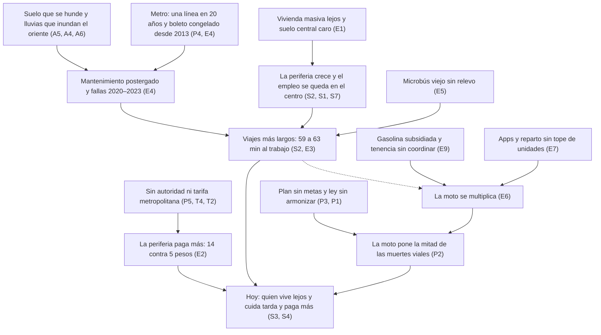

# Movilidad CDMX 2006–2026: cómo llegamos aquí

Chilangatón · Laboratorio de Futuros · 25-oct-2026 · Complemento de [investigacion.md](investigacion.md)

## Resumen para el jurado

**Tesis histórica.** En 20 años la gente se fue a vivir lejos y la red masiva casi no creció. Se cobró barato, se mantuvo poco y se rompió entre 2020 y 2023. El hueco lo llenaron el microbús que nadie renovó y, desde 2015, la moto y las apps, con gasolina subsidiada y sin nadie que junte las tarifas de la CDMX, el Edomex y la federación. Lo que podía hacer un solo gobierno avanzó (Ecobici, Cablebús, trolebús eléctrico). Lo que pedía acuerdo entre gobiernos (tarifa común, plan con metas, ley armonizada) se quedó en no-decisión, y hoy lo pagan primero quien vive lejos y quien cuida.

**Cinco hallazgos 2006 → hoy**

1. **Una línea de Metro en 20 años y el boleto congelado.** La red pasó de unos 201.4 km ➕ a 226.5 km, +12.5% ➕, solo con la Línea 12 ([Wikipedia con datos del STC](https://en.wikipedia.org/wiki/Mexico_City_Metro)). El boleto subió de 2 a 5 pesos y no se mueve desde el 13-dic-2013, aunque el viaje cuesta 13 según el gobierno ([N+, dic-2025](https://www.nmas.com.mx/ciudad-de-mexico/subira-tarifa-metro-cdmx-2026-gobierno-anuncia-precio-para-proximo-ano/)). En 2023, con la Línea 1 cerrada por tramos y la 12 reabriendo por etapas, el Metro movió 21.3% menos pasajeros que en 2006 ➕ ([Wikipedia con datos del STC](https://en.wikipedia.org/wiki/Mexico_City_Metro)).
2. **La periferia creció y paga más.** La CDMX bajó de 46.8% ➕ (2000) a 42.2% (2020) de la población metropolitana ([IPDP](https://ipdp.cdmx.gob.mx/storage/app/uploads/public/648/27d/140/64827d1409a80943844442.pdf)). El micro capitalino pasó de 3.00 pesos (2006) a 7.50 (nov-2025) ([adn40, prensa](https://www.adn40.mx/mexico/2025-11-04/tarifa-microbus-cdmx-ha-aumentado-el-precio-del-pasaje-en-20-anos)), y el mínimo mexiquense es de 14 pesos, 2.8 veces el Metro ([Expansión Política, oct-2025](https://politica.expansion.mx/estados/2025/10/11/tarifa-minima-de-transporte-colectivo-en-edomex-sube-a-14-pesos)).
3. **La moto se multiplicó y pone la mitad de los muertos.** En el país, las motos registradas pasaron de 722,309 (2006) a 4.84 millones (2019), 6.7 veces ➕ ([SEMARNAT con INEGI](https://apps1.semarnat.gob.mx:8443/dgeia/compendio_2021/archivos/02_transporte/d2_transport01_01.pdf)). En la CDMX, los motociclistas pasaron de 21% a 49.5% de las muertes viales entre ene–sep de 2019 y ene–sep de 2025 ([Expansión Política con SSC](https://politica.expansion.mx/cdmx/2026/01/23/5-de-cada-10-muertes-por-hechos-de-transito-son-de-motociclistas-en-cdmx)).
4. **Se tarda más en llegar.** El viaje al trabajo pasó de 59 a 63 minutos entre la EOD 2007 y la 2017, con coberturas distintas ([INEGI](https://www.inegi.org.mx/contenidos/programas/eod/2017/doc/resultados_eod_2017.pdf)). La población ocupada que vive en la CDMX y llega en 30 minutos o menos bajó de 37.7% (2015) a 34.1% (2025), aunque parte de la baja puede ser trabajo en casa ([INEGI 2015](https://evalua.cdmx.gob.mx/storage/app/media/Archivos/Seminario%202018%20sistema%20bienestar%20social/INEGI-%20ALAIN_EIC_2015_DISTRITO%20FEDERAL.pdf); [INEGI 2025](https://www.inegi.org.mx/contenidos/saladeprensa/boletines/2026/ei/EIC2025-def_CDMX.pdf)).
5. **Se electrificó lo público, no la metrópoli.** El trolebús pasó de unas 100 unidades operando (2018) a 425 propias del STE, 502 con las concesionadas (2026) ([Expansión Política con el STE](https://politica.expansion.mx/cdmx/2026/05/12/la-cdmx-apuesta-por-la-movilidad-electrica-en-el-mundial)). Pero el Fondo Metropolitano, creado en 2006, quedó en riesgo en 2020 ([Expansión Política](https://politica.expansion.mx/cdmx/2020/10/09/la-cdmx-en-riesgo-de-perder-los-1-000-mdp-del-fondo-metropolitano)), y en 2025 el Edomex y la CDMX subieron sus pasajes por separado, con 17 días de diferencia ➕ ([Expansión Política](https://politica.expansion.mx/estados/2025/10/11/tarifa-minima-de-transporte-colectivo-en-edomex-sube-a-14-pesos); [adn40](https://www.adn40.mx/mexico/2025-11-04/tarifa-microbus-cdmx-ha-aumentado-el-precio-del-pasaje-en-20-anos)).

*Método (Python):* 201.4 = 226.5 − 25.1 de la Línea 12 · +12.5% = 226.5 / 201.4 − 1 · −21.3% = 1,115.2 / 1,417.0 − 1 · 46.8% = 8,605,239 / 18,396,677 · 2.8 = 14 / 5 · 6.7 = 4,840,823 / 722,309 · 17 días = 1-nov-2025 − 15-oct-2025.

## Cómo leer este documento

- **IDs.** Son los de [investigacion.md](investigacion.md): S1–S7, T1–T5, E1–E9, A1–A7 y P1–P6. No son los de [senales-tendencias-fuerzas.md](senales-tendencias-fuerzas.md), que usa F, T y S con otro significado. Aquí no se repite qué dice cada fuerza hoy; se cuenta cómo llegó ahí.
- **➕** marca interpretación o cálculo del equipo, no dato de la fuente.
- **Confianza de las proyecciones:** 🟢 casi seguro · 🟡 probable · ⚪ posible.
- **"Sin dato 2006"**: las notas no tienen dato de ese año; se da el más antiguo, con su año.
- **Aritmética:** toda se hizo con Python; el método va en una línea junto a la cifra o al pie de la tabla.
- **Prensa:** cuando un dato solo viene de prensa, se dice. Los pesos son corrientes salvo que diga "real".

**Advertencias de comparabilidad**

| Serie | Qué cambió | Cómo usarla |
| --- | --- | --- |
| EOD 2007 frente a EOD 2017 | En 2007 se cubrieron la CDMX y 40 municipios; en 2017, 59 más Tizayuca. Cambió la temporada (mayo–junio contra enero–marzo) y el registro de los viajes a pie. WRI reestimó la de 2017 en 47.2 millones de viajes, no 34.56 ([INEGI, ficha EOD](https://www.inegi.org.mx/rnm/index.php/catalog/533); [WRI, 2023](https://es.wri.org/sites/default/files/2023-10/23_WRI%20TEMPLATE_A4_Working%20Paper-EOD%209%20OCTUBRE%20-.pdf)) | Comparar solo viajes sin caminata (21.95 → 23.41 millones, +6.7% ➕) y leer la tendencia como indicativa |
| Contingencias antes y después de 2016 | Desde el 5-abr-2016 hay contingencia a 150 IMECA, el nivel que antes solo daba precontingencia; en 1993 era a 250, y el programa cambió otra vez en 2019 ([Quadratín](https://mexico.quadratin.com.mx/2016-ano-las-contingencias-ambientales-cdmx/); [ADN40](https://www.adn40.mx/noticia/poder/notas/2019-05-22-12-57/gobcdmx-presenta-nuevo-programa-de-contingencias-ambientales)) | No comparar conteos de reglas distintas; el indicador correcto (días sobre la norma) no tiene dato en las notas |
| Muertes viales según la fuente | INEGI cuenta defunciones en cualquier lugar: 1,042 en 2010 y 510 en 2018. En 2019 el INCIFO contó 646, 62.7% más que los 397 de la SSC ➕ ([PISVI](https://www.semovi.cdmx.gob.mx/storage/app/media/PISVI-2021-2024_.pdf)) | No mezclarlas; aquí se usa la serie de SSC y SEMOVI desde 2019 |
| Población | El total censal y la población "en viviendas particulares" no son lo mismo ([INEGI 2015](https://evalua.cdmx.gob.mx/storage/app/media/Archivos/Seminario%202018%20sistema%20bienestar%20social/INEGI-%20ALAIN_EIC_2015_DISTRITO%20FEDERAL.pdf)); la ZMVM pasó de 76 a 84 municipios y alcaldías ([Xataka, prensa](https://www.xataka.com.mx/otros-1/valle-mexico-no-termina-donde-creiamos-zona-metropolitana-ahora-incluye-84-municipios-alcaldias)) | Usar el mismo concepto en todos los años |

*Método (Python):* +6.7% = 23.41 / 21.95 − 1 · 62.7% = 646 / 397 − 1.

## Cuatro etapas, 2006–2026

**La cadena causal ➕.** Las flechas son interpretación del equipo; cada eslabón tiene fuente en las tablas de abajo. La punteada es la más débil.

### 1 · 2006–2012: obra por partes con gasolina barata

Gobierno del DF de Marcelo Ebrard. Choques: el mayor subsidio federal a la gasolina del periodo (2008), la peor sequía en 40 años (2009) y una caída de 3.1% en los pasajeros del Metro ese año ([CEFP](https://www.cefp.gob.mx/publicaciones/nota/2012/octubre/notacefp0642012.pdf); [La Jornada](https://www.jornada.com.mx/2009/08/04/capital/032n1cap); [Wikipedia con datos del STC](https://en.wikipedia.org/wiki/Mexico_City_Metro)).

- **Heredó:** más de 342 mil viviendas privadas nuevas en el Edomex (2000–2006) ([Arango, PUEC-UNAM](https://www.puec.unam.mx/pdf/publicaciones_digitales/09_eje_9_grandes_conjuntos_habitacionales.pdf)).
- **Construyó:** Ecobici (feb-2010) y la Línea 12 (30-oct-2012), la única línea de Metro de los 20 años ([Expansión Política](https://politica.expansion.mx/cdmx/2025/12/27/ecobici-15-anos-de-transformar-movilidad-en-cdmx); [Crónica](https://www.cronica.com.mx/metropoli/linea-12-metro-abre-totalidad-3-anos-colapso.html)).
- **Decidió:** Atenea, autobuses solo para mujeres (2008), y subir el Metro de 2 a 3 pesos (ene-2010). La federación creó el Fondo Metropolitano (2006) ([Sistema M1](https://www.semujeres.cdmx.gob.mx/storage/app/media/CDMX_SegurayAmigable/ForoTransporte/2_Laura%20Itzel%20Castillo_SM1.pdf); [Wikipedia](https://en.wikipedia.org/wiki/Mexico_City_Metro); [Expansión Política](https://politica.expansion.mx/cdmx/2020/10/09/la-cdmx-en-riesgo-de-perder-los-1-000-mdp-del-fondo-metropolitano)).
- **Dejó pendiente:** el relevo de 28 mil microbuses que anunció la Setravi en 2007 y la flota del trolebús ([Motorpasión](https://www.motorpasion.com.mx/industria/microbuses-cdmx-tiene-20-anos)).
- **Movió:** E1, S2, E9, S6, S4, E4, E5, P4, P5.

### 2 · 2012–2018: leyes de vanguardia sobre una red que envejece

Gobierno de Miguel Ángel Mancera. Choques: la Línea 12 cerró 11 estaciones durante 627 días desde marzo de 2014 ➕, la CAMe endureció las contingencias en 2016 y el sismo del 19-sep-2017 cerró semanas seis estaciones de la misma línea ([Wikipedia L12](https://en.wikipedia.org/wiki/Mexico_City_Metro_Line_12); [Quadratín](https://mexico.quadratin.com.mx/2016-ano-las-contingencias-ambientales-cdmx/); [Telemundo](https://www.telemundo.com/noticias/noticias-telemundo/cuanto-nos-va-costar-asi-se-acumularon-las-fallas-en-la-linea-12-del-metro-de-mexico-antes-tmna3881337)).

- **Construyó:** ningún km de Metro; la red ciclista llegó a 274.41 km en 2018 ([SEMOVI](https://www.semovi.cdmx.gob.mx/storage/app/media/PPT/2024/Infraestructura%20vial%20ciclista%202018-2024%20.pptx.pdf)). La federación empezó El Insurgente en 2014.
- **Decidió:** Metro de 3 a 5 pesos (13-dic-2013), Ley de Movilidad con la pirámide (14-jul-2014), apps sin tope de unidades (15-jul-2015), 50 km/h en vías primarias (15-dic-2015) y la Constitución con derecho a la movilidad (5-feb-2017) ([Expansión Política](https://politica.expansion.mx/cdmx/2025/10/29/hace-cuanto-no-sube-el-precio-del-metro-metrobus-taxis-y-microbuses-en-la-cdmx); [SEDUVI](https://www.seduvi.cdmx.gob.mx/storage/app/media/LEYES/28%20LEY%20DE%20MOVILIDAD%20DEL%20DISTRITO%20FEDERAL.pdf); [El Universal English](https://eluniversal.com.mx/articulo/english/2015/07/15/mexico-city-unveils-first-regulation-uber-latin-america); [Autocosmos](https://noticias.autocosmos.com.mx/2015/08/17/10-cosas-que-debes-saber-sobre-el-nuevo-reglamento-de-transito-del-distrito-federal); [CDHCM](https://piensadh.cdhcm.org.mx/images/2025_cuadernillo_cpcm.pdf)).
- **Dejó pendiente:** el mantenimiento del Metro (trenes de 1969 en la Línea 1 hasta 2018), el trolebús, con unas 100 unidades operando en 2018, y el microbús ([Wikipedia L1](https://en.wikipedia.org/wiki/Mexico_City_Metro_Line_1); [Expansión Política](https://politica.expansion.mx/cdmx/2026/05/12/la-cdmx-apuesta-por-la-movilidad-electrica-en-el-mundial)).
- **Movió:** E4, E2, P1, P2, E7, T2, A3, P4.

### 3 · 2018–2024: electrificar mientras el Metro se rompe

Gobiernos de Claudia Sheinbaum y Martí Batres. Choques: la pandemia (−43.5% de pasajeros del Metro en 2020), Tacubaya (2020), el incendio del Centro de Control (2021), el colapso de la Línea 12 (2021), La Raza (2023), el Cutzamala a 26.91% y el calor récord de 2024 ([Wikipedia](https://en.wikipedia.org/wiki/Mexico_City_Metro); [UnoTV con Conagua](https://www.unotv.com/nacional/sistema-cutzamala-al-52-86-en-junio-2025-frente-al-critico-26-91-en-junio-2024/)).

- **Construyó:** 452 trolebuses, Cablebús 1 y 2 (2021), el Trolebús Elevado (2022), 261 km de ciclovía y la Línea 3 del Metrobús, la primera 100% eléctrica (2023) ([Expansión Política](https://politica.expansion.mx/cdmx/2026/05/12/la-cdmx-apuesta-por-la-movilidad-electrica-en-el-mundial); [SEMOVI](https://www.semovi.cdmx.gob.mx/storage/app/media/PPT/2024/Infraestructura%20vial%20ciclista%202018-2024%20.pptx.pdf); [Expansión Política](https://politica.expansion.mx/cdmx/2026/08/27/metrobus-cdmx-electrico-2033)).
- **Decidió:** la Tarjeta MI (2019), Fotocívicas en lugar de fotomultas (2019), la meta del PISVI (2021) y cerrar la Línea 1 para modernizarla (2022) ([Posta](https://www.posta.com.mx/mexico/cuando-nacio-la-tarjeta-de-movilidad-integrada-conoce-su-historia/vl1622087); [ADN40](https://www.adn40.mx/noticia/ciudad/notas/2019-03-18-11-27/hoy-inician-las-fotocivicas-en-la-cdmx); [PISVI](https://www.semovi.cdmx.gob.mx/storage/app/media/PISVI-2021-2024_.pdf); [Wikipedia L1](https://en.wikipedia.org/wiki/Mexico_City_Metro_Line_1)).
- **Dejó pendiente:** el PGD (plazo de oct-2020, retirado en dic-2023), la armonización con la ley general (may-2022) y el presupuesto del Metro, 17% menor en términos reales en 2023 que en 2018 ([N+ con Cuenta Pública](https://www.nmas.com.mx/ciudad-de-mexico/presupuesto-del-metro-si-ha-bajado-y-no-se-gasta-todo/)). En las notas no aparece ninguna decisión específica para la moto ➕.
- **Movió:** T1, T4, P4, E4, P2, P3, P1, A5, A6, A1, E6.

### 4 · 2024–2026: presupuesto récord, metrópoli sin acuerdos

Gobierno de Clara Brugada. Choques: las lluvias de 2025 (la Línea A se suspendió al menos 18 veces), las protestas contra la gentrificación (jul-2025), las alzas de pasaje (oct–nov 2025) y el Mundial (11-jun-2026) ([Infobae](https://www.infobae.com/mexico/2026/01/01/linea-a-del-metro-cdmx-registra-nuevo-record-en-2025-por-las-veces-que-suspendio-servicio/); [Infobae](https://www.infobae.com/mexico/2025/07/20/el-bando-1-busca-regular-rentas-ante-la-gentrificacion-el-gobierno-de-la-cdmx-retoma-modelo-urbano-de-amlo/)).

- **Construyó:** terminó la Línea 1 (16-nov-2025) y renovó el Tren Ligero (11-may-2026); la federación abrió El Insurgente completo (2-feb-2026) y el tren al AIFA (26-abr-2026) ([Wikipedia L1](https://en.wikipedia.org/wiki/Mexico_City_Metro_Line_1); [Expansión Política](https://politica.expansion.mx/cdmx/2026/05/12/la-cdmx-apuesta-por-la-movilidad-electrica-en-el-mundial); [Posta](https://www.posta.com.mx/mexico/inauguran-estaciones-faltantes-de-el-insurgente-100-mil-millones-de-pesos-y-12-anos-despues/vl2159083); [Publimetro](https://www.publimetro.com.mx/noticias/2026/04/26/sheinbaum-inaugura-el-tren-felipe-angeles-cuanto-cuesta-y-cuanto-tarda-llegar-al-aifa/)).
- **Decidió:** Bando 1 (16-jul-2025), 25 mil mdp para el Metro en 2026 (récord nominal), Cablebús 4 a 6, chatarrizar 2,500 micros a 2030 y la Ley de Cuidados (2-jul-2026) ([Infobae](https://www.infobae.com/mexico/2025/07/20/el-bando-1-busca-regular-rentas-ante-la-gentrificacion-el-gobierno-de-la-cdmx-retoma-modelo-urbano-de-amlo/); [Excélsior](https://www.excelsior.com.mx/comunidad/paquete-economico-2026-cdmx-inversion-publica-presupuesto-historico-movilidad/1754556); [Crónica](https://www.cronica.com.mx/metropoli/2026/02/19/arranca-chatarrizacion-de-microbuses-preven-sustituir-2-mil-500-unidades-hacia-2030/); [Expansión Política](https://politica.expansion.mx/mexico/2026/07/02/emancipacion-para-millones-de-mujeres-brugada-promulga-ley-del-sistema-de-cuidados)).
- **Dejó pendiente:** un PGD sin metas que en ago-2026 no llegaba al Congreso, la ley sin armonizar, una tarifa metropolitana y la obra de la Línea A, sin costo ni fechas ([Crónica](https://www.cronica.com.mx/metropoli/2026/08/19/reconoce-presidente-rezago-en-el-congreso-cdmx-advierte-que-retraso-del-pgd-frena-la-economia/); [Excélsior](https://www.excelsior.com.mx/ciudad-de-mexico/brugada-propone-policia-metropolitana-entre-cdmx-edomex-morelos-e-hidalgo)).
- **Movió:** E1, E4, P4, T2, E5, S3, S6, P3, P5, A4, E2.

*Método (Python):* −3.1% = 1,414.9 / 1,460.1 − 1 (2009 contra 2008) · 627 días = 29-nov-2015 − 12-mar-2014.

## Línea de tiempo 2006–2026

| Fecha | Hito | Tipo | IDs | Fuente |
| --- | --- | --- | --- | --- |
| 2006 | Nace el Fondo Metropolitano: unos 1,500 mdp al año para el Valle de México hasta 2017 | Decisión | P5 | [Expansión Política](https://politica.expansion.mx/cdmx/2020/10/09/la-cdmx-en-riesgo-de-perder-los-1-000-mdp-del-fondo-metropolitano) |
| 2007 | La Setravi anuncia sustituir 28 mil microbuses; no se ejecuta | No-decisión | E5 | [Motorpasión](https://www.motorpasion.com.mx/industria/microbuses-cdmx-tiene-20-anos) |
| 2008 | Arranca Atenea: 67 autobuses solo para mujeres en 23 rutas | Decisión | S4 | [Sistema M1](https://www.semujeres.cdmx.gob.mx/storage/app/media/CDMX_SegurayAmigable/ForoTransporte/2_Laura%20Itzel%20Castillo_SM1.pdf) |
| 2008 | Pico del subsidio a gasolinas y diésel: −264,349.6 mdp de 2012 vía IEPS | Decisión | E9, E6 | [CEFP](https://www.cefp.gob.mx/publicaciones/nota/2012/octubre/notacefp0642012.pdf) |
| ene-2010 | El Metro sube de 2 a 3 pesos | Decisión | E4 | [Wikipedia](https://en.wikipedia.org/wiki/Mexico_City_Metro); [Posta](https://www.posta.com.mx/cdmx/cuanto-ha-subido-el-transporte-publico-en-cdmx-en-los-ultimos-25-anos/vl2033341) |
| feb-2010 | Arranca Ecobici con 1,114 bicis | Obra | S6 | [Expansión Política](https://politica.expansion.mx/cdmx/2025/12/27/ecobici-15-anos-de-transformar-movilidad-en-cdmx) |
| 30-oct-2012 | Abre la Línea 12: 1,300 millones de dólares, con 50% de sobrecosto | Obra | P4 | [Crónica](https://www.cronica.com.mx/metropoli/linea-12-metro-abre-totalidad-3-anos-colapso.html); [Wikipedia L12](https://en.wikipedia.org/wiki/Mexico_City_Metro_Line_12) |
| 13-dic-2013 | El Metro sube de 3 a 5 pesos y no vuelve a subir | Decisión | E4, E2 | [Expansión Política](https://politica.expansion.mx/cdmx/2025/10/29/hace-cuanto-no-sube-el-precio-del-metro-metrobus-taxis-y-microbuses-en-la-cdmx) |
| 12-mar-2014 | Cierran 11 estaciones de la Línea 12 por desgaste de rieles | Choque | P4 | [Wikipedia L12](https://en.wikipedia.org/wiki/Mexico_City_Metro_Line_12) |
| 2014 | Empieza El Insurgente, que debía operar en 2017 | Decisión | T2 | [Posta](https://www.posta.com.mx/mexico/inauguran-estaciones-faltantes-de-el-insurgente-100-mil-millones-de-pesos-y-12-anos-despues/vl2159083) |
| 14-jul-2014 | Ley de Movilidad del DF: la pirámide pone primero al peatón | Decisión | P1 | [SEDUVI](https://www.seduvi.cdmx.gob.mx/storage/app/media/LEYES/28%20LEY%20DE%20MOVILIDAD%20DEL%20DISTRITO%20FEDERAL.pdf) |
| 15-jul-2015 | Se regulan las apps de transporte, sin tope de unidades | Decisión | E7 | [El Universal English](https://eluniversal.com.mx/articulo/english/2015/07/15/mexico-city-unveils-first-regulation-uber-latin-america) |
| 15-dic-2015 | Entra el Reglamento de Tránsito: 50 km/h en vías primarias | Decisión | P2, P1 | [Autocosmos](https://noticias.autocosmos.com.mx/2015/08/17/10-cosas-que-debes-saber-sobre-el-nuevo-reglamento-de-transito-del-distrito-federal) |
| 5-abr-2016 | La CAMe declara contingencia desde 150 IMECA; la serie se rompe | Decisión | A3 | [Quadratín](https://mexico.quadratin.com.mx/2016-ano-las-contingencias-ambientales-cdmx/) |
| 23-ene a 3-mar-2017 | Se levanta la EOD 2017, la última que hay | Decisión | S2, S3 | [INEGI](https://www.inegi.org.mx/contenidos/programas/eod/2017/doc/resultados_eod_2017.pdf) |
| 19-sep-2017 | Sismo: seis estaciones de la Línea 12 cierran durante semanas | Choque | P4, A5 | [Telemundo](https://www.telemundo.com/noticias/noticias-telemundo/cuanto-nos-va-costar-asi-se-acumularon-las-fallas-en-la-linea-12-del-metro-de-mexico-antes-tmna3881337) |
| 18-mar-2019 | Fotocívicas sustituyen a las fotomultas; sancionan desde el 22-abr | Decisión | P2, P1 | [ADN40](https://www.adn40.mx/noticia/ciudad/notas/2019-03-18-11-27/hoy-inician-las-fotocivicas-en-la-cdmx) |
| 16-oct-2019 | Se presenta la Tarjeta MI | Decisión | T4 | [Posta](https://www.posta.com.mx/mexico/cuando-nacio-la-tarjeta-de-movilidad-integrada-conoce-su-historia/vl1622087) |
| 2020 | Pandemia: el Metro mueve 43.5% menos pasajeros que en 2019 | Choque | E4, S7 | [Wikipedia con datos del STC](https://en.wikipedia.org/wiki/Mexico_City_Metro) |
| oct-2020 | Vence el plazo constitucional del PGD y no hay plan | No-decisión | P3 | [Expansión Política](https://politica.expansion.mx/cdmx/2024/11/19/con-4-anos-de-retraso-trazan-ruta-hacia-planeacion-de-la-cdmx) |
| oct-2020 | La extinción de 109 fideicomisos pone en riesgo el Fondo Metropolitano | Decisión | P5 | [Expansión Política](https://politica.expansion.mx/cdmx/2020/10/09/la-cdmx-en-riesgo-de-perder-los-1-000-mdp-del-fondo-metropolitano) |
| 9-ene-2021 | Se incendia el Centro de Control de las Líneas 1 a 6 | Choque | E4 | [Wikipedia](https://en.wikipedia.org/wiki/Mexico_City_Metro) |
| 3-may-2021 | Colapsa la Línea 12: 26 muertos (Telemundo da 24) | Choque | P4 | [Wikipedia L12](https://en.wikipedia.org/wiki/Mexico_City_Metro_Line_12); [Telemundo](https://www.telemundo.com/noticias/noticias-telemundo/cuanto-nos-va-costar-asi-se-acumularon-las-fallas-en-la-linea-12-del-metro-de-mexico-antes-tmna3881337) |
| 2021 | Abren las Líneas 1 y 2 del Cablebús: 9.2 y 10.6 km | Obra | P4 | [SEMOVI, PIMS](https://www.semovi.cdmx.gob.mx/storage/app/media/Programa%20Integral%20de%20Movilidad%20Sustentable%202019-2024.pdf) |
| may-2022 | Ley General de Movilidad y Seguridad Vial: 160 días para armonizar; la CDMX no lo hace | No-decisión | P1 | [Expansión Política](https://politica.expansion.mx/mexico/2025/05/07/11-estados-tres-anos-retrasados-ley-de-movilidad) |
| 11-jul-2022 | Cierra la Línea 1 para modernizarla; termina el 16-nov-2025 | Obra | E4 | [Wikipedia L1](https://en.wikipedia.org/wiki/Mexico_City_Metro_Line_1) |
| 29-oct-2022 | Abre el Trolebús Elevado | Obra | T1, P4 | [Wikipedia, trolebús](https://en.wikipedia.org/wiki/Trolleybuses_in_Mexico_City) |
| 7-ene-2023 | Choque en la Línea 3; entran 6,000 elementos de la Guardia Nacional al Metro | Choque | E4, P6 | [Expansión Política](https://politica.expansion.mx/cdmx/2023/01/13/presupuesto-gasto-en-mantenimiento-metro-cdmx) |
| 17-dic-2023 | Cierra 268 días el tramo elevado de la Línea 9 por hundimiento | Choque | A5 | [Crónica](https://www.cronica.com.mx/metropoli/reabren-tramo-l9-metro-nueve-meses-obras-hundimientos.html) |
| dic-2023 | Batres retira el PGD antes de que se apruebe solo | No-decisión | P3 | [Expansión Política](https://politica.expansion.mx/cdmx/2024/11/19/con-4-anos-de-retraso-trazan-ruta-hacia-planeacion-de-la-cdmx) |
| 25-may-2024 | Récord de calor: 34.7 °C en Tacubaya | Choque | A1 | [Expansión Política](https://politica.expansion.mx/cdmx/2024/05/25/cual-ha-sido-temperatura-mas-alta-cdmx) |
| jun-2024 | El Cutzamala baja a 26.91% | Choque | A6 | [UnoTV con Conagua](https://www.unotv.com/nacional/sistema-cutzamala-al-52-86-en-junio-2025-frente-al-critico-26-91-en-junio-2024/) |
| 16-jul-2025 | Bando 1 contra la gentrificación, tras las protestas de julio | Decisión | E1 | [Infobae](https://www.infobae.com/mexico/2025/07/20/el-bando-1-busca-regular-rentas-ante-la-gentrificacion-el-gobierno-de-la-cdmx-retoma-modelo-urbano-de-amlo/) |
| 15-oct y 1-nov-2025 | El Edomex sube a 14 pesos y la CDMX a 7.50, cada uno por su lado | Decisión | E2, P5 | [Expansión Política](https://politica.expansion.mx/estados/2025/10/11/tarifa-minima-de-transporte-colectivo-en-edomex-sube-a-14-pesos); [adn40](https://www.adn40.mx/mexico/2025-11-04/tarifa-microbus-cdmx-ha-aumentado-el-precio-del-pasaje-en-20-anos) |
| 2025 | Línea A: al menos 18 suspensiones, 14 por lluvia (conteo de prensa) | Choque | A4, A5 | [Infobae](https://www.infobae.com/mexico/2026/01/01/linea-a-del-metro-cdmx-registra-nuevo-record-en-2025-por-las-veces-que-suspendio-servicio/) |
| 28-nov-2025 | Paquete 2026: 25 mil mdp para el Metro y 43,749 para movilidad | Decisión | E4, P4 | [Excélsior](https://www.excelsior.com.mx/comunidad/paquete-economico-2026-cdmx-inversion-publica-presupuesto-historico-movilidad/1754556) |
| 2-feb-2026 | El Insurgente llega a Observatorio tras unos 100 mil mdp (un titular de Publimetro lo fecha el 28-ene) | Obra | T2 | [Posta](https://www.posta.com.mx/mexico/inauguran-estaciones-faltantes-de-el-insurgente-100-mil-millones-de-pesos-y-12-anos-despues/vl2159083) |
| 19-feb-2026 | Arranca la chatarrización: 2,500 microbuses a 2030 | Decisión | E5 | [Crónica](https://www.cronica.com.mx/metropoli/2026/02/19/arranca-chatarrizacion-de-microbuses-preven-sustituir-2-mil-500-unidades-hacia-2030/) |
| 2-jul-2026 | Se promulga la Ley del Sistema Público de Cuidados | Decisión | S3 | [Expansión Política](https://politica.expansion.mx/mexico/2026/07/02/emancipacion-para-millones-de-mujeres-brugada-promulga-ley-del-sistema-de-cuidados) |
| 19-ago-2026 | El PGD sigue sin llegar al Congreso, casi seis años tarde | No-decisión | P3 | [Crónica](https://www.cronica.com.mx/metropoli/2026/08/19/reconoce-presidente-rezago-en-el-congreso-cdmx-advierte-que-retraso-del-pgd-frena-la-economia/) |

*Método (Python):* 268 días = 10-sep-2024 − 17-dic-2023 · −43.5% = 935.2 / 1,655.0 − 1. Quedaron fuera por fecha sin verificar: Hoy No Circula sabatino (2008), Suburbano (2008), AIFA (2022), Cablebús 3 y placas a scooters (2026).

## Las 34 fuerzas desde 2006

Cada fila dice cómo estaba la fuerza hacia 2006, cómo está hoy y qué la movió. El cierre de "Hoy" da su rumbo ➕ si nada cambia (detalle en el escenario inercial).

### Social ([S1–S7](investigacion.md#social))

| ID | Fuerza | Hacia 2006 | Hoy | Qué la movió | Fuentes |
| --- | --- | --- | --- | --- | --- |
| S1 | Capital que envejece y deja de crecer | Sin dato 2006. 2000: 8.61 millones de habitantes y edad mediana de unos 27 años (lectura de gráfica). 2010: 8.85 millones y 11.6% con 60 años o más | 2025: 9,165,819 en viviendas particulares más 50.6 mil en colectivas; 0.0% anual en 2020–2025; edad mediana de 37; 60 o más, 16.2% (2020). ➕ 🟢 edad mediana de 43 en 2040 | Fecundidad de 1.38 (2024), la menor del país, y saldo migratorio interno negativo | [IPDP](https://ipdp.cdmx.gob.mx/storage/app/uploads/public/648/27d/140/64827d1409a80943844442.pdf); [INEGI 2020](https://www.inegi.org.mx/contenidos/programas/ccpv/2020/doc/cpv2020_pres_res_cdmx.pdf); [INEGI 2025](https://www.inegi.org.mx/contenidos/saladeprensa/boletines/2026/ei/EIC2025-def_CDMX.pdf); [CONAPO](https://www.snieg.mx/Documentos/Demografico/sesiones/doc_22023/4_proyecciones_cesnids.pdf) |
| S2 | Se vive lejos, se trabaja en el centro | Sin dato 2006. La CDMX era 46.8% (2000) y 44.0% (2010) de la ZMVM ➕; viaje al trabajo de 59 min sin caminata (EOD 2007) | 42.2% (2020); 63 min (EOD 2017) y 60 desde conurbados; 34.1% de la población ocupada residente llega en 30 min o menos (2025), contra 37.7% en 2015. ➕ 🟡 38.6% de la ZMVM en 2040 | Los conurbados crecieron 1.41% al año y la CDMX 0.28% (2000–2010) ➕; vivienda masiva en el Edomex; 49.5% del empleo privado en tres alcaldías (2023) ➕ | [IPDP](https://ipdp.cdmx.gob.mx/storage/app/uploads/public/648/27d/140/64827d1409a80943844442.pdf); [INEGI EOD](https://www.inegi.org.mx/contenidos/programas/eod/2017/doc/resultados_eod_2017.pdf); [INEGI 2015](https://evalua.cdmx.gob.mx/storage/app/media/Archivos/Seminario%202018%20sistema%20bienestar%20social/INEGI-%20ALAIN_EIC_2015_DISTRITO%20FEDERAL.pdf); [INEGI CE 2024](https://www.inegi.org.mx/contenidos/programas/ce/2024/doc/mcdmx_ce24.pdf) |
| S3 | El cuidado viaja a pie | Sin dato 2006 (la EOD 2007 no se obtuvo por sexo). Lo más antiguo, EOD 2017: camina 71.4% de las mujeres que viajan y 60.3% de los hombres | La EOD publica propósitos sin sexo; ENUT 2024: 39.7 horas semanales de trabajo no pagado de las mujeres contra 18.2 de los hombres (nacional); Ley de Cuidados (2-jul-2026) sin metas de movilidad. ➕ ⚪ el cuidado tiene ley, pero su viaje no se mide | No-decisión de medir el viaje de cuidado; decisión de 2025–2026 de legislarlo | [INEGI EOD](https://www.inegi.org.mx/contenidos/programas/eod/2017/doc/resultados_eod_2017.pdf); [INEGI ENUT](https://www.inegi.org.mx/contenidos/programas/enut/2024/doc/enut_2024_presentacion_resultados.pdf); [Expansión Política](https://politica.expansion.mx/mexico/2026/07/02/emancipacion-para-millones-de-mujeres-brugada-promulga-ley-del-sistema-de-cuidados) |
| S4 | El miedo tiene género | Sin dato 2006. 2009: 9 de cada 10 mujeres de la CDMX había sufrido violencia en el transporte (Inmujeres) | 22.1% de las mujeres en ciudades sufrió acoso en lugares públicos en el 1S-2026, contra 22.3% en el 2S-2025 (nacional urbano). ➕ ⚪ sin tendencia que proyectar | Separar y atender: Atenea (67 unidades en 2008; 136 a 153 en 2017), Viaja Segura (2008–2012); sin evaluación de impacto. El 44.8% de los tocamientos ocurre en la calle y 11% en el transporte (COLMEX, 2017) | [Sistema M1](https://www.semujeres.cdmx.gob.mx/storage/app/media/CDMX_SegurayAmigable/ForoTransporte/2_Laura%20Itzel%20Castillo_SM1.pdf); [BID, 2018](https://publications.iadb.org/publications/spanish/document/G%C3%A9nero-y-Transporte-Ciudad-de-M%C3%A9xico.pdf); [INEGI ENSU](https://www.inegi.org.mx/contenidos/programas/ensu/doc/ensu2026_junio_presentacion_ejecutiva.pdf) |
| S5 | Accesibilidad rezagada | Sin dato 2006. 2018: Metro con 55 de 195 estaciones accesibles (28.2% ➕), Metrobús 202 de 207, trolebús 0 de 187 unidades | 2020: Metro 76 de 195 (39.0% ➕), Metrobús 261 de 265, trolebús 193 de 387; sin conteo de 2026. Discapacidad: 5.2% (2025). ➕ ⚪ las 195 hacia 2031 solo si se hubiera sostenido el ritmo | Flota y líneas nuevas 100% accesibles; no-decisión: sin meta para las estaciones antiguas | [SEMOVI](https://semovi.cdmx.gob.mx/storage/app/media/Accesibilidad%20para%20la%20Movilidad.pdf); [INEGI 2025](https://www.inegi.org.mx/contenidos/saladeprensa/boletines/2026/ei/EIC2025-def_CDMX.pdf) |
| S6 | La bici gana calle | Sin dato 2006 de km. 2004: primera ciclovía; 2007: paseo dominical | 535.54 km (ago-2024) contra 274.41 (2018); 456,892 viajes al día (2024), +71% contra 2018; Ecobici con 9,308 bicis (2025) contra 1,114 (2010). ➕ 🟡 unos 1,232 km en 2040 | Ecobici (2010); 261 km en 2019–2024; Ecobici a Iztapalapa, Tlalpan e Iztacalco (22-sep-2026) | [SEMOVI](https://www.semovi.cdmx.gob.mx/storage/app/media/PPT/2024/Infraestructura%20vial%20ciclista%202018-2024%20.pptx.pdf); [Expansión Política](https://politica.expansion.mx/cdmx/2025/12/27/ecobici-15-anos-de-transformar-movilidad-en-cdmx); [Expansión Política](https://politica.expansion.mx/cdmx/2026/08/28/expansion-ecobici-expande-alcaldias-cdmx-precio) |
| S7 | Teletrabajo para pocos | Sin dato 2006. 2008: 3,299,325 personas en el empleo privado de la CDMX | 3,556,589 (2023), 17.2% menos que el máximo de 2018 ➕; informalidad de 45.7% (IV-2025); potencial de teletrabajo de 10.6% nacional y casi el doble en la CDMX (2019). ➕ 🟡 el empleo formal sigue en el centro | Pandemia (2020); servicios = 85.0% del empleo; causa de la caída 2018–2023 sin verificar | [INEGI CE 2024](https://www.inegi.org.mx/contenidos/programas/ce/2024/doc/mcdmx_ce24.pdf); [INEGI ENOE](https://www.inegi.org.mx/contenidos/saladeprensa/boletines/2026/enoe/enoe2026_02_CdMx.pdf); [Banxico](https://www.sinembargo.mx/wp-content/uploads/2022/03/posibilidades-de-teletrabajo-en-mexico-banxico-home-office.pdf) |

### Tecnológica ([T1–T5](investigacion.md#tecnológica))

| ID | Fuerza | Hacia 2006 | Hoy | Qué la movió | Fuentes |
| --- | --- | --- | --- | --- | --- |
| T1 | El transporte público se electrifica | Sin dato 2006. 2018: unos 100 trolebuses operando en 8 líneas; el Metrobús no tenía línea eléctrica (la primera es de 2023) | 502 trolebuses (425 del STE y 77 concesionados) en 13 líneas (may-2026); Metrobús con 168 eléctricos, unos 20% (ago-2026), aunque sus cifras implican flotas de 840 o 1,000 unidades ➕; trolebús +35.1% de pasajeros (dic-2025). ➕ 🟡 672 metrobuses eléctricos en 2040 al ritmo actual | No-decisión 2006–2018 de reponer flota; compras sostenidas desde 2019 (452); trolebús con batería y concesión con bono (Línea 0) | [Expansión Política](https://politica.expansion.mx/cdmx/2026/05/12/la-cdmx-apuesta-por-la-movilidad-electrica-en-el-mundial); [Expansión Política](https://politica.expansion.mx/cdmx/2026/08/27/metrobus-cdmx-electrico-2033); [INEGI ETUP](https://www.inegi.org.mx/contenidos/saladeprensa/boletines/2026/transporteurbano/trans_urb2026_02.pdf) |
| T2 | Trenes metropolitanos caros, demanda por probar | ➕ No operaba ninguno de los trenes de hoy: El Insurgente empezó en 2014 y la rama al AIFA en sept-2021 | El Insurgente: 57.7 km (2-feb-2026), unos 100 mil mdp, 22 mil pasajeros diarios contra 140 mil estimados (15.7% ➕), 90 pesos. Tren Felipe Ángeles desde el 26-abr-2026, con 57 mil diarios esperados. ➕ ⚪ demanda baja mientras cobren aparte | Obras federales, una por una; 9 años de retraso ➕; tarifa por distancia | [Posta](https://www.posta.com.mx/mexico/inauguran-estaciones-faltantes-de-el-insurgente-100-mil-millones-de-pesos-y-12-anos-despues/vl2159083); [Publimetro](https://www.publimetro.com.mx/noticias/2026/04/26/sheinbaum-inaugura-el-tren-felipe-angeles-cuanto-cuesta-y-cuanto-tarda-llegar-al-aifa/) |
| T3 | Auto eléctrico con sello chino | Sin dato 2006. 2024: 69,713 híbridos y eléctricos vendidos (Electro Movilidad Asociación); el +18% del INEGI implica unos 124 mil ➕ | 146,724 en 2025, 9.6% de los ligeros (INEGI); 76.4% son híbridos convencionales; el eléctrico de batería es 1.4% del mercado ➕. ➕ ⚪ la electrificación privada sigue siendo híbrida | Mercado y marcas chinas (Geely +237.4% en 2025); incentivos sin detalle | [N+](https://www.nmas.com.mx/economia/electromovilidad-cuanto-ha-crecido-venta-autos-electricos-e-hibridos-mexico-razones-tendencia/) |
| T4 | Pago integrado a medias | 17-jun-2006: se venden las primeras tarjetas (17,950) | La MI es la única entrada al Metro (29-ene-2024); MI en el celular solo con Android (dic-2025); Mexibús, Mexicable y El Insurgente, solo como información. ➕ 🟢 una tarjeta sin tarifa integrada | Capas cada 5 a 7 años donde opera la CDMX: 2006, 2012, 2019 y 2024–2025 | [Posta](https://www.posta.com.mx/mexico/cuando-nacio-la-tarjeta-de-movilidad-integrada-conoce-su-historia/vl1622087); [Expansión Política](https://politica.expansion.mx/cdmx/2025/12/09/tarjeta-movilidad-integrada-digital-pagar-metro-con-celular) |
| T5 | Ciudad vigilada | Sin dato 2006. 2011: 8,310 cámaras al abrir el C4i4 | 119,735 cámaras (oct-2026), 14.4 veces más ➕; meta de 150 mil en 2030; sin datos de semáforos con IA. ➕ ⚪ cerca de saturar la meta | Política de seguridad de cuatro administraciones | [Cúspide México, prensa](https://cuspidemexico.com/2026/10/21/cumple-15-anos-sede-del-c5-multiplican-14-veces-sus-camaras/) |

### Económica ([E1–E9](investigacion.md#económica))

| ID | Fuerza | Hacia 2006 | Hoy | Qué la movió | Fuentes |
| --- | --- | --- | --- | --- | --- |
| E1 | Vivienda cara expulsa a la periferia | El Bando Dos (2000) concentró la vivienda nueva en cuatro delegaciones (prensa que cita estudios); más de 342 mil viviendas privadas en el Edomex (2000–2006); índice SHF sin dato 2006 | 4,285,135 pesos en la CDMX y 2,201,128 en el Edomex, 1.95 veces ➕ (2T-2026), +3.40% anual; 207,026 viviendas deshabitadas (2020); Bando 1 (2025). ➕ ⚪ 6.84 millones de pesos nominales en 2040 | Suelo central caro y crédito para comprar lejos; protestas de jul-2025 | [Infobae, prensa](https://www.infobae.com/mexico/2025/07/20/el-bando-1-busca-regular-rentas-ante-la-gentrificacion-el-gobierno-de-la-cdmx-retoma-modelo-urbano-de-amlo/); [Arango](https://www.puec.unam.mx/pdf/publicaciones_digitales/09_eje_9_grandes_conjuntos_habitacionales.pdf); [IIEG con SHF](https://iieg.gob.mx/ns/wp-content/uploads/2026/08/reporte_indice_precios_vivienda_mexico_2doT_2026.pdf); [INEGI 2020](https://www.inegi.org.mx/contenidos/programas/ccpv/2020/doc/cpv2020_pres_res_cdmx.pdf) |
| E2 | La periferia paga más por moverse | Micro en la CDMX: 3.00 pesos (2006). Edomex: sin dato 2006 (12 pesos desde 2017 o 2020; las fuentes no coinciden) | Micro 7.50 (1-nov-2025); Edomex 14 (15-oct-2025), 1.87 veces el micro y 2.8 el Metro ➕; ida y vuelta combi más Metro = 12.1% del salario mínimo de 2026 ➕. ➕ 🟡 micro de 15.5 pesos en 2040 | Alzas negociadas por entidad tras presión de transportistas; Metro congelado | [adn40, prensa](https://www.adn40.mx/mexico/2025-11-04/tarifa-microbus-cdmx-ha-aumentado-el-precio-del-pasaje-en-20-anos); [Expansión Política](https://politica.expansion.mx/estados/2025/10/11/tarifa-minima-de-transporte-colectivo-en-edomex-sube-a-14-pesos); [Runa](https://runahr.com/mx/recursos/nomina/salario-minimo-en-mexico/) |
| E3 | Congestión: 211 horas al año | Sin dato 2006. 2015: unos 59% de tiempo extra ➕, primera del mundo (TomTom) | Primera de 387 ciudades en 2025, con más de 30 min por 10 km (prensa; Eje Central la ubica 17.ª); 211 horas y 10,721 pesos por persona al año en la zona metropolitana (IMCO, 2026). ➕ ⚪ sin tendencia comparable: TomTom cambió de métrica | ➕ Más vehículos, gasolina subsidiada y un Hoy No Circula que regula hologramas, no el uso | [TomTom](https://www.tomtom.com/newsroom/press-releases/general/19731/tomtom-traffic-index-2017-mexico-city-retains-crown-of-most-traffic-congested-city-in-world/); [Récord](https://www.record.com.mx/historia/cdmx-es-la-ciudad-mas-congestionada-del-mundo-segun-el-tomtom-traffic-index-2025-2026012009465993034); [Eje Central](https://www.ejecentral.com.mx/nuestro-eje/tomtom-traffic-index-2025-por-que-hay-tanto-trafico-en-cdmx-estudio-revela-velocidad-de-5-km-h-y-152-horas-perdidas-al-ano); [IMCO](https://imco.org.mx/costo-del-trafico-2026/) |
| E4 | Boleto barato, sistema caro | Metro a 2 pesos; 1,417.0 millones de pasajeros (2006); presupuesto sin dato 2006 | 5 pesos desde el 13-dic-2013 y 13 de costo (declaración oficial); 1,115.2 millones de pasajeros (2023); 25 mil mdp en 2026, récord nominal, tras −17% real entre 2018 y 2023. ➕ ⚪ al ritmo de 2006–2019, volver a 2019 tomaría 33 años | Alzas de 2010 y 2013, luego congelamiento; mantenimiento postergado; fallas de 2020–2023 | [Wikipedia con datos del STC](https://en.wikipedia.org/wiki/Mexico_City_Metro); [N+](https://www.nmas.com.mx/ciudad-de-mexico/subira-tarifa-metro-cdmx-2026-gobierno-anuncia-precio-para-proximo-ano/); [N+ con Cuenta Pública](https://www.nmas.com.mx/ciudad-de-mexico/presupuesto-del-metro-si-ha-bajado-y-no-se-gasta-todo/); [Excélsior](https://www.excelsior.com.mx/comunidad/paquete-economico-2026-cdmx-inversion-publica-presupuesto-historico-movilidad/1754556) |
| E5 | Microbús: la columna que se renueva lento | 2007: se anuncia sustituir 28 mil microbuses; la mayoría ya pasaba su vida útil de 10 años | 5,900 micros de más de 20 años (2020); 535 retirados (2025); meta de 2,500 a 2030; 74.1% de los viajes en transporte público usa micro o combi (2017). ➕ 🟡 a 500 por año, relevar los 5,900 toma unos 12 años | No-decisión de ejecutar el relevo; sin bono, una unidad tarda unos 273 meses en pagarse ➕; bono de 450 mil o 900 mil si es eléctrica (2026) | [Motorpasión](https://www.motorpasion.com.mx/industria/microbuses-cdmx-tiene-20-anos); [Crónica](https://www.cronica.com.mx/metropoli/2026/02/19/arranca-chatarrizacion-de-microbuses-preven-sustituir-2-mil-500-unidades-hacia-2030/); [UNAM Global con INEGI](https://unamglobal.unam.mx/global_revista/microbus-o-combi-transporte-publico-mas-utilizado-en-el-valle-de-mexico/) |
| E6 | La moto crece, el auto no | Sin dato 2006 para la CDMX. País: 722,309 motos y 16.4 millones de autos (2006) | CDMX: 822,871 motos (2025) y 6.5 millones de vehículos registrados (2024) contra 5.8 (2018). País 2006–2019: motos ×6.7 y autos ×2.1 ➕. ➕ 🟡 8.8 millones de vehículos registrados en la CDMX en 2040 | La moto como herramienta de reparto; tenencia sin coordinar: Morelos pasó de 393,444 a 992,042 vehículos (2010–2020) | [SEMARNAT con INEGI](https://apps1.semarnat.gob.mx:8443/dgeia/compendio_2021/archivos/02_transporte/d2_transport01_01.pdf); [Publimetro, prensa](https://www.publimetro.com.mx/nacional/2026/09/03/por-que-hay-cada-vez-mas-motos-en-mexico-ya-van-mas-de-10-millones/); [Expansión Política](https://politica.expansion.mx/cdmx/2026/03/02/la-cdmx-pierde-904-mdp-en-cobro-de-tenencia-pese-a-aumento-de-vehiculos) |
| E7 | Reparto por app, formal a medias | No existía: Uber llegó en 2013 | 237,627 personas con seguridad social completa y 1,663,147 con seguro de riesgos (jun-2026, nacional), 14.3% ➕. ➕ ⚪ unas 19.7 mil afiliaciones completas más por mes (ene–jun 2026) | Apps reguladas sin tope (15-jul-2015); reforma laboral vigente desde ene-2026 | [El Universal English](https://eluniversal.com.mx/articulo/english/2015/07/15/mexico-city-unveils-first-regulation-uber-latin-america); [Mobile Time con STPS](https://mobiletime.la/noticias/10/07/2026/trabajadores-de-apps-seguridad-social/) |
| E8 | Cinturón logístico del norte | Sin dato 2006 del inventario de naves | 12.29 millones de m² (4T-2025, +6.2%), absorción bruta récord de 1.6 millones de m² (91% logística); 43% de lo que se construye está en Zumpango–AIFA. ➕ ⚪ el empleo de almacén se aleja al norte | Demanda logística y de comercio electrónico; suelo junto al AIFA | [CBRE vía MexicoIndustry](https://mexicoindustry.com/noticia/boom-inmobiliario-industrial-en-la-cdmx-absorcion-historica-e-inversion-extranjera-sostienen-la-expansion-en-2026) |
| E9 | Gasolina topada | Magna a 6.74 pesos (2006, prensa); subsidio vía IEPS de −56,031.6 mdp de 2012 (2006) | Magna a 23.76 (2026, prensa); estímulo de 59.48% del IEPS de la Magna y 100% del diésel (17–23 oct 2026). ➕ ⚪ 25.7 pesos en 2040 si sigue el tope | SHCP: IEPS negativo en 2006–2011 (−654,049.6 mdp de 2012) y estímulos semanales desde 2022 | [Posta, prensa](https://www.posta.com.mx/nuevo-leon/por-que-ha-aumentado-el-precio-de-la-gasolina-en-mexico-hasta-2026/v-vl2153460); [CEFP](https://www.cefp.gob.mx/publicaciones/nota/2012/octubre/notacefp0642012.pdf); [El Imparcial](https://www.elimparcial.com/dinero/2026/10/17/hacienda-sube-el-estimulo-fiscal-a-la-gasolina-y-deja-en-cero-el-ieps-del-diesel-del-17-al-23-de-octubre-lo-que-absorbera-hasta-485-pesos-por-tanque-en-mexico/) |

### Ambiental ([A1–A7](investigacion.md#ambiental))

| ID | Fuerza | Hacia 2006 | Hoy | Qué la movió | Fuentes |
| --- | --- | --- | --- | --- | --- |
| A1 | Más calor sobre la calle | Sin dato 2006 | Récord de 34.7 °C en Tacubaya (25-may-2024); 76 días de calor extremo de marzo a junio de 2024 y 40 en 2025 (CAMe, vía prensa). ➕ 🟢 más calor, como prevé el PACCM | Cambio climático e isla de calor | [Expansión Política](https://politica.expansion.mx/cdmx/2024/05/25/cual-ha-sido-temperatura-mas-alta-cdmx); [Chilango](https://www.chilango.com/noticias/2025-cdmx-menos-dias-calor-extremo-2024-persiste-contaminacion-came/); [SEDEMA](https://www.sedema.cdmx.gob.mx/storage/app/media/DGCPCA/PACCM_y_ELAC_uv.pdf) |
| A2 | El transporte es el gran emisor | Sin dato 2006. 2008 (ZMVM): fuentes móviles con 82.4% del NOx, 51.8% del PM2.5 y unos 42% de los GEI | 2016 (CDMX): 81.2% de las emisiones directas y 61.3% con los tres alcances; no es comparable con 2008. ➕ ⚪ sin inventario posterior a 2016 | Parque de 4,536,914 vehículos en la ZMVM (2008), 81.4% autos particulares | [ProAire 2011–2020](https://sma.edomex.gob.mx/sites/sma.edomex.gob.mx/files/files/Programas/ProAireZMVM/proaire2011_2020_02_capitulo2.pdf); [SEDEMA](https://www.sedema.cdmx.gob.mx/storage/app/media/DGCPCA/PACCM_y_ELAC_uv.pdf) |
| A3 | Ozono que no cede | Sin dato 2006. 2002: 6 contingencias | 2024: 11 por ozono (CAMe) o 12 (UNAM); 2025: 5 en la temporada seca-caliente, al 15-ago. ➕ no se proyecta: la serie se rompió | Criterio nuevo (5-abr-2016) y programa nuevo (may-2019); ➕ el calor de 2024 | [El Universal](https://www.eluniversal.com.mx/metropoli/cual-es-el-record-de-contingencias-en-un-ano-en-el-valle-de-mexico/); [Quadratín](https://mexico.quadratin.com.mx/2016-ano-las-contingencias-ambientales-cdmx/); [UnoTV con UNAM](https://www.unotv.com/ciencia-y-tecnologia/los-meses-con-mas-contingencias-en-el-valle-de-mexico-unam-preve-mas-episodios-en-2026/); [Chilango](https://www.chilango.com/noticias/2025-cdmx-menos-dias-calor-extremo-2024-persiste-contaminacion-came/) |
| A4 | Lluvias que cortan la red | Sin dato 2006 | Línea A: al menos 18 suspensiones en 2025, 14 por lluvia, contra 9 en 2024 (conteo de prensa); el cajón Los Reyes–La Paz está "demasiado fracturado". ➕ ⚪ más cortes si no se interviene | ➕ Lluvia extrema sobre suelo que se hunde; obra anunciada para 2026 sin costo ni fechas | [Infobae](https://www.infobae.com/mexico/2026/01/01/linea-a-del-metro-cdmx-registra-nuevo-record-en-2025-por-las-veces-que-suspendio-servicio/) |
| A5 | El suelo se hunde bajo el Metro | Hasta unos 35 cm al año en zonas de la ZMVM en los noventa y dos mil | Más de 2 cm al mes (NISAR, oct-2025 a ene-2026, preliminar); Línea 9 cerrada 268 días en 2023–2024 (220 mdp). ➕ 🟢 la obra de la Línea 9 se diseñó para unos 15 años y vence hacia 2039 | Bombeo del acuífero; no-decisión: el proyecto de la Línea 9 (2022) tardó más de un año en licitarse | [NASA JPL](https://www.jpl.nasa.gov/news/us-indian-space-mission-maps-extreme-subsidence-in-mexico-city/); [Crónica](https://www.cronica.com.mx/metropoli/reabren-tramo-l9-metro-nueve-meses-obras-hundimientos.html); [Vanguardia con Reforma](https://vanguardia.com.mx/noticias/cerraran-tramo-elevado-de-la-linea-9-del-metro-de-la-cdmx-por-problemas-de-hundimiento-HB9012898) |
| A6 | Acuífero sobreexplotado | Sin dato 2006 de extracción. 2009: "la mayor sequía de los pasados 40 años", con recortes de 10% a 50% | Cutzamala a 26.91% (jun-2024) y 52.86% (jun-2025); sin dato de extracción frente a recarga. ➕ ⚪ cada sequía empuja más bombeo | ➕ Cuando falla el Cutzamala sube el bombeo, y con él el hundimiento (A5) | [La Jornada](https://www.jornada.com.mx/2009/08/04/capital/032n1cap); [UnoTV con Conagua](https://www.unotv.com/nacional/sistema-cutzamala-al-52-86-en-junio-2025-frente-al-critico-26-91-en-junio-2024/); [NASA JPL](https://www.jpl.nasa.gov/news/us-indian-space-mission-maps-extreme-subsidence-in-mexico-city/) |
| A7 | La brecha climática de 2040 | Plan Verde (2007) y PACCM 2008–2012: sus metas y evaluaciones no están en las notas | Metas frente a 2016: −36% a 2040 sin condiciones y −83% con financiamiento; el tope de 24.8 Mt de 2024 no se puede verificar. ➕ ⚪ 17.6 o 4.7 Mt en 2040 según la meta | Depende del financiamiento internacional | [SEDEMA](https://www.sedema.cdmx.gob.mx/storage/app/media/DGCPCA/PACCM_y_ELAC_uv.pdf) |

### Política ([P1–P6](investigacion.md#política))

| ID | Fuerza | Hacia 2006 | Hoy | Qué la movió | Fuentes |
| --- | --- | --- | --- | --- | --- |
| P1 | Derecho a la movilidad sin dientes | Sin dato 2006 verificado del marco legal. Lo más antiguo: Ley de Movilidad del DF (14-jul-2014), con la pirámide | Constitución con derecho a la movilidad (5-feb-2017); ley general (may-2022) sin armonizar; la iniciativa de 2026 omite velocidad y alcohol, según Bicitekas. ➕ 🟡 derecho en papel, sin sanción | No-decisión legislativa; puntos en lugar de multas (2019) | [SEDUVI](https://www.seduvi.cdmx.gob.mx/storage/app/media/LEYES/28%20LEY%20DE%20MOVILIDAD%20DEL%20DISTRITO%20FEDERAL.pdf); [CDHCM](https://piensadh.cdhcm.org.mx/images/2025_cuadernillo_cpcm.pdf); [Expansión Política](https://politica.expansion.mx/mexico/2025/05/07/11-estados-tres-anos-retrasados-ley-de-movilidad); [Excélsior](https://www.excelsior.com.mx/ciudad-de-mexico/reforma-ley-movilidad-es-simulacion-dicen-activistas) |
| P2 | Meta vial incumplida | Sin dato 2006. 2010: 1,042 muertes (INEGI, defunciones) | SSC y SEMOVI: 397 muertes (2019), 533 (2024) y 424 (2025), 208 en moto; lesionados +70.5% entre 2019 y 2024. ➕ ⚪ unas 500 muertes al año en 2040 | 50 km/h y fotomultas (2015): −0.2% en la tendencia de mortalidad; Fotocívicas (2019): +2.7% (INSP); la moto; PISVI incumplido; sin meta después de 2024 | [PISVI](https://www.semovi.cdmx.gob.mx/storage/app/media/PISVI-2021-2024_.pdf); [Expansión Política](https://politica.expansion.mx/cdmx/2022/09/24/cambio-de-fotomultas-a-fotocivicas-incremento-muertes-viales-y-choques-en-cdmx); [Excélsior](https://www.excelsior.com.mx/ciudad-de-mexico/bajan-20-muertes-hechos-transito-cdmx) |
| P3 | Plan rector a 2045 sin metas | No existía el PGD de 20 años | Proyecto 2025–2045 sin metas de movilidad; consulta cerrada el 10-abr-2026; pendiente en el Gobierno el 19-ago-2026, casi seis años tarde. ➕ 🟡 revisiones hacia 2032 y 2038 | Plazo de oct-2020 incumplido; rechazo social (2021–2023); IPDP sin titular (feb-2023 a nov-2024); retiro en dic-2023 | [Expansión Política](https://politica.expansion.mx/cdmx/2024/11/19/con-4-anos-de-retraso-trazan-ruta-hacia-planeacion-de-la-cdmx); [Expansión Política](https://politica.expansion.mx/cdmx/2026/04/28/cdmx-2046-avanza-el-plan-general-de-desarrollo); [Crónica](https://www.cronica.com.mx/metropoli/2026/08/19/reconoce-presidente-rezago-en-el-congreso-cdmx-advierte-que-retraso-del-pgd-frena-la-economia/) |
| P4 | Obra eléctrica hacia la periferia | Metro con 11 líneas, 175 estaciones y unos 201.4 km ➕; Cablebús: 0 km | Metro con 12 líneas, 195 estaciones y 226.5 km; Cablebús 1 y 2 con 19.8 km (2021) ➕; Trolebús Elevado de 8.0 km; 43,749 mdp para movilidad en 2026. ➕ 🟢 unos 244 km de Metro en 2040 | Las fallas de la Línea 12 (2014 y 2021) frenan el Metro pesado; giro a modos ligeros; en 2022–2026, reparar antes que ampliar | [Wikipedia](https://en.wikipedia.org/wiki/Mexico_City_Metro); [SEMOVI, PIMS](https://www.semovi.cdmx.gob.mx/storage/app/media/Programa%20Integral%20de%20Movilidad%20Sustentable%202019-2024.pdf); [Excélsior](https://www.excelsior.com.mx/comunidad/paquete-economico-2026-cdmx-inversion-publica-presupuesto-historico-movilidad/1754556) |
| P5 | Metrópoli partida | Fondo Metropolitano (2006): unos 1,500 mdp al año al Valle de México hasta 2017, con comité federal | Fondo en riesgo desde oct-2020 (destino sin verificar); Consejo de 2026 con 84 municipios y alcaldías, sin acuerdo de transporte reportado; pasajes fijados por separado (oct–nov 2025). ➕ 🟡 pasajes que se suman en cada frontera | Dependencia del dinero federal; unos 8,000 mdp sin ejercer; integración por obra, no por tarifa | [Expansión Política](https://politica.expansion.mx/cdmx/2020/10/09/la-cdmx-en-riesgo-de-perder-los-1-000-mdp-del-fondo-metropolitano); [Finanzas CDMX](https://procesos.finanzas.cdmx.gob.mx/PbR/public/assets/doc/evaluaciones/2018/17_DESEMPENO_DEL_FONDO_METROPOLITANO_OK.pdf); [Excélsior](https://www.excelsior.com.mx/ciudad-de-mexico/brugada-propone-policia-metropolitana-entre-cdmx-edomex-morelos-e-hidalgo) |
| P6 | Miedo en el transporte | Sin dato 2006. Ene–ago 2018: 1,576 carpetas por robo con violencia en el transporte ➕ (SESNSP) | Ene–ago 2019: +73.4% ➕; 2025: unas 3,600 carpetas en Metro, Metrobús, Trolebús y RTP, con menos de 1 de cada 10 detenidos en flagrancia (prensa); 61.1% se siente inseguro (sep-2026, nacional urbano). ➕ ⚪ sin serie que proyectar | ➕ Poca disuasión; Guardia Nacional en el Metro (ene-2023) | [Expansión Política](https://politica.expansion.mx/cdmx/2019/09/23/alerta-en-la-cdmx-el-robo-con-violencia-en-transporte-publico-sube-73); [Crónica](https://www.cronica.com.mx/metropoli/2026/07/16/denuncian-mas-de-4-mil-delitos-en-transporte-publico-en-16-meses-con-solo-4-detenidos-in-fraganti/); [INEGI ENSU](https://www.inegi.org.mx/contenidos/saladeprensa/boletines/2026/ensu/ENSU2026_10_CP.pdf) |

*Método (Python):* 49.5% = 24.0 + 15.5 + 10.0 · 1.4% = 9.6% × 14.3% · 124 mil = 146,724 / 1.18 · 840 = 168 / 0.20 y 1,000 = 700 / 0.70 · 19.7 mil = 98,627 / 5 meses · 28.2% = 55 / 195 · 1.95 = 4,285,135 / 2,201,128 · 12.1% = 2 × (14 + 5) / 315.04 · 273 meses = 3,000,000 / 11,000 · 14.3% = 237,627 / 1,663,147 · 1,576 = 1,455 + 121 · +73.4% = 2,732 / 1,576 − 1 · 1.41% = (11,265,762 / 9,791,438)^(1/10) − 1.

## Decisiones y no-decisiones que explican el presente

| # | Decisión o no-decisión | Quién y cuándo | Consecuencia medible | IDs | Lección para 2040 ➕ |
| --- | --- | --- | --- | --- | --- |
| 1 | Congelar el boleto del Metro | Mancera lo subió a 5 pesos (13-dic-2013); Sheinbaum y Brugada no lo tocaron | El subsidio es 61.5% del costo del viaje ➕ ([N+](https://www.nmas.com.mx/ciudad-de-mexico/subira-tarifa-metro-cdmx-2026-gobierno-anuncia-precio-para-proximo-ano/)); presupuesto −17% real de 2018 a 2023 ([N+ con Cuenta Pública](https://www.nmas.com.mx/ciudad-de-mexico/presupuesto-del-metro-si-ha-bajado-y-no-se-gasta-todo/)) | E4, E2 | Sin regla de financiamiento, el mantenimiento paga la tarifa política |
| 2 | Postergar el mantenimiento del Metro | STC y gobiernos hasta 2022: trenes de 1969 en la Línea 1 hasta 2018; 19% del presupuesto sin gastar en 2016–2021 | Tacubaya (2020), Centro de Control (2021), La Raza (2023) y la Línea 1 con tramos cerrados 1,224 días ➕ ([Wikipedia L1](https://en.wikipedia.org/wiki/Mexico_City_Metro_Line_1); [N+](https://www.nmas.com.mx/ciudad-de-mexico/presupuesto-del-metro-si-ha-bajado-y-no-se-gasta-todo/)) | E4, P4 | Medir la red por días de servicio, no por km |
| 3 | Inaugurar la Línea 12 con fallas | Ebrard, 30-oct-2012 | 627 días con 11 estaciones cerradas (2014–2015) y colapso con 26 muertos (2021) y 1,002 días sin servicio completo ➕ ([Wikipedia L12](https://en.wikipedia.org/wiki/Mexico_City_Metro_Line_12); [Crónica](https://www.cronica.com.mx/metropoli/linea-12-metro-abre-totalidad-3-anos-colapso.html)) | P4, A5 | Después de 2012 no hubo Metro pesado nuevo: la periferia se atiende con modos ligeros |
| 4 | No relevar el microbús | Setravi lo anunció en 2007; nadie lo ejecutó | 5,900 micros de más de 20 años en 2020 y 1,751 sustituidos al corte de 2023 ([Motorpasión](https://www.motorpasion.com.mx/industria/microbuses-cdmx-tiene-20-anos)) | E5, A7 | El hombre-camión no puede pagar su relevo: sin bono público no hay transición |
| 5 | Dejar caer el trolebús y luego comprarlo | STE en 2006–2018; Sheinbaum en 2018–2023 (452 unidades) | De unas 100 unidades operando a 425 del STE (502 con las concesionadas), y +35.1% de pasajeros en dic-2025 ([Expansión Política](https://politica.expansion.mx/cdmx/2026/05/12/la-cdmx-apuesta-por-la-movilidad-electrica-en-el-mundial); [INEGI ETUP](https://www.inegi.org.mx/contenidos/saladeprensa/boletines/2026/transporteurbano/trans_urb2026_02.pdf)) | T1 | La compra pública sostenida funciona; escalarla pide al concesionado, como la Línea 0 |
| 6 | Vivienda lejos sin transporte | GDF con el Bando Dos (2000, prensa) e inmobiliarias con crédito en el Edomex (2000–2006) | La CDMX bajó de 46.8% a 42.2% de la ZMVM (2000–2020) ➕; 60 min al trabajo desde conurbados (2017); traslados de 3 a 5 horas en Ixtapaluca ([IPDP](https://ipdp.cdmx.gob.mx/storage/app/uploads/public/648/27d/140/64827d1409a80943844442.pdf); [INEGI EOD](https://www.inegi.org.mx/contenidos/programas/eod/2017/doc/resultados_eod_2017.pdf); [Arango](https://www.puec.unam.mx/pdf/publicaciones_digitales/09_eje_9_grandes_conjuntos_habitacionales.pdf)) | E1, S2 | La vivienda social debe ir junto a la red, decidida en la misma mesa |
| 7 | Gasolina barata como política | SHCP: IEPS negativo en 2006–2011 y estímulos semanales desde 2022 | −654,049.6 mdp de 2012 en subsidio (2006–2011); en oct-2026 se perdona 59.48% del IEPS de la Magna ([CEFP](https://www.cefp.gob.mx/publicaciones/nota/2012/octubre/notacefp0642012.pdf); [El Imparcial](https://www.elimparcial.com/dinero/2026/10/17/hacienda-sube-el-estimulo-fiscal-a-la-gasolina-y-deja-en-cero-el-ieps-del-diesel-del-17-al-23-de-octubre-lo-que-absorbera-hasta-485-pesos-por-tanque-en-mexico/)) | E9, E3, E6, A2 | La transición plena choca con una decisión fiscal federal que la ciudad no controla |
| 8 | Tenencia y placas sin coordinar | CDMX: umbral del subsidio congelado unos 13 años; 17 estados sin tenencia | Morelos pasó de 393,444 a 992,042 vehículos (2010–2020) y la tenencia de la CDMX cayó 17.4% (2018–2025) ➕ ([Expansión Política](https://politica.expansion.mx/cdmx/2026/03/02/la-cdmx-pierde-904-mdp-en-cobro-de-tenencia-pese-a-aumento-de-vehiculos)) | E6, P5 | Sin reglas fiscales metropolitanas, cada medida contra el auto se escapa por la frontera |
| 9 | Cambiar fotomultas por Fotocívicas, sin política para la moto | Sheinbaum, 18-mar-2019 | El INSP asocia el cambio con +2.7% en la tendencia de mortalidad; las muertes subieron de 397 (2019) a 533 (2024) y la moto puso 49.1% en 2025 ➕ ([Expansión Política](https://politica.expansion.mx/cdmx/2022/09/24/cambio-de-fotomultas-a-fotocivicas-incremento-muertes-viales-y-choques-en-cdmx); [Excélsior](https://www.excelsior.com.mx/ciudad-de-mexico/bajan-20-muertes-hechos-transito-cdmx)) | P2, P1, E6 | La única medida con efecto favorable documentado (2015) se debilitó; 2040 pide sanción y meta para la moto |
| 10 | Nadie fija la tarifa metropolitana | CDMX, Edomex, Hidalgo y la federación, todo el periodo | El Fondo Metropolitano dependía de un comité federal y dejó unos 8,000 mdp sin ejercer; en 2025 los pasajes subieron por separado ([Expansión Política](https://politica.expansion.mx/cdmx/2020/10/09/la-cdmx-en-riesgo-de-perder-los-1-000-mdp-del-fondo-metropolitano); [Expansión Política](https://politica.expansion.mx/estados/2025/10/11/tarifa-minima-de-transporte-colectivo-en-edomex-sube-a-14-pesos)) | P5, E2, T4 | La metrópoli se integró por obra, nunca por tarifa |
| 11 | Plan, ley y datos sin cerrar | Sheinbaum, Batres, Brugada y el Congreso CDMX | PGD: plazo de oct-2020 incumplido, retirado en dic-2023 y sin metas en 2026; ley general sin armonizar desde may-2022; sin EOD desde 2017 (no se halló anuncio) ([Expansión Política](https://politica.expansion.mx/cdmx/2024/11/19/con-4-anos-de-retraso-trazan-ruta-hacia-planeacion-de-la-cdmx); [Crónica](https://www.cronica.com.mx/metropoli/2026/08/19/reconoce-presidente-rezago-en-el-congreso-cdmx-advierte-que-retraso-del-pgd-frena-la-economia/)) | P3, P1, S2 | Un plan sin cifras no obliga; las revisiones de 2032 y 2038 son la oportunidad |
| 12 | Trenes federales sin integración | Gobierno federal: El Insurgente (2014) y rama al AIFA (sept-2021) | El Insurgente: 9 años tarde, unos 1,733 mdp por km ➕ y 15.7% de la demanda prevista ➕, con 90 pesos el viaje completo ([Posta](https://www.posta.com.mx/mexico/inauguran-estaciones-faltantes-de-el-insurgente-100-mil-millones-de-pesos-y-12-anos-despues/vl2159083)) | T2, P5 | Un tren que cobra aparte no se llena |

*Método (Python):* 61.5% = (13 − 5) / 13 · 1,224 días = 16-nov-2025 − 11-jul-2022 · 1,002 días = 30-ene-2024 − 3-may-2021 · −17.4% = 4,298 / 5,202 − 1 · 49.1% = 208 / 424 · 1,733 = 100,000 / 57.7.

## Lo que 20 años dicen de las dos incertidumbres críticas

### 1. ¿Quién gobierna la metrópoli? ([P5, P3](investigacion.md#las-dos-incertidumbres-críticas))

**Evidencia histórica**

- **La coordinación fue dinero federal, no autoridad.** El Fondo Metropolitano dio unos 1,500 mdp al año al Valle de México de 2006 a 2017. Aprobaba los proyectos un comité de Hacienda, Sedatu y Semarnat, y quedó en riesgo en oct-2020 ([Expansión Política](https://politica.expansion.mx/cdmx/2020/10/09/la-cdmx-en-riesgo-de-perder-los-1-000-mdp-del-fondo-metropolitano)). En 2017 la CDMX dejó 13.67% sin ejercer "sin evidencia documental" ([Finanzas CDMX](https://procesos.finanzas.cdmx.gob.mx/PbR/public/assets/doc/evaluaciones/2018/17_DESEMPENO_DEL_FONDO_METROPOLITANO_OK.pdf)).
- **La integración llegó hasta donde manda un solo gobierno.** La tarjeta sumó capas en 2006, 2012, 2019 y 2024–2025, pero el Mexibús, el Mexicable y El Insurgente solo aparecen como información en la app MI ([Posta](https://www.posta.com.mx/mexico/cuando-nacio-la-tarjeta-de-movilidad-integrada-conoce-su-historia/vl1622087); [Expansión Política](https://politica.expansion.mx/cdmx/2025/12/09/tarjeta-movilidad-integrada-digital-pagar-metro-con-celular)).
- **Las obras metropolitanas fueron federales o conjuntas, una por una:** El Insurgente, el tren al AIFA y el trolebús Chalco–Santa Martha ([Posta](https://www.posta.com.mx/mexico/inauguran-estaciones-faltantes-de-el-insurgente-100-mil-millones-de-pesos-y-12-anos-despues/vl2159083); [Publimetro](https://www.publimetro.com.mx/noticias/2026/04/26/sheinbaum-inaugura-el-tren-felipe-angeles-cuanto-cuesta-y-cuanto-tarda-llegar-al-aifa/); [adn40](https://www.adn40.mx/ciudad/2025-03-26/inicio-operaciones-trolebus-chalco-santa-martha/)).
- **Lo fiscal se fuga por la frontera:** 17 estados sin tenencia y, según una estimación académica citada por la prensa, al menos 350 mil vehículos con placas de Morelos en la CDMX hacia 2020 ([Expansión Política](https://politica.expansion.mx/cdmx/2026/03/02/la-cdmx-pierde-904-mdp-en-cobro-de-tenencia-pese-a-aumento-de-vehiculos)).
- **El único órgano metropolitano que decidió fue ambiental:** en 2016 la CAMe cambió el criterio de contingencia y dejó sin circular a todos los autos un día a la semana de abril a junio ([Quadratín](https://mexico.quadratin.com.mx/2016-ano-las-contingencias-ambientales-cdmx/)).
- **El plan rector lleva seis años sin aprobarse** y, cuando avanzó, perdió las metas (P3, arriba).

**Veredicto ➕.** La historia respalda el eje: las grandes no-decisiones del periodo son metropolitanas. Pero sugiere dos ajustes. Primero, la integración no llegó con consejos ni fondos; llegó cuando un órgano pudo decidir, como la CAMe en 2016. El eje se mide mejor con una pregunta concreta: ¿quién fija la tarifa y quién paga el subsidio? Segundo, falta un actor: la federación construye los trenes y paga parte del Cablebús 4, pero cobra aparte. Proponemos llamar al eje "¿quién fija la tarifa y el subsidio metropolitanos?", con polos "una tarifa que subsidia a la periferia" y "pasajes que se suman en cada frontera".

### 2. ¿Qué tan a fondo va la transición? ([A7, E5](investigacion.md#las-dos-incertidumbres-críticas))

**Evidencia histórica**

- **Lo público sí se electrificó, y casi todo desde 2019:** el trolebús pasó de unas 100 unidades operando a 425 del STE (502 con las concesionadas), y el Metrobús de ninguna línea eléctrica a unos 20% de su flota ([Expansión Política](https://politica.expansion.mx/cdmx/2026/05/12/la-cdmx-apuesta-por-la-movilidad-electrica-en-el-mundial); [Expansión Política](https://politica.expansion.mx/cdmx/2026/08/27/metrobus-cdmx-electrico-2033)).
- **Lo privado se "electrificó" con híbridos:** 9.6% de las ventas de 2025, con 76.4% de híbridos convencionales; el eléctrico de batería es 1.4% del mercado ➕ ([N+](https://www.nmas.com.mx/economia/electromovilidad-cuanto-ha-crecido-venta-autos-electricos-e-hibridos-mexico-razones-tendencia/)).
- **Lo que más creció fue la moto:** ×6.7 en el país entre 2006 y 2019 ➕ ([SEMARNAT con INEGI](https://apps1.semarnat.gob.mx:8443/dgeia/compendio_2021/archivos/02_transporte/d2_transport01_01.pdf)).
- **El microbús, columna del sistema, se releva por cientos:** 535 unidades retiradas en 2025 y una meta de 2,500 a 2030 ([Crónica](https://www.cronica.com.mx/metropoli/2026/02/19/arranca-chatarrizacion-de-microbuses-preven-sustituir-2-mil-500-unidades-hacia-2030/)).
- **El cambio modal no se puede medir:** no hay EOD desde 2017 ni inventario de emisiones de la CDMX posterior a 2016, así que nadie sabe si se cumplió el tope de 24.8 Mt de 2024 ([SEDEMA](https://www.sedema.cdmx.gob.mx/storage/app/media/DGCPCA/PACCM_y_ELAC_uv.pdf)).
- **La red física es el cuello de botella:** la Línea 9 cerró 268 días por hundimiento y la Línea A tuvo 14 suspensiones por lluvia en 2025 ([Crónica](https://www.cronica.com.mx/metropoli/reabren-tramo-l9-metro-nueve-meses-obras-hundimientos.html); [Infobae](https://www.infobae.com/mexico/2026/01/01/linea-a-del-metro-cdmx-registra-nuevo-record-en-2025-por-las-veces-que-suspendio-servicio/)).

**Veredicto ➕.** La historia respalda el eje, pero muestra que electrificar flota no es lo mismo que transitar: el periodo cambió unidades sin evidencia de cambio modal. Sugerimos medir los polos con reparto modal y días de servicio de la red, no con unidades eléctricas. También confirma que el motor es el dinero: los bonos para el micro y el financiamiento internacional del −83%, como ya dice investigacion.md. Y deja una advertencia: el suelo y el agua (A4, A5) no son el fondo del escenario, sino su condición. Sin ellos resueltos, ninguna transición llega al oriente.

## Escenario inercial 2040 ("si nada cambia")

Todo en esta sección es ➕. Regla: tasa compuesta para población, precios y parque vehicular; lineal para kilómetros, unidades compradas por año y porcentajes. Cuando la compuesta da una cifra absurda, se dice.

| Indicador | Serie base (años y fuente) | Ritmo histórico | Valor 2040 inercial | Confianza |
| --- | --- | --- | --- | --- |
| Población de la CDMX | 8,985,339 (2015), 9,209,944 (2020) y 9,216,419 (2025, ➕ particulares + colectivas) ([INEGI 2015](https://evalua.cdmx.gob.mx/storage/app/media/Archivos/Seminario%202018%20sistema%20bienestar%20social/INEGI-%20ALAIN_EIC_2015_DISTRITO%20FEDERAL.pdf); [INEGI 2020](https://www.inegi.org.mx/contenidos/programas/ccpv/2020/doc/cpv2020_pres_res_cdmx.pdf); [INEGI 2025](https://www.inegi.org.mx/contenidos/saladeprensa/boletines/2026/ei/EIC2025-def_CDMX.pdf)) | Compuesta: 0.01% anual (2020–2025) o 0.25% (2015–2025) | 9.24 a 9.57 millones | 🟢 |
| CDMX en la población de la ZMVM | 52.9% (1990), 46.8% (2000), 44.0% (2010), 42.2% (2020) ([IPDP](https://ipdp.cdmx.gob.mx/storage/app/uploads/public/648/27d/140/64827d1409a80943844442.pdf)) | Lineal: −0.18 puntos al año (2010–2020); −0.36 (1990–2020) | 38.6% (35.1% con el ritmo largo) | 🟡 la delimitación cambió de 76 a 84 |
| Edad mediana, CDMX | 31 (2010, lectura de gráfica), 35 (2020), 37 (2025) ([INEGI 2020](https://www.inegi.org.mx/contenidos/programas/ccpv/2020/doc/cpv2020_pres_res_cdmx.pdf); [INEGI 2025](https://www.inegi.org.mx/contenidos/saladeprensa/boletines/2026/ei/EIC2025-def_CDMX.pdf)) | Lineal: +0.4 años por año | 43 años | 🟢 |
| 60 años o más, CDMX | 11.6% (2010) y 16.2% (2020) ([INEGI 2020](https://www.inegi.org.mx/contenidos/programas/ccpv/2020/doc/cpv2020_pres_res_cdmx.pdf)) | Lineal: +0.46 puntos al año | 25.4% | 🟡 sin dato 2025 |
| Ocupados que viven en la CDMX y llegan en 30 min o menos | 37.7% (2015) y 34.1% (2025) ([INEGI 2015](https://evalua.cdmx.gob.mx/storage/app/media/Archivos/Seminario%202018%20sistema%20bienestar%20social/INEGI-%20ALAIN_EIC_2015_DISTRITO%20FEDERAL.pdf); [INEGI 2025](https://www.inegi.org.mx/contenidos/saladeprensa/boletines/2026/ei/EIC2025-def_CDMX.pdf)) | Lineal: −0.36 puntos al año | 28.7% | ⚪ dos puntos; el trabajo en casa mueve el denominador |
| Viaje al trabajo sin caminata, ZMVM | 59 min (EOD 2007) y 63 (EOD 2017) ([INEGI](https://www.inegi.org.mx/contenidos/programas/eod/2017/doc/resultados_eod_2017.pdf)) | Lineal: +0.4 min al año | 72 min | ⚪ ruptura de método: cobertura y temporada |
| Pasajeros del Metro al año | 1,417.0 millones (2006), 1,655.0 (2019) y 1,115.2 (2023) ([Wikipedia con datos del STC](https://en.wikipedia.org/wiki/Mexico_City_Metro)) | Compuesta: +1.2% anual (2006–2019) | 1,366 millones desde la base de 2023; 2,127 si vuelve al nivel de 2019 | ⚪ ruptura en 2020; en dic-2025 crecía 8.3% anual ([INEGI ETUP](https://www.inegi.org.mx/contenidos/saladeprensa/boletines/2026/transporteurbano/trans_urb2026_02.pdf)) |
| Red del Metro | Unos 201.4 km (2006, ➕) y 226.5 km (2026) ([Wikipedia](https://en.wikipedia.org/wiki/Mexico_City_Metro)) | Lineal: +1.25 km al año | 244 km | 🟡 extrapola una sola línea en 20 años; no hay línea nueva con fecha |
| Pasaje mínimo del micro, CDMX (nominal) | 3.00 pesos (2006) y 7.50 (2025) ([adn40, prensa](https://www.adn40.mx/mexico/2025-11-04/tarifa-microbus-cdmx-ha-aumentado-el-precio-del-pasaje-en-20-anos)) | Compuesta: 4.94% anual | 15.5 pesos: 3.1 veces el Metro si sigue en 5 (hoy, 1.5) | 🟡 la serie de prensa se contradice en 2017 (5.50 o 5.00) |
| Pasaje mínimo, Edomex (nominal) | 12 pesos (2017 o 2020) y 14 (2025) ([Expansión Política](https://politica.expansion.mx/estados/2025/10/11/tarifa-minima-de-transporte-colectivo-en-edomex-sube-a-14-pesos)) | Compuesta: 1.95% (base 2017) o 3.13% (base 2020) | 18.7 a 22.2 pesos: 3.7 a 4.4 veces el Metro | ⚪ |
| Vehículos registrados, CDMX | 5.8 millones (2018) y 6.5 (2024) ([Expansión Política con INEGI](https://politica.expansion.mx/cdmx/2026/03/02/la-cdmx-pierde-904-mdp-en-cobro-de-tenencia-pese-a-aumento-de-vehiculos)) | Compuesta: 1.92% anual | 8.8 millones | 🟡 no cuenta las placas foráneas |
| Motos registradas, país (contexto de E6) | 2,637,264 (2015) y 10,547,500 (2025) ([SEMARNAT](https://apps1.semarnat.gob.mx:8443/dgeia/compendio_2021/archivos/02_transporte/d2_transport01_01.pdf); [Publimetro, prensa](https://www.publimetro.com.mx/nacional/2026/09/03/por-que-hay-cada-vez-mas-motos-en-mexico-ya-van-mas-de-10-millones/)) | Lineal: +791 mil al año (la compuesta, 14.9%, daría 84 millones) | 22.4 millones | ⚪ no hay serie de la CDMX, y otra nota de prensa da 6 millones en 2024 ([Publimetro, 2025](https://www.publimetro.com.mx/noticias/2025/05/25/crecimiento-de-motocicletas-en-cdmx-ya-es-un-problema-de-salud-publica/)) |
| Muertes viales, CDMX (SSC y SEMOVI) | 397 (2019) y 424 (2025) ([Expansión Política](https://politica.expansion.mx/cdmx/2024/08/07/cdmx-lejos-del-objetivo-de-reducir-30-muertes-por-hechos-de-transito); [Excélsior](https://www.excelsior.com.mx/ciudad-de-mexico/bajan-20-muertes-hechos-transito-cdmx)) | Compuesta: +1.1% anual | Unas 500 al año (la meta ONU para 2030 serían 194) | ⚪ serie volátil, de 388 a 533 |
| Infraestructura ciclista | 274.41 km (2018) y 535.54 km (2024) ([SEMOVI](https://www.semovi.cdmx.gob.mx/storage/app/media/PPT/2024/Infraestructura%20vial%20ciclista%202018-2024%20.pptx.pdf)) | Lineal: +43.5 km al año | 1,232 km | 🟡 |
| Viajes diarios en bici, CDMX | Unos 267 mil (2018, ➕ implícito en el +71%) y 456,892 (2024) ([SEMOVI](https://www.semovi.cdmx.gob.mx/storage/app/media/PPT/2024/Infraestructura%20vial%20ciclista%202018-2024%20.pptx.pdf)) | Lineal: +31.6 mil al año (la compuesta, 9.4%, daría 1.9 millones) | 0.96 millones | ⚪ |
| Trolebuses | Unos 100 operando (2018) y 502 en total (2026) ([Expansión Política](https://politica.expansion.mx/cdmx/2026/05/12/la-cdmx-apuesta-por-la-movilidad-electrica-en-el-mundial)) | Lineal: +50 al año (la compuesta, 22.3%, es absurda) | 1,206 unidades | ⚪ mezcla unidades operando y totales |
| Metrobuses eléctricos | 60 (2023) y 168 (ago-2026) ([Expansión Política](https://politica.expansion.mx/cdmx/2026/08/27/metrobus-cdmx-electrico-2033)) | Lineal: +36 al año | 672: las 700 de la meta de 2030 llegarían hasta 2040 | 🟡 |
| Estaciones accesibles del Metro | 55 (2018) y 76 (2020) de 195 ([SEMOVI](https://semovi.cdmx.gob.mx/storage/app/media/Accesibilidad%20para%20la%20Movilidad.pdf)) | Lineal: +10.5 al año | Las 195 hacia 2031, solo si se sostuvo el ritmo | ⚪ sin dato desde 2020 |
| Viviendas habitadas, CDMX | 2,757,433 (2020, ➕ derivado del Censo) y 3,022,557 (2025) ([INEGI 2020](https://www.inegi.org.mx/contenidos/programas/ccpv/2020/doc/cpv2020_pres_res_cdmx.pdf); [INEGI 2025](https://www.inegi.org.mx/contenidos/saladeprensa/boletines/2026/ei/EIC2025-def_CDMX.pdf)) | Compuesta: 1.85% anual | 3.98 millones | 🟡 censo contra encuesta |
| Precio promedio de la vivienda, CDMX (nominal) | 4,285,135 pesos (2T-2026), +3.40% anual ([IIEG con SHF](https://iieg.gob.mx/ns/wp-content/uploads/2026/08/reporte_indice_precios_vivienda_mexico_2doT_2026.pdf)) | Compuesta: 3.40% (un solo año) | 6.84 millones | ⚪ |
| Gasolina Magna (nominal) | 6.74 (2006), 23.50 (2024) y 23.76 pesos (2026) ([Posta, prensa](https://www.posta.com.mx/nuevo-leon/por-que-ha-aumentado-el-precio-de-la-gasolina-en-mexico-hasta-2026/v-vl2153460)) | Compuesta: 0.55% anual con tope (2024–2026); 6.5% (2006–2026) | 25.7 pesos si sigue el tope; 57.4 sin él | ⚪ |
| Cámaras del C5 | 8,310 (2011) y 119,735 (2026) ([Cúspide México, prensa](https://cuspidemexico.com/2026/10/21/cumple-15-anos-sede-del-c5-multiplican-14-veces-sus-camaras/)) | Lineal: +7.4 mil al año | 224 mil (la meta oficial es 150 mil en 2030) | ⚪ |

*Método (Python):* compuesta = v × (1 + r)^años, con r = (fin / inicio)^(1/años) − 1; lineal = v + pendiente × años. Ejemplos: micro 15.5 = 7.50 × 1.0494^15; Metro 1,366 = 1,115.2 × 1.0120^17; 33 años para volver a 2019 = ln(1,655.0 / 1,115.2) / ln(1.0120); 672 = 168 + 36 × 14.

**No se proyectan, por ruptura de método o falta de serie:** contingencias (criterios de 2016 y 2019); hundimiento (los 2 cm al mes de NISAR son tres meses secos y los 35 cm al año de los noventa son otra ventana); emisiones (no hay inventario de la CDMX después de 2016; solo metas de 17.6 o 4.7 Mt sobre 27.5 Mt ([SEDEMA](https://www.sedema.cdmx.gob.mx/storage/app/media/DGCPCA/PACCM_y_ELAC_uv.pdf))); congestión (TomTom cambió de métrica); muertes del INEGI (otro método que la SSC); y la Línea A (solo dos años).

## Cruce con investigacion.md

Primero, lo que un jurado podría detectar. Todos los veredictos salen de las notas de esta retrospectiva.

| ID | Lo que dice investigacion.md | Veredicto | Qué cambiar | Fuente |
| --- | --- | --- | --- | --- |
| A4 (y hallazgo 3 y pitch) | "La Línea A se suspendió 4 veces por inundación" en 2025 | Corregir | "En 2025 la Línea A se suspendió al menos 18 veces, 14 por lluvia o inundación (conteo de prensa)" | [Infobae](https://www.infobae.com/mexico/2026/01/01/linea-a-del-metro-cdmx-registra-nuevo-record-en-2025-por-las-veces-que-suspendio-servicio/) |
| S2 (y hallazgo 1 y pitch) | "Solo 34.1% de quienes trabajan en la CDMX llega en 30 minutos o menos" | Corregir | "34.1% de la población ocupada que vive en la CDMX". No incluye a quien llega del Edomex, y el mismo boletín usa 34.1% para quienes trabajan fuera de su alcaldía | [INEGI 2025](https://www.inegi.org.mx/contenidos/saladeprensa/boletines/2026/ei/EIC2025-def_CDMX.pdf) |
| P1 | "El dictamen de 2026 dejó fuera los límites de velocidad y alcohol" | Corregir | No hubo dictamen votado: "la iniciativa de 2026, según Bicitekas, deja fuera velocidad y alcohol" | [Excélsior](https://www.excelsior.com.mx/ciudad-de-mexico/reforma-ley-movilidad-es-simulacion-dicen-activistas) |
| P2 | "La meta era bajar 30% las muertes viales entre 2019 y 2024" | Corregir | La meta del PISVI 2021–2024 fue −30% de "muertes en sitio" con base INEGI 2018 (510). Se incumplió con cualquier base: 533 en 2024 contra 357 ➕. Y 424 no es el mínimo de la serie: 2020 tuvo 388 | [PISVI](https://www.semovi.cdmx.gob.mx/storage/app/media/PISVI-2021-2024_.pdf); [Excélsior](https://www.excelsior.com.mx/ciudad-de-mexico/bajan-20-muertes-hechos-transito-cdmx) |
| E4 | "Solo la Línea 3 pide 7,889 millones" | Corregir | Son para la Línea 3 y la infraestructura operativa del Metro; y el "mayor presupuesto" es nominal | [Excélsior](https://www.excelsior.com.mx/comunidad/paquete-economico-2026-cdmx-inversion-publica-presupuesto-historico-movilidad/1754556) |
| S3 | "Menos de ellas van en auto: 18.2% contra 26.4%" | Corregir | Esa cifra es transporte privado; en auto son 16.7% y 23.7% ➕ | [BID, 2018](https://publications.iadb.org/publications/spanish/document/G%C3%A9nero-y-Transporte-Ciudad-de-M%C3%A9xico.pdf); [INEGI EOD](https://www.inegi.org.mx/contenidos/programas/eod/2017/doc/resultados_eod_2017.pdf) |
| A5 | "Pantitlán acumula unos 80 cm y baja unos 10 al año"; golpea a las líneas A, 9, 12 y 4 | Matizar | 80 cm en 36 años son 2.2 cm al año ➕: no ponerlas juntas. El daño documentado es en la A y la 9; la 12 falló por diseño y construcción, y la 4 no tiene fuente | [Vanguardia con Reforma](https://vanguardia.com.mx/noticias/cerraran-tramo-elevado-de-la-linea-9-del-metro-de-la-cdmx-por-problemas-de-hundimiento-HB9012898); [Telemundo](https://www.telemundo.com/noticias/noticias-telemundo/cuanto-nos-va-costar-asi-se-acumularon-las-fallas-en-la-linea-12-del-metro-de-mexico-antes-tmna3881337) |
| A3 | "11 contingencias por ozono en 2024, récord, cuando antes eran de 3 a 6" | Matizar | La UNAM cuenta 12; desde el 5-abr-2016 se declaran a 150 IMECA y en 1993 eran a 250: no es un récord comparable | [UnoTV con UNAM](https://www.unotv.com/ciencia-y-tecnologia/los-meses-con-mas-contingencias-en-el-valle-de-mexico-unam-preve-mas-episodios-en-2026/); [Quadratín](https://mexico.quadratin.com.mx/2016-ano-las-contingencias-ambientales-cdmx/) |
| P6 | "3,684 denuncias por robo en 2025 y solo 4% de detenciones en flagrancia" | Matizar | El titular atribuye 3,684 a 16 meses; 2025 suma 3,636 ➕ en cuatro sistemas. Más seguro: "menos de 1 de cada 10" | [Crónica](https://www.cronica.com.mx/metropoli/2026/07/16/denuncian-mas-de-4-mil-delitos-en-transporte-publico-en-16-meses-con-solo-4-detenidos-in-fraganti/) |
| T1 | "De unas 100 unidades en operación en 2018 a 502 en 2026" | Matizar | Compara unidades operando con totales; las del STE son 425, 4.25 veces ➕ | [Expansión Política](https://politica.expansion.mx/cdmx/2026/05/12/la-cdmx-apuesta-por-la-movilidad-electrica-en-el-mundial) |
| E5 | "Micro y combi hacen 74.1% de los viajes en transporte público" | Matizar | "74.1% de esos viajes usa micro o combi en algún tramo" | [UNAM Global con INEGI](https://unamglobal.unam.mx/global_revista/microbus-o-combi-transporte-publico-mas-utilizado-en-el-valle-de-mexico/) |
| E6 | "La moto crece, el auto no" | Matizar | El parque registrado de la CDMX sumó 706,965 vehículos entre 2018 y 2024, y la placa foránea esconde autos | [Expansión Política](https://politica.expansion.mx/cdmx/2026/03/02/la-cdmx-pierde-904-mdp-en-cobro-de-tenencia-pese-a-aumento-de-vehiculos) |
| E1 | "La ciudad expulsa más de 23,000 hogares al año hacia la periferia" | Matizar | El IPDP lo dice sin fuente ni periodo, y no dice "hacia la periferia" | [IPDP](https://ipdp.cdmx.gob.mx/storage/app/uploads/public/648/27d/140/64827d1409a80943844442.pdf) |
| A6 | Lluvia de 1,600 millones de m³ y tratamiento de menos de 15% | Matizar | Las notas no las verificaron, y ninguna mide la sobreexplotación: usar extracción frente a recarga | [NASA JPL](https://www.jpl.nasa.gov/news/us-indian-space-mission-maps-extreme-subsidence-in-mexico-city/) |
| P5 | "El Consejo Metropolitano de 2026 no tomó acuerdos de transporte" | Matizar | "No se reportó acuerdo de transporte": hubo siete acuerdos y la nota detalla dos. El Consejo ya existía en 2017 | [Excélsior](https://www.excelsior.com.mx/ciudad-de-mexico/brugada-propone-policia-metropolitana-entre-cdmx-edomex-morelos-e-hidalgo); [Finanzas CDMX](https://procesos.finanzas.cdmx.gob.mx/PbR/public/assets/doc/evaluaciones/2018/17_DESEMPENO_DEL_FONDO_METROPOLITANO_OK.pdf) |
| S2 | "Bajaría a 37.4% hacia 2035" | Matizar | El IPDP dice "en los próximos quince años" y no da fuente | [IPDP](https://ipdp.cdmx.gob.mx/storage/app/uploads/public/648/27d/140/64827d1409a80943844442.pdf) |
| E7 | "1.66 millones solo seguro de riesgos de trabajo" | Matizar | La fuente no dice si incluye a las 237,627: quitar "solo" | [Mobile Time](https://mobiletime.la/noticias/10/07/2026/trabajadores-de-apps-seguridad-social/) |
| E9 | "Para sostener el tope de 24 pesos" | Matizar | La nota citada no menciona el tope | [El Imparcial](https://www.elimparcial.com/dinero/2026/10/17/hacienda-sube-el-estimulo-fiscal-a-la-gasolina-y-deja-en-cero-el-ieps-del-diesel-del-17-al-23-de-octubre-lo-que-absorbera-hasta-485-pesos-por-tanque-en-mexico/) |
| T3 | "Híbridos y eléctricos fueron 9.5% de las ventas" | Matizar | El dato anual del INEGI es 9.6%, y 76.4% son híbridos convencionales | [N+](https://www.nmas.com.mx/economia/electromovilidad-cuanto-ha-crecido-venta-autos-electricos-e-hibridos-mexico-razones-tendencia/) |
| S1 | "Contra 32 del país"; 60 o más de 15% (2030) a 24% (2050) | Sin verificar y matizar | La mediana nacional no se verificó (CONAPO proyecta 30 para 2024); el 15% → 24% es nacional, y la CDMX ya tenía 16.2% en 2020 | [CONAPO](https://www.snieg.mx/Documentos/Demografico/sesiones/doc_22023/4_proyecciones_cesnids.pdf); [INEGI 2020](https://www.inegi.org.mx/contenidos/programas/ccpv/2020/doc/cpv2020_pres_res_cdmx.pdf) |
| P4 | Cablebús 4 a 6: "40 km en cinco alcaldías", 20% de avance | Sin verificar | La fuente no se pudo abrir; los trazos que nombra el paquete tocan seis alcaldías si la Línea 4 entra a Coyoacán | [Excélsior](https://www.excelsior.com.mx/comunidad/paquete-economico-2026-cdmx-inversion-publica-presupuesto-historico-movilidad/1754556) |
| E3 | "El costo más alto del país" | Sin verificar | Las 211 horas sí se confirman, y son de la zona metropolitana | [IMCO](https://imco.org.mx/costo-del-trafico-2026/) |
| Varios | Renta de 14,500 a 20,000 (E1); 260 mil motos en 2015 y viviendas con moto de 8.1% a 13.3% (E6); 3.08 millones de cuidadoras (S3); 300 km de ciclovía (S6); pago sin contacto desde 2024 (T4); AIFA a 110 pesos (T2); trolebús Chalco–Santa Martha a 13 pesos (P5); isla de calor y 39 °C en un vagón (A1); 85.8% del NOx (A2); 48,387 puntos del C5 (T5); Cutzamala a 97.1% (comodín) | Sin verificar | Las notas no hallaron o no pudieron abrir la fuente: citarlas tal cual o sacarlas del pitch | — |
| S4, S5, S7, P3, A7, T2, T5, A1, A2, S6 | 22.1% de acoso; 76 de 195 estaciones; 10.6% de teletrabajo; PGD sin metas; −36% o −83%; El Insurgente; 119,653 cámaras; 34.7 °C; 81.2%; 456,000 viajes en bici | Se confirma | Poner el año del dato: S5 es de 2020, A2 de 2016 y S6 de 2024 | [INEGI ENSU](https://www.inegi.org.mx/contenidos/programas/ensu/doc/ensu2026_junio_presentacion_ejecutiva.pdf); [SEMOVI](https://semovi.cdmx.gob.mx/storage/app/media/Accesibilidad%20para%20la%20Movilidad.pdf); [Banxico](https://www.sinembargo.mx/wp-content/uploads/2022/03/posibilidades-de-teletrabajo-en-mexico-banxico-home-office.pdf); [Cuadernillo del PGD](https://sedeco.cdmx.gob.mx/storage/app/media/Proyecto%20PGD/PGD_cuadernillo.pdf); [SEDEMA](https://www.sedema.cdmx.gob.mx/storage/app/media/DGCPCA/PACCM_y_ELAC_uv.pdf); [Posta](https://www.posta.com.mx/mexico/inauguran-estaciones-faltantes-de-el-insurgente-100-mil-millones-de-pesos-y-12-anos-despues/vl2159083) |

*Método (Python):* 357 = 510 × 0.7 · 2.2 = 80 / 36 · 4.25 = 425 / 100 · 3,636 = 1,407 + 487 + 417 + 46 + 1,279 · 16.7% = 1.32 / 7.91 y 23.7% = 1.83 / 7.72.

## Huecos de datos y cómo cerrarlos

| Hueco | IDs | Dónde se baja |
| --- | --- | --- |
| Autos y motos registrados por entidad, 2006–2025 (la CDMX no tiene línea base 2006) | E6 | [INEGI, VMRC, tabulados y datos abiertos](https://www.inegi.org.mx/programas/vehiculosmotor/) · [consulta interactiva del INEGI](https://www.inegi.org.mx/sistemas/olap/proyectos/bd/continuas/transporte/vehiculos.asp) |
| EOD 2007: reparto modal y viajes por sexo y propósito | S2, S3, E5 | [INEGI, ficha de la EOD](https://www.inegi.org.mx/rnm/index.php/catalog/533) |
| Tiempo de traslado de 2020 y rangos de más de una hora en 2025 | S2 | Tabulados del Censo 2020 y de la EIC 2025 (sin enlace exacto en las notas); pista: [INEGI, especiales 2015](https://www.inegi.org.mx/contenidos/programas/intercensal/2015/doc/especiales2015_12_3.pdf) |
| Población de la CDMX y el Edomex a 2030 y 2040 | S1, S2 | Bases de CONAPO 2020–2070 (sin enlace exacto en las notas); referencias: [CONAPO ante el SNIEG](https://www.snieg.mx/Documentos/Demografico/sesiones/doc_22023/4_proyecciones_cesnids.pdf) · [perfil sociodemográfico del Edomex](https://transparenciafiscal.edomex.gob.mx/sites/transparenciafiscal.edomex.gob.mx/files/files/pdf/marco-programatico-presupuestal/PDEM2023-2029/Perfil-sociodemografico-int-territorial.pdf) |
| Delimitación y población de la ZMVM (76 o 84; 21.8 o 21.4 millones en 2020) | S2, P5 | [Metrópolis de México 2020](https://www.inegi.org.mx/contenidos/productos/prod_serv/contenidos/espanol/bvinegi/productos/nueva_estruc/702825007073.pdf) · [declaratoria en el SIDOF](https://sidof.segob.gob.mx/notas/docFuente/5797032) |
| Pasajeros anuales 2024–2025 por sistema; Metro 2023 (la tabla da 1,115.2 millones y el recuadro 1,155) | E4, T1 | [INEGI, ETUP mensual](https://www.inegi.org.mx/contenidos/saladeprensa/boletines/2025/transporteurbano/trans_urb2025_02.pdf) · [STC, cifras de operación](https://www.metro.cdmx.gob.mx/operacion/cifras-de-operacion) |
| Presupuesto del Metro y de la movilidad, 2006–2026, en pesos reales | E4, P4 | Cuenta Pública de la CDMX (sin enlace exacto en las notas) |
| Días con ozono sobre la norma, 2006–2025, y precontingencias antes de 2016 | A3 | Informes anuales de calidad del aire de la SEDEMA (sin enlace exacto en las notas); para 2016: [IMCO, "Contingencia anunciada"](https://imco.org.mx/wp-content/uploads/2016/07/2016-Contingencia_Anunciada-Documento.pdf) |
| Fondo Metropolitano por año, 2006–2026 | P5 | [CEFP, 2007](https://www.cefp.gob.mx/notas/2007/notacefp0542007.pdf) · [ASF, 2018](https://www.asf.gob.mx/Trans/Informes/IR2018c/Documentos/Informes_Especiales/2018_AEGF_3_a.pdf) |
| Emisiones después de 2016 y metas del Plan Verde y del PACCM 2008–2012 | A2, A7 | [Inventario de emisiones ZMVM 2018](https://www.sedema.cdmx.gob.mx/storage/app/media/DGCA/InventarioDeEmisionesZMVM2018.pdf) · [resumen ejecutivo del PACCM](https://sedema.cdmx.gob.mx/storage/app/media/programas/cambio-climatico/resumen-ejecutivo-PACCM.pdf) |
| Muertes viales 2006–2009 y método de la SSC | P2 | Defunciones del INEGI y STCONAPRA (sin enlace exacto en las notas) |
| Fechas del Hoy No Circula (2008 y 2014), Suburbano, AIFA y Cablebús 3 | E3, T2, P4 | Gaceta Oficial del DF (sin enlace exacto); pista: [Quadratín, HNC sabatino](https://mexico.quadratin.com.mx/Inicia-Hoy-No-Circula-sabatino/) |
| Avance y trazo del Cablebús 4 a 6 | P4 | [La Razón, 4-ago-2026](https://www.razon.com.mx/ciudad/2026/08/04/lineas-4-5-y-6-del-cablebus-son-una-realidad-y-combatiran-la-pobreza-de-tiempo-asegura-clara-brugada/) (no se pudo abrir) |
| Apertura y tarifa del trolebús Chalco–Santa Martha | P5, E2 | [Chilango](https://www.chilango.com/noticias/transporte/cuando-abre-al-publico-el-trolebus-chalco-santa-martha-cambian-fecha-de-inauguracion/) |
| Accesibilidad en 2026 | S5 | [Metrobús, PDF 2025](https://www.metrobus.cdmx.gob.mx/storage/app/uploads/public/68a/51c/c6a/68a51cc6a24fe144166568.pdf) (solo Metrobús); del Metro, sin enlace en las notas |
| Bando Dos: fecha exacta y efectos medidos | E1 | [Tesis UNAM 0676757](https://ru.dgb.unam.mx/bitstream/20.500.14330/TES01000676757/3/0676757_A1.pdf) |
| Una EOD nueva (no se halló anuncio) | S2, S3 | Mientras llega: [base ajustada de WRI, 2023](https://es.wri.org/sites/default/files/2023-10/23_WRI%20TEMPLATE_A4_Working%20Paper-EOD%209%20OCTUBRE%20-.pdf) |

## Fuentes principales

Consultadas el 25 de octubre de 2026. Cada fila de arriba enlaza su fuente; estas son las de más peso.

- [INEGI, Encuesta Origen-Destino 2017, resultados](https://www.inegi.org.mx/contenidos/programas/eod/2017/doc/resultados_eod_2017.pdf) y [ficha con la EOD 2007](https://www.inegi.org.mx/rnm/index.php/catalog/533)
- [WRI México, base ajustada de la EOD 2017 (2023)](https://es.wri.org/sites/default/files/2023-10/23_WRI%20TEMPLATE_A4_Working%20Paper-EOD%209%20OCTUBRE%20-.pdf)
- [INEGI, Encuesta Intercensal 2025, Ciudad de México](https://www.inegi.org.mx/contenidos/saladeprensa/boletines/2026/ei/EIC2025-def_CDMX.pdf) y [Encuesta Intercensal 2015, Distrito Federal](https://evalua.cdmx.gob.mx/storage/app/media/Archivos/Seminario%202018%20sistema%20bienestar%20social/INEGI-%20ALAIN_EIC_2015_DISTRITO%20FEDERAL.pdf)
- [INEGI, Censo 2020, Ciudad de México](https://www.inegi.org.mx/contenidos/programas/ccpv/2020/doc/cpv2020_pres_res_cdmx.pdf)
- [IPDP, diagnóstico ampliado del PGD](https://ipdp.cdmx.gob.mx/storage/app/uploads/public/648/27d/140/64827d1409a80943844442.pdf) y [cuadernillo del Proyecto de PGD 2025–2045](https://sedeco.cdmx.gob.mx/storage/app/media/Proyecto%20PGD/PGD_cuadernillo.pdf)
- [SEMARNAT, Compendio 2021: vehículos registrados 2006–2019](https://apps1.semarnat.gob.mx:8443/dgeia/compendio_2021/archivos/02_transporte/d2_transport01_01.pdf)
- [INEGI, Encuesta de Transporte Urbano de Pasajeros, dic-2025](https://www.inegi.org.mx/contenidos/saladeprensa/boletines/2026/transporteurbano/trans_urb2026_02.pdf)
- [SEMOVI, Programa Integral de Movilidad Sustentable 2019–2024](https://www.semovi.cdmx.gob.mx/storage/app/media/Programa%20Integral%20de%20Movilidad%20Sustentable%202019-2024.pdf), [PISVI 2021–2024](https://www.semovi.cdmx.gob.mx/storage/app/media/PISVI-2021-2024_.pdf), [infraestructura ciclista 2018–2024](https://www.semovi.cdmx.gob.mx/storage/app/media/PPT/2024/Infraestructura%20vial%20ciclista%202018-2024%20.pptx.pdf) y [accesibilidad](https://semovi.cdmx.gob.mx/storage/app/media/Accesibilidad%20para%20la%20Movilidad.pdf)
- [SEDEMA, PACCM 2021–2030 y ELAC 2021–2050](https://www.sedema.cdmx.gob.mx/storage/app/media/DGCPCA/PACCM_y_ELAC_uv.pdf) y [ProAire ZMVM 2011–2020, cap. 2](https://sma.edomex.gob.mx/sites/sma.edomex.gob.mx/files/files/Programas/ProAireZMVM/proaire2011_2020_02_capitulo2.pdf)
- [NASA JPL, hundimiento con NISAR (2026)](https://www.jpl.nasa.gov/news/us-indian-space-mission-maps-extreme-subsidence-in-mexico-city/)
- [CEFP, IEPS a gasolinas y diésel (2012)](https://www.cefp.gob.mx/publicaciones/nota/2012/octubre/notacefp0642012.pdf)
- [Finanzas CDMX, evaluación del Fondo Metropolitano (2018)](https://procesos.finanzas.cdmx.gob.mx/PbR/public/assets/doc/evaluaciones/2018/17_DESEMPENO_DEL_FONDO_METROPOLITANO_OK.pdf)
- [IMCO, Costo del tráfico 2026](https://imco.org.mx/costo-del-trafico-2026/)
- [N+, presupuesto del Metro con Cuenta Pública y México Evalúa (2023)](https://www.nmas.com.mx/ciudad-de-mexico/presupuesto-del-metro-si-ha-bajado-y-no-se-gasta-todo/), prensa
- [Wikipedia, Mexico City Metro](https://en.wikipedia.org/wiki/Mexico_City_Metro), agregador con la afluencia del STC
